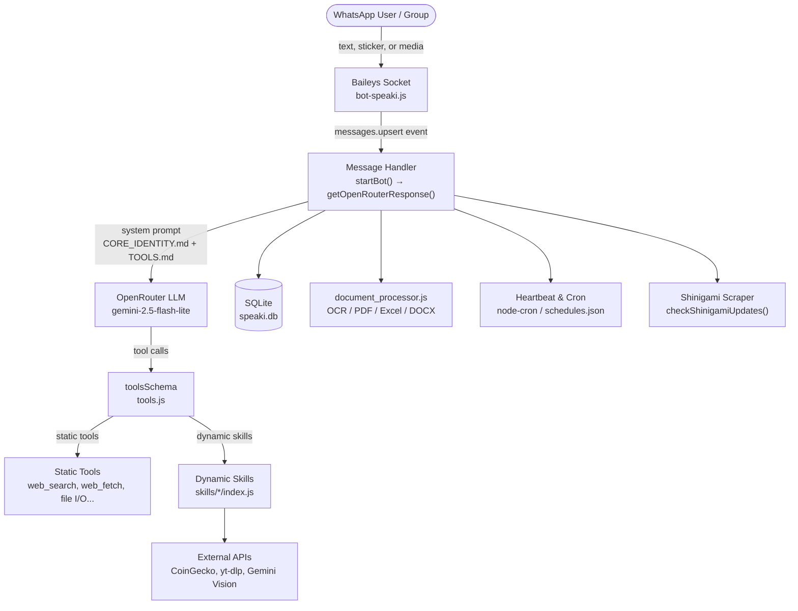

**Supikip** (internal codename *"Speaki"*) is a standalone, self-hosted **WhatsApp AI assistant** that runs as a single Node.js process. It connects to WhatsApp via the Baileys library, routes every incoming message through a large language model (LLM) hosted on OpenRouter, and lets that model autonomously call a growing set of **tools** and **skills** — from web search and document analysis to media downloading and sticker replies. This page orients you to what the project is, how its major pieces fit together, and where to read next. It does not cover setup or internals in depth; those belong to the dedicated pages linked at the end.

Sources: [README.md](README.md#L1-L4), [package.json](package.json#L1-L17)

## What Is Supikip?

At its core, Supikip is an **LLM-driven agent wrapped around a WhatsApp transport layer**. Unlike a hard-coded chatbot with fixed command keywords, it sends your chat history plus a structured *system prompt* to an OpenRouter model (default `google/gemini-2.5-flash-lite`) and lets the model decide which tools to invoke. The model, the tools, and the bot's personality are all decoupled: the brain is the LLM, the hands are the tools, and the identity is a set of Markdown files. This separation is the single most important architectural idea to grasp before reading anything else.

Sources: [bot-speaki.js](bot-speaki.js#L15-L16), [bot-speaki.js](bot-speaki.js#L443-L481)

## High-Level Architecture

The diagram below traces a single message's life cycle. A WhatsApp user sends text, a sticker, or a file; the Baileys socket inside `bot-speaki.js` captures it; the message handler builds a request containing the cached system prompt and the combined tool schema; the OpenRouter LLM responds with either natural language or one or more tool calls; those calls execute locally (static tools) or dispatch to dynamically loaded skill modules. Side systems — SQLite, the document processor, the cron/heartbeat scheduler, and the Shinigami manhwa scraper — operate alongside this loop.



The architecture cleanly separates **transport** (Baileys), **reasoning** (OpenRouter), **capability** (tools + skills), and **state** (SQLite + Markdown memory files). Each boundary is a single import, which keeps the system modular and beginner-friendly to extend.

Sources: [bot-speaki.js](bot-speaki.js#L554-L666), [bot-speaki.js](bot-speaki.js#L378-L419), [tools.js](tools.js#L1-L90), [database_db.js](database_db.js#L1-L60)

## Project Structure

The repository is intentionally flat so that a new developer can locate the main script, the tool registry, and the personality files without hunting through nested folders. The tree below shows the files that matter for understanding the system (runtime artifacts such as `speaki.db`, `stiker_db/`, and `temp_docs/` are generated on first run).

```
Supikip/
├── bot-speaki.js            # Entry point: Baileys socket, message loop, LLM call, scrapers
├── tools.js                # Static tool registry + dynamic skills loader
├── database_db.js          # SQLite initialization and sticker queries
├── document_processor.js   # Inbound document parsing (PDF, Excel, DOCX, text)
├── skills/                 # Drop-in capability modules (each: SKILL.md + index.js)
│   ├── bitcoin_market_analyzer/
│   ├── ocr_extractor/
│   ├── serpapi_quota_manager/
│   ├── social_media_downloader/
│   └── sticker_responder/
├── supikip.service         # systemd unit for production deployment
├── schedules.json          # Cron task definitions
├── serpapi_quota.json      # SerpAPI usage tracking
├── CORE_IDENTITY.md        # Primary personality / behavior prompt
├── TOOLS.md                # Local environment & contact notes (merged into prompt)
├── AGENTS.md               # Short operational reference
├── HEARTBEAT.md            # Periodic tasks evaluated by the LLM
├── MEMORY.md               # Long-term memory (< 30 lines)
├── .env                    # OPENROUTER_API_KEY, MODEL_NAME, group JIDs
└── package.json            # ES-module manifest and dependencies
```

Sources: [README.md](README.md#L13-L28), [supikip.service](supikip.service#L1-L16)

## Core Capabilities

The following table summarizes what Supikip can do out of the box. These are implemented as **static tools** (defined directly in `tools.js`) and are always available to the LLM.

| Capability | Tool / Mechanism | Purpose |
| --- | --- | --- |
| Web search | `web_search` | Tiered search (Tavily → SerpAPI → DuckDuckGo) with AI summary |
| Web fetch | `web_fetch` | Retrieve and clean text from a URL |
| System status | `get_system_status` | Report RAM, CPU, and uptime |
| File I/O | `read_workspace_file`, `write_workspace_file`, `send_workspace_file` | Read, edit, and send local files |
| Patch apply | `apply_patch` | Token-efficient search-and-replace edits |
| Terminal | `run_terminal_command` | Owner-only shell execution |
| Scheduling | `add_cron_schedule`, `remove_cron_schedule`, `set_one_shot_reminder` | Dynamic cron and reminders |
| PDF parsing | `parse_pdf_file` | Extract text from local PDFs |
| Image analysis | `analyze_image` | Multimodal vision via Gemini |
| Sub-agent | `delegate_subagent` | Isolated sub-conversation with the LLM |
| Performance test | `run_performance_test` | Owner-triggered latency/I-O benchmark |

Sources: [README.md](README.md#L55-L72), [tools.js](tools.js#L80-L90)

## Built-in Dynamic Skills

Beyond static tools, Supikip auto-discovers **skill modules** at startup by scanning the `skills/` directory. A valid skill is a folder containing a `SKILL.md` (with an embedded OpenAI-style function schema) and an `index.js` exporting an `execute` function. The loader parses the JSON block from `SKILL.md`, registers the schema into the shared `toolsSchema`, and records the module path for later dispatch. The five shipped skills are:

| Skill Folder | Exposed Function | What It Does |
| --- | --- | --- |
| `bitcoin_market_analyzer` | `analyze_bitcoin_market` | Real-time BTC price/volume from CoinGecko & Binance |
| `ocr_extractor` | `extract_text_from_image` | Text extraction from images via Gemini Vision |
| `serpapi_quota_manager` | `manage_serpapi_quota` | Monitor or manually update SerpAPI usage |
| `social_media_downloader` | `download_social_media` | Download media via `yt-dlp` from major platforms |
| `sticker_responder` | `send_sticker_response` | Send a random sticker from SQLite by tag |

Sources: [README.md](README.md#L75-L94), [tools.js](tools.js#L38-L78), [skills/bitcoin_market_analyzer/SKILL.md](skills/bitcoin_market_analyzer/SKILL.md#L1-L25), [skills/bitcoin_market_analyzer/index.js](skills/bitcoin_market_analyzer/index.js#L1-L25)

## Technology & Dependencies

Supikip is an **ES-module** Node.js project (note `"type": "module"` in the manifest). Its external dependencies are minimal and purpose-driven, which keeps the deployment surface small and easy to audit.

| Dependency | Role |
| --- | --- |
| `@itsliaaa/baileys` | WhatsApp Web socket client (local fork) |
| `dotenv` | Loads `.env` configuration |
| `node-cron` | In-process cron scheduling |
| `sqlite3` | Serverless relational store for stickers |
| `pdf-parse` | PDF text extraction |
| `mammoth` | DOCX text extraction |
| `xlsx` | Excel/ODS spreadsheet parsing |
| `qrcode-terminal` | Renders the pairing QR code in the terminal |

Sources: [package.json](package.json#L1-L17), [bot-speaki.js](bot-speaki.js#L1-L9)

## Where to Go Next

You now have a mental model of Supikip as a layered, modular WhatsApp agent. Follow this reading progression to go from running it to understanding it deeply:

1. **[Quick Start](2-quick-start)** — install dependencies, configure your key, and pair WhatsApp in minutes.
2. **[Configuration and Environment Variables](3-configuration-and-environment-variables)** — learn every `.env` setting and JSON file that tunes behavior.
3. **[Running as a systemd Service](4-running-as-a-systemd-service)** — deploy it as a resilient background service using `supikip.service`.
4. **[Architecture Overview](5-architecture-overview)** — a deeper tour of the runtime boundaries shown above.
5. **[WhatsApp Connection and Lifecycle](6-whatsapp-connection-and-lifecycle)** — how the Baileys socket connects, reconnects, and stores auth state.
6. **[LLM Integration and Tool-Calling Loop](7-llm-integration-and-tool-calling-loop)** — the `getOpenRouterResponse` request/response cycle and tool dispatch.
7. **[Modular System Prompt and Identity Files](8-modular-system-prompt-and-identity-files)** — how `CORE_IDENTITY.md`, `TOOLS.md`, and friends shape the bot's personality.
8. **[Static Tools Registry](9-static-tools-registry)** and **[Dynamic Skills Loader](10-dynamic-skills-loader)** — extend capabilities with your own tools and skills.
9. Remaining pages cover state and peripherals: **[Conversation Memory and History Management](11-conversation-memory-and-history-management)**, **[SQLite Sticker Database](12-sqlite-sticker-database)**, **[Document Processor](13-document-processor)**, **[Shinigami Manhwa Scraper](14-shinigami-manhwa-scraper)**, **[Heartbeat and Cron Scheduling](15-heartbeat-and-cron-scheduling)**, **[OCR Image Extraction](16-ocr-image-extraction)**, and **[Security and Operational Warnings](17-security-and-operational-warnings)**.