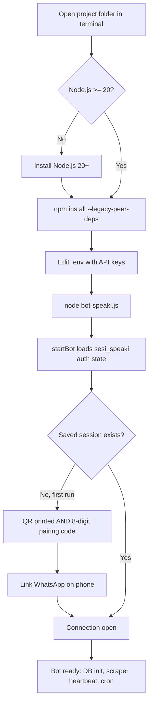

This page takes you from a fresh clone of the **Supikip** (codename *Speaki*) repository to a running, WhatsApp-connected AI assistant in the shortest reliable path. Supikip is a standalone Node.js application that links to WhatsApp through the Baileys library, reasons through an LLM on OpenRouter, and extends itself with static tools and drop-in skill modules. By the end of this guide you will have installed dependencies, supplied your API keys, launched the bot, and paired it with your phone.

Sources: [README.md](README.md#L1-L4), [package.json](package.json#L1-L17)

## Prerequisites

Before you begin, confirm you have a small but non-negotiable set of tools. The most important is the Node.js runtime: Baileys v7 requires **Node.js 20.0.0 or higher**, and NPM ships with Node.js so no separate package manager is needed. You will also need an **OpenRouter API key** (the bot's conversational intelligence depends on it), and optionally a **Tavily** and/or **SerpAPI** key if you want the web-search tools to work. Finally, keep your **phone with WhatsApp** nearby, because the first launch requires an interactive link step.

Sources: [README.md](README.md#L7-L9), [bot-speaki.js](bot-speaki.js#L15-L16)

## Step 1 — Install Dependencies

From the project root, install all required libraries with `npm install --legacy-peer-deps`. The `--legacy-peer-deps` flag is mandatory because the pinned Baileys build (`@itsliaaa/baileys`, loaded locally from `./baileys`) carries peer-dependency constraints that the default resolver rejects; without the flag the install fails. The manifest declares only purpose-driven dependencies — `dotenv`, `node-cron`, `sqlite3`, `pdf-parse`, `mammoth`, `xlsx`, and `qrcode-terminal` — so the dependency surface stays small and easy to audit.

Sources: [README.md](README.md#L34-L39), [package.json](package.json#L1-L17)

## Step 2 — Configure Your Environment

All secrets and tunables live in the `.env` file at the project root (it is present locally but excluded from version control by `.gitignore`). Open it in a text editor and, at minimum, set `OPENROUTER_API_KEY`; the model defaults to `google/gemini-2.5-flash-lite` in code but can be overridden via `MODEL_NAME`. The table below summarizes every variable the bot reads and what happens if you omit it.

Sources: [.env](.env#L1-L28), [.gitignore](.gitignore#L1-L22), [bot-speaki.js](bot-speaki.js#L15-L16)

| Variable | Purpose | Default if unset |
|---|---|---|
| `OPENROUTER_API_KEY` | Authenticates LLM requests to OpenRouter | None (required for chat) |
| `MODEL_NAME` | LLM model identifier | `google/gemini-2.5-flash-lite` |
| `HERMES_API_KEY` | Local Hermes API gateway secret | None (optional) |
| `HERMES_ENDPOINT` | Local Hermes chat completions URL | None (optional) |
| `MANHWA_GROUP_JID` | Target group for manhwa update pushes | `120363407159758205@g.us` |
| `MANHWA_CHECK_INTERVAL` | Scraper poll interval (milliseconds) | `900000` (15 min) |
| `BOT_NUMBER` | Phone number used for the pairing code | `6283891270115` |
| `OWNER_NUMBER` | Admin/owner phone for privileged operations | None |
| `TAVILY_API_KEY` | Primary web-search key (Tavily) | None (optional) |
| `SERPAPI_API_KEY` | Fallback web-search key (SerpAPI) | None (optional) |

Sources: [.env](.env#L1-L28), [bot-speaki.js](bot-speaki.js#L15-L16), [bot-speaki.js](bot-speaki.js#L24-L25), [bot-speaki.js](bot-speaki.js#L578), [tools.js](tools.js#L383), [tools.js](tools.js#L420), [tools.js](tools.js#L722)

## Step 3 — Run and Connect to WhatsApp

Launch the bot in the foreground with `node bot-speaki.js`. The entry point calls `startBot()`, which loads a multi-file authentication state from the `sesi_speaki/` folder and prints connection events to your terminal. On the very first run there is no saved session, so the bot offers two linking methods: a **QR code** is rendered in the terminal (scan it via WhatsApp → Linked Devices → Link a Device), and simultaneously an **8-digit pairing code** is printed if a phone number is configured (`BOT_NUMBER`, else `OWNER_NUMBER`, else the built-in default). Once linked, the `connection.update` handler reports "successfully connected," initializes the SQLite database, and starts the scraper, heartbeat, and cron loops.

Sources: [README.md](README.md#L44-L51), [bot-speaki.js](bot-speaki.js#L540-L565), [bot-speaki.js](bot-speaki.js#L566-L620)

The flowchart below traces the exact startup path, including the branch where a saved session lets you skip the interactive link entirely.



Sources: [bot-speaki.js](bot-speaki.js#L540-L620), [README.md](README.md#L44-L51)

## Project Layout at a Glance

Recognizing the on-disk layout helps you navigate later. The tree below shows the files that matter for a first run; runtime state folders (`sesi_speaki/`, `speaki.db`, `stiker_db/`) are generated automatically and intentionally excluded from version control.

```
Supikip/
├── bot-speaki.js          # Entry point: Baileys socket, message loop, LLM call
├── tools.js               # Static tool registry + dynamic skills loader
├── database_db.js         # SQLite initialization and sticker queries
├── document_processor.js  # Inbound document parsing (PDF, Excel, DOCX, text)
├── skills/                # Drop-in capability modules (each: SKILL.md + index.js)
├── supikip.service        # systemd unit for production deployment
├── schedules.json         # Cron task definitions
├── CORE_IDENTITY.md       # Primary personality / behavior prompt
├── TOOLS.md               # Local environment & contact notes
├── AGENTS.md              # Short operational reference
├── HEARTBEAT.md           # Periodic tasks evaluated by the LLM
├── MEMORY.md              # Long-term memory (< 30 lines)
├── .env                   # API keys and tunables (gitignored)
└── package.json           # ES-module manifest and dependencies
```

Sources: [README.md](README.md#L13-L28), [.gitignore](.gitignore#L1-L22)

## From First Run to Production

The steps above run the bot in the foreground, which is ideal for verifying the QR/pairing login but not for long-term operation. Once you have confirmed a successful link (so that `sesi_speaki/` exists on disk), you can promote the bot to a background **systemd** daemon that survives reboots and crashes. The critical rule is to scan the QR **first** interactively — if you start the daemon before linking, the QR prints only to background logs and the bot cannot log in. The full procedure lives on the dedicated deployment page.

Sources: [DAEMON_SETUP.md](DAEMON_SETUP.md#L7-L12), [bot-speaki.js](bot-speaki.js#L558)

## Where to Go Next

You now have a connected, conversational bot. Follow this reading progression to move from running it to understanding and tuning it:

- **[Configuration and Environment Variables](3-configuration-and-environment-variables)** — every `.env` setting and JSON file that tunes behavior in depth.
- **[Running as a systemd Service](4-running-as-a-systemd-service)** — deploy the bot as a resilient background service.
- **[Architecture Overview](5-architecture-overview)** — a deeper tour of the runtime boundaries and message life cycle.
- **[WhatsApp Connection and Lifecycle](6-whatsapp-connection-and-lifecycle)** — how the Baileys socket connects, reconnects, and stores auth state.
- **[LLM Integration and Tool-Calling Loop](7-llm-integration-and-tool-calling-loop)** — the request/response cycle and tool dispatch.
- **[Modular System Prompt and Identity Files](8-modular-system-prompt-and-identity-files)** — how `CORE_IDENTITY.md`, `TOOLS.md`, and friends shape the bot's personality.