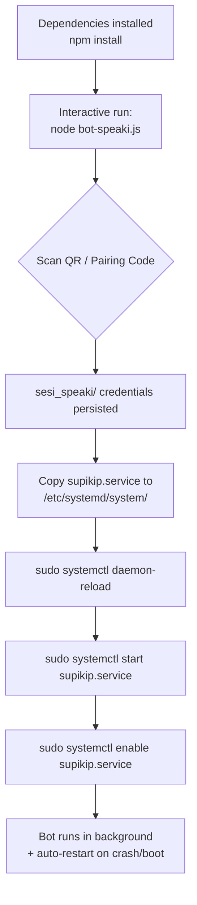

This page documents how to operate the Speaki WhatsApp bot as a persistent background daemon managed by **systemd** on Linux. It covers the deployed unit file (`supikip.service`), the mandatory one-time authentication step, the installation workflow, and routine service management. It deliberately excludes environment-variable configuration (see [Configuration and Environment Variables](3-configuration-and-environment-variables)) and the internal WhatsApp connection state machine (see [WhatsApp Connection and Lifecycle](6-whatsapp-connection-and-lifecycle)); those are addressed on their own catalog pages.

Sources: [supikip.service](supikip.service#L1-L16) · [package.json](package.json#L5)

## The systemd Unit File

The repository ships a ready-to-deploy unit at `supikip.service`. It is a `Type=simple` service: systemd treats the `ExecStart` process itself as the main process and supervises it directly. The unit runs the bot under the non-root user `naaklaam`, sets the working directory to the project root, and uses an **absolute** Node.js binary path resolved from the Linuxbrew install (`/home/linuxbrew/.linuxbrew/bin/node`). Because the entry point resolves credentials and data files relative to the current directory, `WorkingDirectory` is essential — it is what lets `sesi_speaki/` and `.env` load correctly at runtime.

Sources: [supikip.service](supikip.service#L5-L15) · [ps_aux_output.txt](ps_aux_output.txt#L1)

The table below maps every directive in the deployed unit to its operational purpose.

| Directive | Value | Purpose |
|-----------|-------|---------|
| `Description` | `Speaki WhatsApp Bot Standalone Service` | Human-readable identifier shown in `systemctl status`. |
| `After` | `network.target` | Defer startup until the network stack is online (required for the WhatsApp WebSocket). |
| `Type` | `simple` | Main PID is the `ExecStart` process; no forking or notification handshake. |
| `User` | `naaklaam` | Drop privileges from root; filesystem access scoped to this user. |
| `WorkingDirectory` | `/home/naaklaam/Supikip` | Anchors relative paths such as `sesi_speaki` and `.env`. |
| `ExecStart` | `/home/linuxbrew/.linuxbrew/bin/node bot-speaki.js` | Absolute Node binary + ESM entry point (`package.json` `main`). |
| `Restart` | `always` | Revive the process on any exit — crash, error, or clean termination. |
| `RestartSec` | `5` | Five-second backoff between restart attempts to avoid thrashing. |
| `Environment` | `NODE_ENV=production` | Signals production mode to the runtime. |
| `WantedBy` | `multi-user.target` | Enables autostart in the standard non-graphical boot target. |

Sources: [supikip.service](supikip.service#L1-L16) · [package.json](package.json#L4-L5)

## Prerequisite: Authenticate Before Daemonizing

The single most important operational rule is that **you must complete WhatsApp authentication interactively once before launching the bot as a daemon**. The entry point stores session credentials in the `sesi_speaki/` directory via `useMultiFileAuthState('sesi_speaki')` and prints a QR code to the terminal (`printQRInTerminal: true`) or, as a fallback, an 8-digit pairing code. If you start the service as a background daemon first, the QR is buried in the journal and the bot can never log in — the `sesi_speaki/` folder will not be created and the connection stalls.

Sources: [bot-speaki.js](bot-speaki.js#L557-L562) · [bot-speaki.js](bot-speaki.js#L592-L597) · [DAEMON_SETUP.md](DAEMON_SETUP.md#L7-L12)

Run the bot once in the foreground, scan the QR (or use the pairing code) with the target WhatsApp account, wait for the `Speaki Bot telah sukses terhubung` confirmation, then stop it with `Ctrl+C`. The `sesi_speaki/` folder now exists and persists the session, so subsequent daemon starts authenticate silently. The directory is confirmed present in the working tree (`drwxr-xr-x ... sesi_speaki`).

Sources: [bot-speaki.js](bot-speaki.js#L618-L621) · [DAEMON_SETUP.md](DAEMON_SETUP.md#L9-L11)

## Installation Walkthrough

The deployment flow below assumes dependencies are already installed (`npm install`) and the one-time QR authentication from the previous section is complete. The unit file must be copied to the system directory `/etc/systemd/system/`, after which systemd must re-read its configuration before the service can be started and enabled for boot.

Sources: [DAEMON_SETUP.md](DAEMON_SETUP.md#L53-L80) · [package.json](package.json#L6-L15)

Sources: [DAEMON_SETUP.md](DAEMON_SETUP.md#L57-L80) · [supikip.service](supikip.service#L14-L15)

The concrete commands mirror the flowchart. Note that the deployed unit is named `supikip.service`; the `DAEMON_SETUP.md` template references `speaki-bot.service` as a generic draft name — use the actual filename shipped in the repository to keep paths consistent.

Sources: [DAEMON_SETUP.md](DAEMON_SETUP.md#L15-L38) · [supikip.service](supikip.service#L1)

| Step | Command | Effect |
|------|---------|--------|
| 1. Install unit | `sudo cp supikip.service /etc/systemd/system/` | Registers the unit with systemd. |
| 2. Reload | `sudo systemctl daemon-reload` | Re-reads changed unit files. |
| 3. Start | `sudo systemctl start supikip.service` | Launches the bot in the background now. |
| 4. Enable | `sudo systemctl enable supikip.service` | Creates a boot symlink under `multi-user.target`. |

Sources: [DAEMON_SETUP.md](DAEMON_SETUP.md#L57-L80)

## Node Binary Path Requirement

systemd does **not** inherit the user's `PATH`, so `ExecStart` must point at an absolute Node binary. The shipped unit hardcodes the Linuxbrew path `/home/linuxbrew/.linuxbrew/bin/node` (a symlink into `Cellar/node/26.3.0/bin/node`, confirmed on this host). On a different machine, resolve the correct path with `which node` and edit the unit accordingly — for example, an nvm install would yield something like `/home/<user>/.nvm/versions/node/vXX/bin/node`. The `DAEMON_SETUP.md` draft illustrates `/usr/bin/node` as the conventional default; the actual deployed value differs because this host uses Linuxbrew.

Sources: [supikip.service](supikip.service#L9) · [DAEMON_SETUP.md](DAEMON_SETUP.md#L42-L49) · [ps_aux_output.txt](ps_aux_output.txt#L1)

## Service Management Commands

Once enabled, the bot is controlled entirely through `systemctl` and observed through `journalctl`. Restarting is required after any edit to `bot-speaki.js` or the `.env` file so the new code and variables are picked up. The live log stream is the primary observability surface because all runtime output (connection events, scraper activity, heartbeat reports) is written to stdout/stderr and captured by the journal.

Sources: [DAEMON_SETUP.md](DAEMON_SETUP.md#L84-L103) · [bot-speaki.js](bot-speaki.js#L555)

| Task | Command |
|------|---------|
| Check status / errors | `sudo systemctl status supikip.service` |
| Follow live logs | `journalctl -u supikip.service -f` |
| Stop the bot | `sudo systemctl stop supikip.service` |
| Restart after code/.env edit | `sudo systemctl restart supikip.service` |
| Disable boot autostart | `sudo systemctl disable supikip.service` |

Sources: [DAEMON_SETUP.md](DAEMON_SETUP.md#L88-L103)

## Troubleshooting

The `Restart=always` policy means a misconfiguration produces a tight restart loop rather than a clean failure, so symptoms must be read from the journal. The table below correlates common failure modes with their root cause and fix. The most frequent issue is launching the daemon before the interactive QR scan, which leaves `sesi_speaki/` unpopulated.

Sources: [supikip.service](supikip.service#L10) · [bot-speaki.js](bot-speaki.js#L558-L562) · [DAEMON_SETUP.md](DAEMON_SETUP.md#L7-L12)

| Symptom | Likely Cause | Resolution |
|---------|--------------|------------|
| Bot never logs in; QR unseen | Daemonized before interactive scan | Stop service, run `node bot-speaki.js` in foreground, scan QR, then restart service. |
| `Failed at step EXEC spawning node` | Wrong/absent Node path in `ExecStart` | Replace with absolute path from `which node`. |
| Rapid restart loop | `WorkingDirectory` or `sesi_speaki` permissions wrong | Ensure `User=naaklaam` can read/write `/home/naaklaam/Supikip`. |
| `Sesi keluar` / logged-out message | WhatsApp invalidated the session | Delete `sesi_speaki/`, re-run interactively, re-scan QR. |
| No logs at all | Wrong unit name / not reloaded | Confirm `supikip.service` filename and run `daemon-reload`. |

Sources: [bot-speaki.js](bot-speaki.js#L599-L617) · [DAEMON_SETUP.md](DAEMON_SETUP.md#L7-L12) · [supikip.service](supikip.service#L8-L10)

## Next Steps

With the bot running reliably under systemd, the operational foundation is complete. To understand what the daemon actually does at runtime, read [Architecture Overview](5-architecture-overview) for the component map, [WhatsApp Connection and Lifecycle](6-whatsapp-connection-and-lifecycle) for the reconnect and logout behavior referenced in troubleshooting, and [Heartbeat and Cron Scheduling](15-heartbeat-and-cron-scheduling) for the periodic tasks that execute while the service is alive. For first-time setup from scratch, return to [Quick Start](2-quick-start).