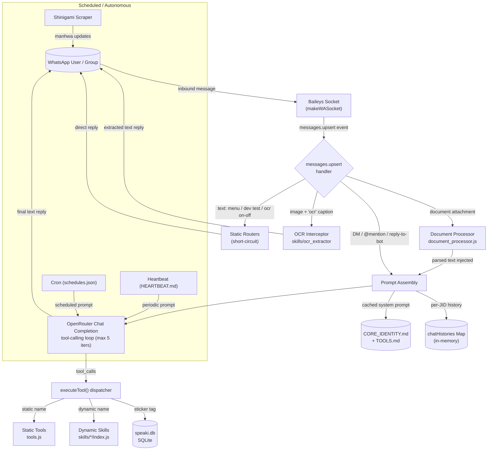

Supikip (codenamed "Speaki") is a standalone WhatsApp agent built on the Baileys library and driven by an OpenRouter-hosted LLM. Rather than hard-coding conversational logic, the bot exposes a **tool-calling agent loop**: the LLM decides which capabilities to invoke, and a dispatcher routes those calls to either statically-registered tools or dynamically-loaded skill modules. This page presents the system from 10,000 feet — the layers, the request lifecycle, and how the subsystems fit together. Each subsystem is documented in depth on its own catalog page, linked throughout.

Sources: [README.md](README.md#L1-L20) [package.json](package.json#L1-L17)

## System at a Glance

The diagram below traces a single inbound message from a WhatsApp user through the Baileys transport, the static routers and interceptors, the prompt assembly, and the LLM tool-calling loop, ending with either a direct reply or a tool execution. Scheduled subsystems (scraper, heartbeat, cron) run independently of inbound traffic.



Sources: [bot-speaki.js](bot-speaki.js#L666-L939) [bot-speaki.js](bot-speaki.js#L443-L549) [tools.js](tools.js#L932-L983)

## Project Structure

The repository is intentionally flat: a single orchestrator file, a tools module, a document processor, a SQLite helper, and a `skills/` directory whose contents are discovered at runtime. Identity and operational behavior live in markdown files that are concatenated into the system prompt.

```text
Supikip/
├── bot-speaki.js            # Orchestrator: socket, message handler, LLM loop, schedulers
├── tools.js                # Static tools registry + dynamic skills loader + dispatcher
├── database_db.js          # SQLite helper (speaki.db, stickers table)
├── document_processor.js   # Multi-format document extraction
├── package.json            # ESM project, Baileys + node-cron + sqlite3 + parsers
├── CORE_IDENTITY.md        # Core personality / behavior (system prompt fragment)
├── TOOLS.md                # Environment & contact notes (system prompt fragment)
├── HEARTBEAT.md            # Periodic task list evaluated by the LLM
├── MEMORY.md               # Long-term memory notes (< 30 lines)
├── AGENTS.md               # Operational reference
├── schedules.json          # Cron job definitions
├── last_manhwa.json        # Shinigami scraper state
├── serpapi_quota.json      # SerpAPI usage tracking
├── sesi_speaki/            # Baileys multi-file auth state
└── skills/                 # Dynamically loaded capability modules
    └── <skill_name>/
        ├── SKILL.md        # Documentation + embedded JSON tool schema
        └── index.js        # Exports async execute(args, sock, ctx)
```

Sources: [README.md](README.md#L13-L29) [package.json](package.json#L1-L17) [tools.js](tools.js#L38-L78)

## Core Architectural Layers

Supikip can be decomposed into six cooperating layers. The transport and orchestration layers are monolithic (both live in `bot-speaki.js`), while the tool, persistence, and scheduling layers are modular and independently extensible.

| Layer | Responsibility | Primary File(s) | Extensible? |
|-------|----------------|-----------------|-------------|
| **Transport** | WhatsApp WebSocket connection, auth state, QR/pairing, reconnect | `bot-speaki.js` (`startBot`) | No |
| **Orchestration** | Inbound message routing, static routers, interceptors, schedulers | `bot-speaki.js` | No |
| **LLM Agent** | System-prompt assembly, chat history, OpenRouter tool-calling loop | `bot-speaki.js` (`getOpenRouterResponse`, `getSystemInstruction`) | No |
| **Tool System** | Static tool schemas + dynamic skill discovery + dispatch | `tools.js` | Yes (skills) |
| **Persistence** | In-memory chat history, SQLite sticker DB, JSON state files | `database_db.js`, `bot-speaki.js` | Partial |
| **Scheduling** | Shinigami scraper, heartbeat, cron jobs | `bot-speaki.js` | Yes (schedules.json) |

Sources: [bot-speaki.js](bot-speaki.js#L554-L663) [bot-speaki.js](bot-speaki.js#L386-L422) [bot-speaki.js](bot-speaki.js#L443-L549)

## Subsystem Inventory

The following subsystems are first-class architectural components. Each has a dedicated deep-dive page in this wiki; the table maps the component to its implementation file and its catalog entry so you can navigate to the relevant detail.

| Subsystem | Implementation | Catalog Page |
|-----------|----------------|--------------|
| WhatsApp connection & lifecycle | `bot-speaki.js` (`startBot`, `connection.update`) | [WhatsApp Connection and Lifecycle](6-whatsapp-connection-and-lifecycle) |
| LLM integration & tool loop | `bot-speaki.js` (`getOpenRouterResponse`) | [LLM Integration and Tool-Calling Loop](7-llm-integration-and-tool-calling-loop) |
| Modular system prompt | `getSystemInstruction()` + `*.md` files | [Modular System Prompt and Identity Files](8-modular-system-prompt-and-identity-files) |
| Static tools registry | `tools.js` (`staticSchema`) | [Static Tools Registry](9-static-tools-registry) |
| Dynamic skills loader | `tools.js` (`loadDynamicSkills`) | [Dynamic Skills Loader](10-dynamic-skills-loader) |
| Conversation memory | `chatHistories` Map | [Conversation Memory and History Management](11-conversation-memory-and-history-management) |
| SQLite sticker DB | `database_db.js` | [SQLite Sticker Database](12-sqlite-sticker-database) |
| Document processor | `document_processor.js` | [Document Processor](13-document-processor) |
| Shinigami scraper | `checkShinigamiUpdates()` | [Shinigami Manhwa Scraper](14-shinigami-manhwa-scraper) |
| Heartbeat & cron | `checkHeartbeat`, `initCronSchedules` | [Heartbeat and Cron Scheduling](15-heartbeat-and-cron-scheduling) |
| OCR extraction | `skills/ocr_extractor` | [OCR Image Extraction](16-ocr-image-extraction) |

Sources: [bot-speaki.js](bot-speaki.js#L146-L226) [bot-speaki.js](bot-speaki.js#L232-L368) [tools.js](tools.js#L81-L376)

## Request Lifecycle

Every inbound message is processed by a single `messages.upsert` handler that applies a fixed pipeline before any LLM inference occurs. The pipeline is designed to **short-circuit cheap, deterministic operations** (menu, dev test, OCR toggle, image OCR) so they never consume LLM tokens, reserving the agent loop for genuine conversational or tool-requiring requests.

The pipeline order is: (1) static text routers for `menu`, `speaki dev test`, and `ocr on/off`; (2) an image interceptor that fires when an image carries an `ocr` caption or the room has Auto-OCR enabled; (3) document detection that downloads and parses attachments via `document_processor.js`; (4) prompt assembly that prepends the sender name and injects parsed document content; and (5) a reply-gate that only invokes the LLM for DMs, `@mentions`, replies-to-bot, or name mentions (`speaki`/`supikip`).

Sources: [bot-speaki.js](bot-speaki.js#L666-L784) [bot-speaki.js](bot-speaki.js#L786-L830) [bot-speaki.js](bot-speaki.js#L832-L937)

Once the reply-gate passes, `getOpenRouterResponse()` builds the message array from the cached system instruction and the per-JID history, then enters a bounded `while` loop (maximum 5 iterations). On each iteration it calls OpenRouter with `tools: toolsSchema`; if the model returns `tool_calls`, those calls are appended as an assistant message and each is executed via `executeTool()`, with results fed back as `tool` role messages. The loop terminates when the model returns plain text or the iteration cap is hit.

Sources: [bot-speaki.js](bot-speaki.js#L443-L549) [bot-speaki.js](bot-speaki.js#L466-L544)

## The Tool System: Static Registry + Dynamic Skills

The agent's capabilities are expressed as a unified `toolsSchema` array exported from `tools.js` as `[...staticSchema, ...loadDynamicSkills()]`. Static tools are declared inline as OpenAI-style function schemas (e.g., `web_search`, `get_system_status`, `run_terminal_command`, `send_workspace_file`), while dynamic skills are discovered by scanning the `skills/` directory at module load: each subdirectory containing both `SKILL.md` and `index.js` contributes its JSON schema block (extracted from the fenced ```json block in `SKILL.md`) and registers its `index.js` path in a `loadedSkills` Map keyed by tool name.

Sources: [tools.js](tools.js#L81-L373) [tools.js](tools.js#L38-L78) [tools.js](tools.js#L376)

Dispatch is centralized in `executeTool(name, args, sock, checkShinigamiUpdatesFn, extraContext)`. A `switch` statement resolves every statically-known tool name; the `default` branch falls back to the `loadedSkills` Map, performing a dynamic `import()` of the skill's `index.js` and invoking its exported `execute(args, sock, extraContext)` function. This design means new capabilities can be added by dropping a `SKILL.md` + `index.js` pair into `skills/` without touching the orchestrator or the dispatcher.

Sources: [tools.js](tools.js#L932-L983) [skills/sticker_responder/SKILL.md](skills/sticker_responder/SKILL.md#L1-L25)

## Persistence and State

State is split between volatile in-memory structures and durable files. Conversation history lives entirely in the `chatHistories` Map (keyed by JID, capped at 10 messages, with an 18-hour TTL cleaner), so it is lost on restart. Durable state includes the SQLite `speaki.db` (the `stickers` table tracking filename, tag, `added_by`, and `usage_count`), the `last_manhwa.json` scraper checkpoint, `serpapi_quota.json` for search quota, and the Markdown files (`MEMORY.md`, `HEARTBEAT.md`, `schedules.json`) that drive autonomous behavior.

Sources: [database_db.js](database_db.js#L8-L35) [bot-speaki.js](bot-speaki.js#L370-L380) [bot-speaki.js](bot-speaki.js#L639-L653)

## Configuration Surface

Runtime behavior is governed primarily by environment variables loaded from `.env` (OpenRouter key, model name, owner number, group JIDs, scraper interval) and by the Markdown identity files. Dependencies are minimal and declared as ESM in `package.json`: Baileys (vendored locally), `node-cron`, `sqlite3`, `pdf-parse`, `xlsx`, `mammoth`, `dotenv`, and `qrcode-terminal`. The full list of variables and their effects is covered on the configuration page.

Sources: [package.json](package.json#L1-L17) [bot-speaki.js](bot-speaki.js#L15-L29) [README.md](README.md#L41-L48)

## Suggested Reading Progression

To go from this overview to implementation detail, follow the catalog in dependency order: start with the transport and lifecycle, then the LLM agent loop, then the two halves of the tool system, then state and the autonomous subsystems.

1. **[WhatsApp Connection and Lifecycle](6-whatsapp-connection-and-lifecycle)** — how the socket, auth state, and reconnect logic work.
2. **[LLM Integration and Tool-Calling Loop](7-llm-integration-and-tool-calling-loop)** — the bounded agent loop in detail.
3. **[Modular System Prompt and Identity Files](8-modular-system-prompt-and-identity-files)** — how `CORE_IDENTITY.md`/`TOOLS.md` become the system prompt.
4. **[Static Tools Registry](9-static-tools-registry)** and **[Dynamic Skills Loader](10-dynamic-skills-loader)** — the two capability sources.
5. **[Conversation Memory and History Management](11-conversation-memory-and-history-management)**, **[SQLite Sticker Database](12-sqlite-sticker-database)**, **[Document Processor](13-document-processor)** — state and content handling.
6. **[Heartbeat and Cron Scheduling](15-heartbeat-and-cron-scheduling)** and **[Shinigami Manhwa Scraper](14-shinigami-manhwa-scraper)** — autonomous behaviors.
7. **[Security and Operational Warnings](17-security-and-operational-warnings)** — operational risks before you deploy.