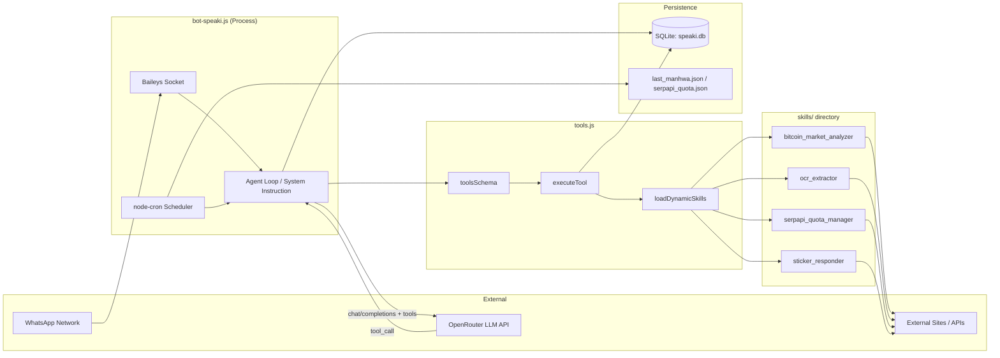

This page introduces **Supikip** (internally branded as "Speaki"), a low-latency, AI-powered WhatsApp automation agent. It is a Node.js application that connects to WhatsApp via the Baileys library, delegates reasoning to an LLM through the OpenRouter API, and extends its capabilities through a dynamically loaded **skills system** and a **tool integration framework**. The goal of this Overview is to orient a beginner developer: what the project is, how its major pieces fit together, and where to go next.

Sources: [package.json](package.json#L1-L15) [CORE_IDENTITY.md](CORE_IDENTITY.md#L3-L8)

## What Is Supikip / Speaki?

Supikip is a personal automation assistant that lives inside WhatsApp groups and private chats. It is not a generic chatbot; it is designed with a specific "persona" — terse, cold, professional, and direct — and operates with implicit background maintenance of memory and administrative tasks. At the technical level it is a single-process daemon (`bot-speaki.js`) that maintains a persistent WebSocket connection to WhatsApp, listens for messages, and decides whether to respond using an LLM with function-calling.

The system is deliberately modular: core conversation logic lives in the entry point, but every specialized capability (Bitcoin market analysis, OCR, SerpAPI quota management, sticker responses) is isolated inside the `skills/` directory as a self-describing unit consisting of a `SKILL.md` schema file and an `index.js` execution file.

Sources: [CORE_IDENTITY.md](CORE_IDENTITY.md#L3-L23) [AGENTS.md](AGENTS.md#L1-L9)

## Architectural Overview

The following diagram shows the runtime data flow. Incoming WhatsApp events are handled by the Baileys socket inside `bot-speaki.js`. The bot builds a system instruction and message history, then calls the OpenRouter LLM. The LLM may request tools; those requests are resolved through `tools.js`, which either executes built-in tools or delegates to dynamically loaded skills. Scheduled tasks from `schedules.json` feed the same LLM pipeline via `node-cron`, and persistent data is stored in a local SQLite database (`speaki.db`).

Sources: [bot-speaki.js](bot-speaki.js#L1-L11) [bot-speaki.js](bot-speaki.js#L287-L340) [tools.js](tools.js#L32-L50) [database_db.js](database_db.js#L1-L35)

## Project Structure

The repository is organized so that the **entry point and core modules** sit at the root, while **capabilities are pushed into `skills/`**. Supporting configuration files (`.env` is expected but not committed) and runtime state files are generated at runtime. The table below maps each top-level element to its role.

| Path / File | Role | Type |
| --- | --- | --- |
| `bot-speaki.js` | Main entry point: Baileys socket, agent loop, LLM calls, Shinigami scraper | Core module |
| `tools.js` | Tool schema registry + `executeTool` dispatcher + dynamic skill loader | Core module |
| `database_db.js` | SQLite initialization and sticker/state queries | Core module |
| `skills/` | Pluggable capability units (each with `SKILL.md` + `index.js`) | Extension |
| `schedules.json` | Declarative cron jobs that trigger the LLM pipeline | Config |
| `serpapi_quota.json` | Runtime state for SerpAPI search quota tracking | State |
| `supikip.service` | systemd unit for running the bot as a daemon | Deployment |
| `CORE_IDENTITY.md` | Persona, boundaries, and memory rules | Documentation |
| `AGENTS.md` | Operational quick reference for agents | Documentation |

Sources: [package.json](package.json#L1-L15) [supikip.service](supikip.service#L1-L16) [get_dir_structure](.)

## Core Capabilities

The bot ships with four built-in skills, each surfaced to the LLM as a JSON function-calling schema. The table summarizes what each one does and its trigger.

| Skill | Purpose | Key Input |
| --- | --- | --- |
| `bitcoin_market_analyzer` | Fetches Bitcoin ETF flows & 24h liquidation data | `target_metric`: all / etf / liquidation |
| `ocr_extractor` | Extracts text from a local image via multimodal vision | `image_path` (required) |
| `serpapi_quota_manager` | Views or manually updates SerpAPI search quota | `action`: view / update |
| `sticker_responder` | Replies with a random expression/meme sticker from DB | `tag`: all / ketus / lucu / datar / kaget |

Beyond skills, the agent loop supports built-in tools (e.g., performance testing) and an autonomous Shinigami manhwa scraper that resolves active domains dynamically and posts updates to a designated group on an interval.

Sources: [skills/bitcoin_market_analyzer/SKILL.md](skills/bitcoin_market_analyzer/SKILL.md#L1-L24) [skills/ocr_extractor/SKILL.md](skills/ocr_extractor/SKILL.md#L1-L23) [skills/serpapi_quota_manager/SKILL.md](skills/serpapi_quota_manager/SKILL.md#L1-L32) [skills/sticker_responder/SKILL.md](skills/sticker_responder/SKILL.md#L1-L24) [bot-speaki.js](bot-speaki.js#L23-L120)

## Technology Stack

The project is a pure ECMAScript Modules (`"type": "module"`) Node.js application. Its dependencies are minimal and purpose-built:

| Dependency | Purpose |
| --- | --- |
| `@itsliaaa/baileys` (local `./baileys`) | WhatsApp Web protocol client |
| `sqlite3` | Local persistent storage |
| `node-cron` | Scheduled task execution |
| `pdf-parse` | PDF text extraction tooling |
| `qrcode-terminal` | Render pairing QR code in terminal |
| `dotenv` | Load environment variables (API keys, JIDs) |
| `pino` / `@hapi/boom` | Logging and error wrapping (from Baileys) |

The LLM layer is not an npm dependency — it is accessed over HTTPS to `https://openrouter.ai/api/v1/chat/completions` using an API key from `.env`, with `google/gemini-2.5-flash-lite` as the default model.

Sources: [package.json](package.json#L1-L14) [bot-speaki.js](bot-speaki.js#L15-L16) [bot-speaki.js](bot-speaki.js#L262-L270)

## Deployment Model

Supikip is intended to run as a long-lived background service. A `systemd` unit (`supikip.service`) launches `node bot-speaki.js` with `Restart=always` so the bot self-heals after crashes. Runtime state — including the SQLite database, manhwa scrape state, and quota file — is written to the working directory, making the deployment essentially portable and file-backed rather than requiring an external database server.

Sources: [supikip.service](supikip.service#L1-L16) [database_db.js](database_db.js#L5-L5) [bot-speaki.js](bot-speaki.js#L23-L25)

## Where to Go Next

This Overview intentionally avoids deep implementation detail. To continue your onboarding, follow this logical progression:

1. **[Quick Start](2-quick-start)** — install dependencies, configure `.env`, and get the bot paired and running locally.
2. **[Project Identity and Core Philosophy](3-project-identity-and-core-philosophy)** — understand the persona, red lines, and memory conventions that shape behavior.
3. **[Bot Runtime Setup and Daemon Deployment](4-bot-runtime-setup-and-daemon-deployment)** — turn the local run into a production `systemd` service.
4. **[Architecture and Entry Point (bot-speaki.js)](8-architecture-and-entry-point-bot-speaki-js)** — deep dive into the agent loop and socket lifecycle.
5. **[Skills Architecture and SKILL.md Convention](12-skills-architecture-and-skill-md-convention)** — learn how to build your own pluggable capability.

For operational usage once deployed, see **[User Interaction and Command Guide](5-user-interaction-and-command-guide)** and **[Heartbeat and Scheduling Mechanism](7-heartbeat-and-scheduling-mechanism)**.