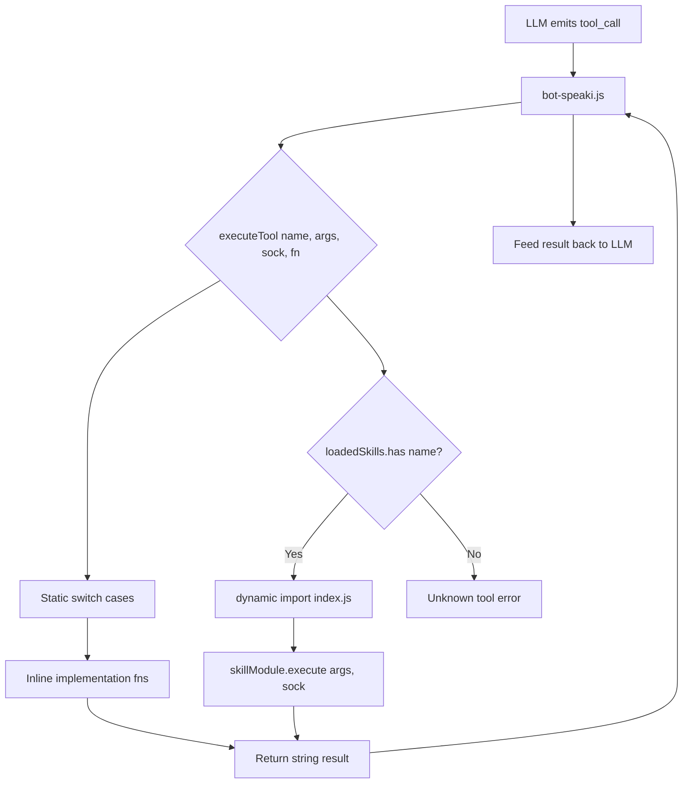
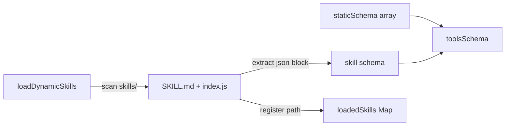

The `tools.js` module is the **central capability registry and execution router** for the Supikip (Speaki) WhatsApp bot. It defines the complete set of actionable tools the LLM can invoke, exposes them as an OpenAI/OpenRouter-compatible function schema, and dispatches runtime calls to the correct implementation. This page documents the module's architecture, the two-tier schema model (static + dynamic skills), the security boundaries, and the dispatch contract. It is scoped strictly to `tools.js`; for how the entry point consumes this module, see [Architecture and Entry Point (bot-speaki.js)](8-architecture-and-entry-point-bot-speaki-js), and for the dynamic skill convention see [Skills Architecture and SKILL.md Convention](12-skills-architecture-and-skill-md-convention).

## Architectural Overview

The module follows a **schema/implementation separation** pattern. Schemas describe what the LLM can call; implementation functions perform the work; and a single `executeTool` switch routes by name. Static tools are declared inline, while dynamic skills are discovered at load time by scanning the `skills/` directory. The diagram below shows the data flow from LLM tool call to execution.



The combined schema is exported as `toolsSchema`, built by spreading the static array and the dynamically loaded skill schemas at module evaluation time.

Sources: [tools.js](tools.js#L376) [tools.js](tools.js#L882-L933) [bot-speaki.js](bot-speaki.js#L8)

## Two-Tier Schema Model

The framework distinguishes **static (built-in) tools** from **dynamic skills**. Static tools are hardcoded in `staticSchema` and always present. Dynamic skills are discovered at startup by `loadDynamicSkills()`, which scans `skills/` for folders containing both `SKILL.md` and `index.js`, extracts the JSON schema block from `SKILL.md`, and registers the `index.js` file path in the `loadedSkills` Map keyed by `function.name`.



The final exported schema is `[...staticSchema, ...loadDynamicSkills()]`, meaning dynamic skills are appended after static ones. Each skill's `index.js` must export an `execute(args, sock)` function; the router dynamically `import()`s it on first invocation.

Sources: [tools.js](tools.js#L32-L78) [tools.js](tools.js#L81-L373) [tools.js](tools.js#L917-L930)

## Static Tool Inventory

The `staticSchema` array declares 16 built-in tools. The table below summarizes each tool, its purpose, and whether it requires the `sock` WhatsApp connection or the injected `checkShinigamiUpdatesFn` callback.

| Tool Name | Purpose | Requires `sock` | Requires Scraper Fn |
|---|---|---|---|
| `web_search` | Internet search via SerpAPI with DuckDuckGo fallback | No | No |
| `check_shinigami_now` | Manual trigger of manhwa update scraper | Yes | Yes |
| `get_system_status` | RAM/CPU/uptime/server metrics | No | No |
| `web_fetch` | Fetch and strip HTML from a URL | No | No |
| `read_workspace_file` | Read a workspace file | No | No |
| `write_workspace_file` | Write a workspace file | No | No |
| `run_terminal_command` | Execute shell command (owner only) | No | No |
| `add_cron_schedule` | Add a cron job to `schedules.json` | No | No |
| `remove_cron_schedule` | Remove a cron job | No | No |
| `set_one_shot_reminder` | One-shot timed WhatsApp reminder | Yes | No |
| `apply_patch` | Precise text-replace file edit | No | No |
| `parse_pdf_file` | Extract text from PDF | No | No |
| `analyze_image` | Multimodal image analysis via OpenRouter | No | No |
| `delegate_subagent` | Delegate task to isolated LLM subagent | No | No |
| `run_performance_test` | Latency and I/O benchmark | No | No |
| `send_workspace_file` | Send a file to target WhatsApp groups | Yes | No |

Sources: [tools.js](tools.js#L81-L373)

## Implementation Patterns

Each static tool is implemented as a named async or sync function with a consistent **contract: accept primitive arguments, return a human-readable string**. Errors are caught and returned as descriptive strings rather than thrown, ensuring the LLM always receives a parseable result. Key implementation characteristics worth noting:

The `web_search` tool prefers SerpAPI when `SERPAPI_API_KEY` is set, incrementing `serpapi_quota.json` usage via `incrementSerpApiUsage()`, and transparently falls back to a DuckDuckGo HTML scraper when the key is absent. The `web_fetch` and `parse_pdf_file` tools both truncate output (5000 and 8000 chars respectively) to protect the LLM token budget. The `analyze_image` and `delegate_subagent` tools call OpenRouter's chat completions API directly, detecting image MIME type from extension for the vision path. Tools that touch the filesystem (`read_workspace_file`, `write_workspace_file`, `apply_patch`, `parse_pdf_file`, `send_workspace_file`) all sanitize paths by stripping `../` sequences to constrain writes to the working directory.

Sources: [tools.js](tools.js#L18-L30) [tools.js](tools.js#L381-L439) [tools.js](tools.js#L487-L517) [tools.js](tools.js#L522-L546) [tools.js](tools.js#L522-L663) [tools.js](tools.js#L669-L723)

## Security and Authorization Boundaries

The module encodes **owner-only guards implicitly through tool descriptions** (e.g., `get_system_status`, `run_terminal_command` are marked "Hanya JO" / owner-only), but enforcement of those guards occurs in the caller (`bot-speaki.js`), not in `tools.js` itself. The only hard security control inside the module is **path traversal mitigation**: every file-path-accepting tool normalizes the filename with `filename.replace(/\.\.\//g, '')` before joining with `process.cwd()`. Tools that send messages (`set_one_shot_reminder`, `send_workspace_file`) target hardcoded group JIDs from `process.env.MANHWA_GROUP_JID` or fallback constants. Developers extending tools must apply equivalent path sanitization and rely on the entry point for role checks.

Sources: [tools.js](tools.js#L523) [tools.js](tools.js#L538) [tools.js#L607-L621) [tools.js](tools.js#L842-L851)

## The Dispatch Contract: `executeTool`

`executeTool(name, args, sock, checkShinigamiUpdatesFn)` is the single public entry point for runtime execution. It is a `switch` over `name`:
- **Static cases** map directly to implementation functions, passing `args` properties.
- **Default case** consults `loadedSkills`: if the name is registered, it dynamically `import()`s the skill's `index.js` and calls `execute(args, sock)`; if the exported `execute` is missing or import fails, it returns a diagnostic string; if the name is unknown entirely, it returns a "tool not found" message.

The four parameters reveal the **dependency injection strategy**: `sock` (the Baileys connection) and `checkShinigamiUpdatesFn` (the scraper from the main module) are passed in by the caller because `tools.js` cannot import them directly without creating a circular dependency. This keeps the tool module decoupled and testable. Note that `sock` and `checkShinigamiUpdatesFn` are only needed by certain tools, and unused parameters are silently ignored in the relevant cases.

Sources: [tools.js](tools.js#L882-L933) [bot-speaki.js](bot-speaki.js#L515)

## Integration with the Entry Point

The entry point imports `toolsSchema` and `executeTool` from `tools.js` and supplies the schema to every LLM completion request (`tools: toolsSchema`). When the LLM returns a `tool_call`, the handler calls `executeTool(name, args, sock, checkShinigamiUpdates)` and feeds the returned string back as a tool result. Notably, `run_performance_test` is also invoked through an independent dynamic `import('./tools.js')` path in the heartbeat logic, confirming the module is safe to import multiple times.

Sources: [bot-speaki.js](bot-speaki.js#L8) [bot-speaki.js](bot-speaki.js#L270) [bot-speaki.js](bot-speaki.js#L481) [bot-speaki.js](bot-speaki.js#L515) [bot-speaki.js](bot-speaki.js#L751-L754)

## Extension Guide

To add a capability, you have two paths. For a **static tool**, append a schema object to `staticSchema` and add a `case` to the `executeTool` switch with a matching implementation function, applying the path-sanitization convention. For a **dynamic skill**, create a new folder under `skills/` with a `SKILL.md` containing a ```json``` schema block and an `index.js` exporting `async function execute(args, sock)`; the loader picks it up automatically on restart with no change to `tools.js`. The dynamic path is preferred because it preserves `tools.js` stability and isolates skill dependencies. For the full skill authoring convention, consult [Skills Architecture and SKILL.md Convention](12-skills-architecture-and-skill-md-convention).

Sources: [tools.js](tools.js#L38-L78) [tools.js](tools.js#L916-L930) [skills/ocr_extractor/SKILL.md](skills/ocr_extractor/SKILL.md#L1-L5)

## Related Pages

- [Architecture and Entry Point (bot-speaki.js)](8-architecture-and-entry-point-bot-speaki-js) — how `toolsSchema` and `executeTool` are consumed in the request lifecycle.
- [Skills Architecture and SKILL.md Convention](12-skills-architecture-and-skill-md-convention) — the dynamic skill loading format referenced by `loadDynamicSkills()`.
- [Database Layer (database_db.js)](9-database-layer-database_db-js) — persistence layer used alongside tool execution.
- [SerpApi Quota Monitoring and Configuration](18-serpapi-quota-monitoring-and-configuration) — the `serpapi_quota.json` file incremented by `incrementSerpApiUsage()`.