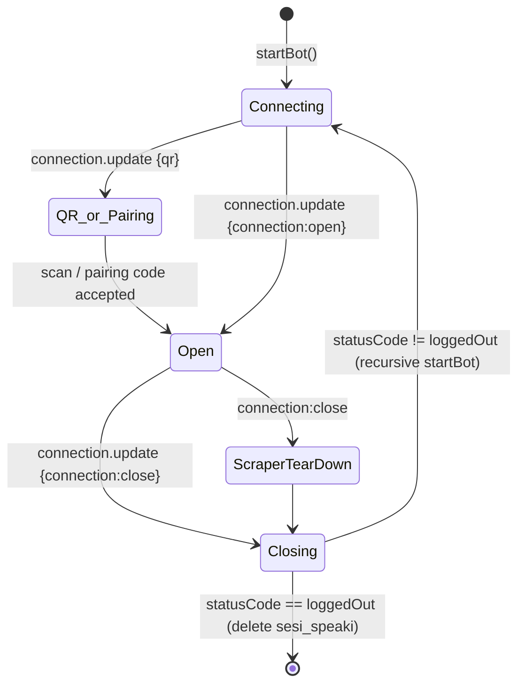

This page documents how the Supikip/Speaki bot integrates with WhatsApp through the `@itsliaaa/baileys` library (v0.3.18-final), a hardened fork of WhiskeySockets/Baileys. It focuses specifically on the Baileys layer: the dependency wiring, authentication strategy, socket lifecycle, event subscription model, and the message-sending primitives the bot consumes. For the broader application wiring, see [Architecture and Entry Point (bot-speaki.js)](8-architecture-and-entry-point-bot-speaki-js).

## Library Dependency and Version Pinning

The bot consumes Baileys as a **local file dependency** rather than a published npm package. The `package.json` declares it via the `file:` protocol pointing at the in-repo `./baileys` directory, which guarantees the fork's production fixes (newsletter media upload, album messages, rich messages) are bundled with the deployment. The library is imported as an ESM module, pulling `makeWASocket`, `useMultiFileAuthState`, `DisconnectReason`, `jidNormalizedUser`, `downloadMediaMessage`, and `Browsers` from the package root.

Sources: [package.json](package.json#L6-L13), [bot-speaki.js](bot-speaki.js#L1)

## Authentication Strategy: Multi-File Auth State

The bot uses the **multi-file auth state** strategy, persisting session credentials into a local folder named `sesi_speaki`. This strategy writes encryption keys, pre-key bundles, and core credentials as separate JSON files, which the `baileys_documentation.md` notes is the recommended default to avoid single-file corruption. The `useMultiFileAuthState('sesi_speaki')` call returns a `{ state, saveCreds }` tuple; `state` is injected into `makeWASocket`'s `auth` option, and `saveCreds` is bound to the `creds.update` event to persist credential rotations automatically. On a `loggedOut` disconnect, the documented recovery path is to delete the `sesi_speaki` folder and re-scan.

Sources: [bot-speaki.js](bot-speaki.js#L557-L567), [baileys_documentation.md](baileys_documentation.md#L72-L75)

## Socket Construction and Browser Profile

The `makeWASocket` factory is configured with three deliberate options. `printQRInTerminal: true` renders a scannable QR in the console for initial linking. `browser: Browsers.ubuntu('Chrome')` sets an official Ubuntu Chrome browser profile to reduce link-rejection risk from WhatsApp's device-fingerprinting. `logger: pino({ level: 'silent' })` suppresses Baileys' verbose internal logging to keep the process output clean. These choices reflect a production daemon posture rather than a development debug posture.

Sources: [bot-speaki.js](bot-speaki.js#L560-L565)

## Connection Lifecycle and Reconnection Logic

The bot subscribes to `connection.update` to drive its entire lifecycle. The handler distinguishes three states: a `qr` payload (rendered via `qrcode-terminal` and, when the account is unregistered, used to request an 8-digit pairing code via `sock.requestPairingCode`), a `close` event, and an `open` event. On `close`, the `shouldReconnect` decision inspects `lastDisconnect.error` — if it is a `Boom` instance whose `statusCode` equals `DisconnectReason.loggedOut`, reconnection is suppressed; otherwise `startBot()` is re-invoked recursively. This pattern mirrors the canonical example in the library documentation but adds a scraper-interval teardown to prevent memory leaks while offline.

Sources: [bot-speaki.js](bot-speaki.js#L572-L617), [baileys_documentation.md](baileys_documentation.md#L138-L159)

The following diagram maps the connection state machine as implemented in the bot:

## Inbound Message Handling: messages.upsert

Inbound traffic is consumed exclusively through the `messages.upsert` event, with the handler gating on `!msg.key.fromMe && m.type === 'notify'` to ignore the bot's own echoes and non-notify receipts. Text extraction is defensive, falling back across `conversation`, `extendedTextMessage.text`, `imageMessage.caption`, and `videoMessage.caption`. The handler uses `jidNormalizedUser` to strip device suffixes (`:1`, `:2`) from JIDs, a normalization critical for reliable mention/reply comparison in group chats. Outbound media download uses `downloadMediaMessage` to pull image buffers into memory for the OCR skill path.

Sources: [bot-speaki.js](bot-speaki.js#L666-L690), [bot-speaki.js](bot-speaki.js#L798-L804), [bot-speaki.js](bot-peaki.js#L854-L862)

## Presence and Reply Semantics

Before dispatching any LLM-derived answer, the bot calls `sock.sendPresenceUpdate('composing', jid)` to surface a typing indicator, then `sock.sendPresenceUpdate('paused', jid)` afterward. Replies are sent through `sock.sendMessage(jid, { text })` for plain text, and with a `{ quoted: msg }` context object when replying to OCR results so the response threads under the original image. These are the only outbound primitives the bot layer relies on; richer fork features (interactive buttons, lists, album messages) are documented in the library but not exercised by the current bot logic.

Sources: [bot-speaki.js](bot-speaki.js#L732-L734), [bot-speaki.js](bot-speaki.js#L811-L822), [bot-speaki.js](bot-speaki.js#L884-L893), [baileys_documentation.md](baileys_documentation.md#L186-L212)

## Mention and Reply Detection in Groups

Group responsiveness depends on `jidNormalizedUser` normalization combined with four detection signals: explicit JID mention via `mentionedJid`, text mention (`@<botNumber>`), reply-to-bot via `contextInfo.participant`, and name-mention (`speaki`/`supikip` substrings). Direct messages bypass all checks and always trigger a reply. The hardcoded bot-number sentinel `133526976512185` appears as a fallback comparator, indicating the bot author's specific WhatsApp ID is baked into the logic.

Sources: [bot-speaki.js](bot-speaki.js#L845-L879)

## Baileys Module Layout Referenced by the Bot

The table below maps the specific Baileys modules the bot touches to their on-disk location and role, drawn from the library's documented structure and verified against the `baileys/lib` tree.

| Module / Export | Path in `baileys/lib` | Role in Bot |
|---|---|---|
| `makeWASocket` | `index.js` | Socket factory; entry of all connectivity |
| `useMultiFileAuthState` | `Utils/use-multi-file-auth-state.js` | Session persistence to `sesi_speaki` |
| `DisconnectReason` | `Utils/` (exported from root) | Reconnection guard logic |
| `jidNormalizedUser` | `WABinary/jid-utils.js` | JID device-suffix normalization |
| `downloadMediaMessage` | `Utils/messages-media.js` | Image buffer download for OCR |
| `Browsers` | `Utils/browser-utils.js` | Browser profile fingerprint |
| `messages-send.js` | `Socket/messages-send.js` | Underpins `sendMessage` / `sendPresenceUpdate` |
| `messages-recv.js` | `Socket/messages-recv.js` | Decrypts inbound → `messages.upsert` |
| `socket.js` | `Socket/socket.js` | WebSocket lifecycle, Noise handshake, keep-alive |

Sources: [baileys_documentation.md](baileys_documentation.md#L25-L65), [baileys/lib/Socket](baileys/lib/Socket), [baileys/lib/Utils](baileys/lib/Utils)

## Fork-Specific Advantages Leveraged

The `@itsliaaa/baileys` fork provides the production hardening the bot depends on: no source obfuscation (auditable `lib/` tree), anti-auto-follow newsletter behavior, and rich-message support. While the bot currently uses only plain-text and image-caption paths, the `mentionAll` extension and interactive-button primitives are available in `messages-send.js` for future capability growth without changing the dependency.

Sources: [baileys_documentation.md](baileys_documentation.md#L93-L102)

## Related Pages

To understand how the Baileys socket feeds the rest of the system, continue to [Architecture and Entry Point (bot-speaki.js)](8-architecture-and-entry-point-bot-speaki-js) for the full event-to-LLM pipeline, or [Database Layer (database_db.js)](9-database-layer-database_db-js) for how sticker registration coexists with the WhatsApp session. The [Tool Integration Framework (tools.js)](10-tool-integration-framework-tools-js) page explains how `sock` is passed into tool executions for outbound sends.