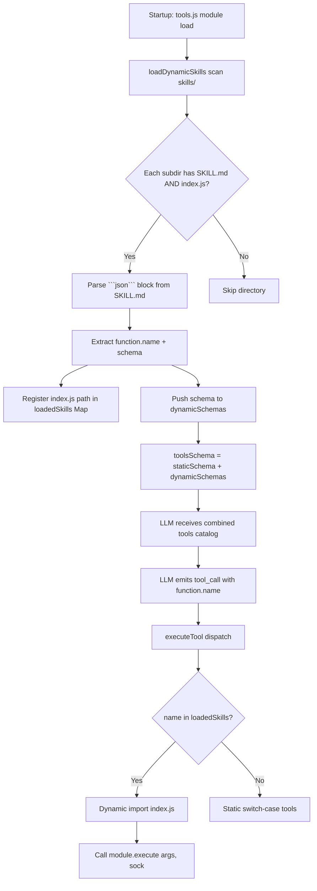
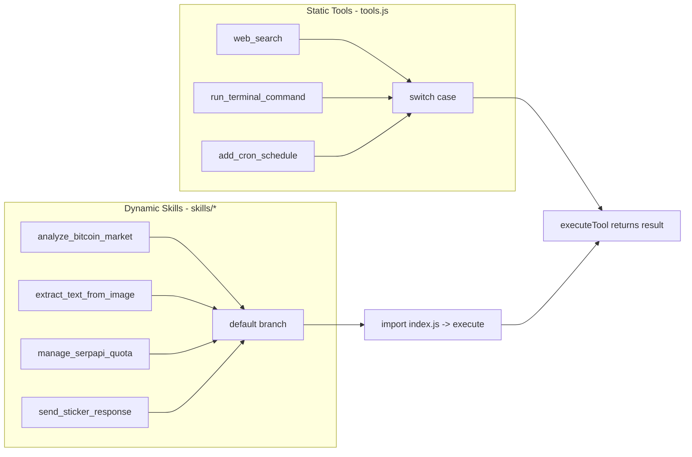

This page documents the **plugin architecture** that powers Speaki's extensible skills system. It explains how the `skills/` directory is discovered at runtime, how each skill is declared through a `SKILL.md` manifest, and how the `tools.js` dynamic loader fuses skill schemas into the model-facing tool catalog. The focus here is strictly the *convention and orchestration layer*; per-skill behavior is covered in the dedicated skill pages.

## Architectural Overview

The skills system operates as a **convention-over-configuration plugin loader**. Each subdirectory under `skills/` is treated as an independent module that must contain exactly two files: `SKILL.md` (a declarative tool-schema manifest) and `index.js` (the imperative execution logic). At process startup, `tools.js` scans the `skills/` directory, parses each `SKILL.md` to extract a JSON tool schema, and merges those schemas with a set of statically-coded built-in tools. The LLM receives the combined schema and, when it invokes a skill-named function, the loader dynamically `import()`s the corresponding `index.js` and calls its `execute` export.

Sources: [tools.js](tools.js#L32-L78) [tools.js](tools.js#L376) [bot-speaki.js](bot-speaki.js#L8)



The diagram above shows the two-phase lifecycle: a **load-time phase** (discovery, parsing, registration) and a **runtime phase** (LLM tool-call dispatch). The critical insight is that skill execution is fully decoupled from the static `switch` statement — dynamic skills are handled exclusively in the `default` branch of `executeTool`.

Sources: [tools.js](tools.js#L38-L78) [tools.js](tools.js#L882-L932)

## The SKILL.md Convention

`SKILL.md` is the **single source of truth for a skill's interface**. It is a Markdown file whose only machine-readable content is a single fenced ```` ```json ```` block containing an OpenAI/OpenRouter-compatible function schema. The loader extracts this block with the regular expression `/```json\s*([\s\S]*?)\s*```/` and parses it as JSON.

The schema follows the standard `function`-calling shape:

- `function.name` — the unique tool identifier. This string is the **binding key**: it is used both to register the skill's `index.js` path in the `loadedSkills` Map and to match incoming LLM tool calls.
- `function.description` — natural-language guidance consumed by the LLM to decide when to invoke the skill.
- `function.parameters` — a JSON-Schema object describing accepted arguments, with `properties`, optional `enum` constraints, and a `required` array.

Each of the four current skills conforms to this shape. The `name` field and its declared parameters are summarized below.

Sources: [tools.js](tools.js#L54-L66) [skills/bitcoin_market_analyzer/SKILL.md#L5-L24) [skills/ocr_extractor/SKILL.md#L5-L22)

| Skill Directory | `function.name` | Parameters | Required |
|---|---|---|---|
| `bitcoin_market_analyzer` | `analyze_bitcoin_market` | `target_metric` (enum: all/etf/liquidation) | none |
| `ocr_extractor` | `extract_text_from_image` | `image_path` (string) | `image_path` |
| `serpapi_quota_manager` | `manage_serpapi_quota` | `action` (enum: view/update), `usage_count`, `total_limit` | `action` |
| `sticker_responder` | `send_sticker_response` | `tag` (enum: all/ketus/lucu/datar/kaget) | none |

Because the loader keys registration on `schema.function.name`, **the `name` in `SKILL.md` must be unique across all skills and must exactly match the name the LLM emits in its tool call**. A collision or mismatch results in either a registration overwrite or a "tool not found" response.

Sources: [skills/serpapi_quota_manager/SKILL.md#L5-L31) [skills/sticker_responder/SKILL.md#L5-L23) [tools.js](tools.js#L64)

## The index.js Execution Contract

Every skill's `index.js` must export a single async function with the signature `execute(args, sock)`. This is the only contract the loader enforces at runtime. The two parameters are:

- `args` — the JSON object the LLM populated from the skill's declared `parameters`.
- `sock` — the active Baileys WhatsApp socket instance, enabling the skill to send messages, stickers, or media directly to chats.

The dispatch logic in `executeTool`'s `default` branch confirms this contract: it performs `await import(execJsPath)`, verifies `typeof skillModule.execute === 'function'`, and then `return await skillModule.execute(args, sock)`. If the export is missing, the loader returns a diagnostic failure string rather than throwing — making skill misconfiguration a graceful degradation rather than a crash.

All four currently-shipped skills satisfy the contract, as verified by their export signatures:

Sources: [tools.js](tools.js#L916-L931) [skills/bitcoin_market_analyzer/index.js#L56) [skills/serpapi_quota_manager/index.js#L22)

| Skill | `execute` Signature | Notable Dependency |
|---|---|---|
| `bitcoin_market_analyzer` | `execute(args, sock)` | External market APIs (Farside/Coinglass) |
| `ocr_extractor` | `execute(args, sock)` | Multimodal AI vision model |
| `serpapi_quota_manager` | `execute(args, sock)` | `serpapi_quota.json` file I/O |
| `sticker_responder` | `execute(args, sock)` | `database_db.js` (`getRandomStickerByTag`) + `sock.sendMessage` |

The `sticker_responder` implementation illustrates the typical pattern: it reads `args.tag`, queries the SQLite database via a shared import from `database_db.js`, resolves a physical `.webp` path on disk, and pushes the sticker to predefined group JIDs through the injected `sock` instance. This demonstrates that skills are **first-class modules** — they can import shared infrastructure (database, schemas) and operate on the live socket.

Sources: [skills/sticker_responder/index.js#L1-L46) [skills/sticker_responder/index.js#L8-L42)

## Static vs. Dynamic Tool Fusion

The combined catalog exposed to the LLM is produced at line 376 of `tools.js`:

```
export const toolsSchema = [...staticSchema, ...loadDynamicSkills()];
```

This single expression reveals the system's layering. `staticSchema` is a hard-coded array of built-in tools (web search, file I/O, cron, terminal, etc.) defined inline in `tools.js`. `loadDynamicSkills()` returns the array of skill schemas parsed from the `skills/` directory. The spread merge means **skills appear indistinguishable from built-in tools to the LLM** — there is no separate namespace. However, at execution time the two classes diverge: static tools are resolved by an explicit `switch` statement, while dynamic skills fall through to the `default` branch's `import()`-based loader.

Sources: [tools.js](tools.js#L81-L373) [tools.js](tools.js#L376) [tools.js](tools.js#L882-L932)



The separation is deliberate: built-in tools are performance-critical and hot-path, so they avoid the `import()` overhead; skills are loaded lazily only when actually invoked, keeping cold-start memory and parse cost minimal.

Sources: [tools.js](tools.js#L882-L932)

## Directory Structure and Discovery Rules

The loader enforces a strict discovery contract. For each entry in the `skills/` directory, it checks that `fs.statSync(skillPath).isDirectory()` is true, then requires **both** `SKILL.md` and `index.js` to exist (`fs.existsSync(skillMdPath) && fs.existsSync(execJsPath)`). If either is missing, the directory is silently skipped. The schema must also contain a parseable ```` ```json ```` block; a parse failure logs an error and skips that skill without aborting the entire scan. This fail-soft design means a malformed skill never breaks the bot's tool catalog.

Sources: [tools.js](tools.js#L44-L72)

The canonical on-disk layout for a compliant skill is:

```
skills/
└── <skill_name>/
    ├── SKILL.md      # manifest: fenced ```json tool schema
    └── index.js      # module exporting async execute(args, sock)
```

Adding a new skill requires **no changes to `tools.js` or `bot-speaki.js`** — dropping a conformant directory into `skills/` is sufficient for discovery, schema exposure to the LLM, and runtime dispatch. This is the defining property of the convention: the architecture is open for extension without modification.

Sources: [tools.js](tools.js#L38-L78) [tools.js](tools.js#L376)

## Contract Summary for Skill Authors

To author a conformant skill, three invariants must hold. First, the directory name under `skills/` must contain both `SKILL.md` and `index.js`. Second, `SKILL.md` must embed exactly one ```` ```json ```` block whose `function.name` is globally unique and matches the LLM's intended call. Third, `index.js` must `export async function execute(args, sock)` and return a string (or serializable value) as the tool result. Violating any invariant degrades gracefully: missing files skip the skill, a bad JSON block logs and skips, and a missing `execute` export returns a clear error string at call time.

Sources: [tools.js](tools.js#L52-L70) [tools.js](tools.js#L918-L929)

## Where to Go Next

This page covered the *convention and orchestration* of the skills system. To understand the concrete behavior of each shipped skill, consult the dedicated pages: [Bitcoin Market Analyzer Skill](13-bitcoin-market-analyzer-skill), [OCR Extractor Skill](14-ocr-extractor-skill), [SerpApi Quota Manager Skill](15-serpapi-quota-manager-skill), and [Sticker Responder Skill](16-sticker-responder-skill). For the surrounding tool framework that hosts the loader, see [Tool Integration Framework (tools.js)](10-tool-integration-framework-tools-js). To trace how the combined `toolsSchema` reaches the LLM and how tool calls are processed end-to-end, refer to [Architecture and Entry Point (bot-speaki.js)](8-architecture-and-entry-point-bot-speaki-js).