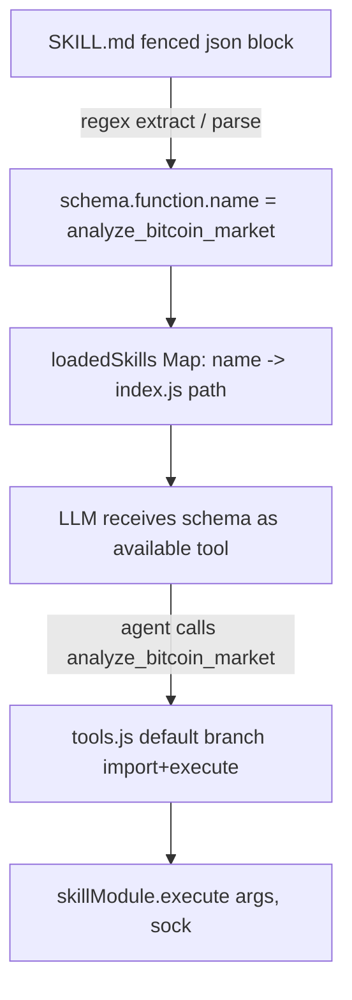
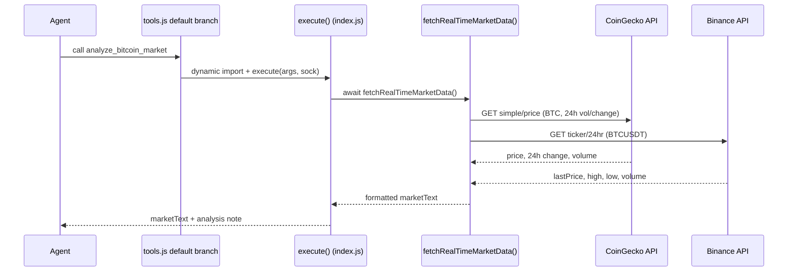
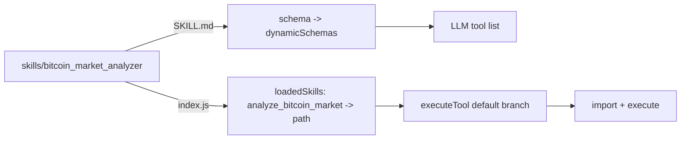

This page documents the **Bitcoin Market Analyzer Skill** — a dynamic skill that provides real-time Bitcoin market data to the Speaki bot's LLM agent. It is one of four skills in the `skills/` directory and is loaded at runtime by the dynamic skill loader in `tools.js`. The skill exposes a single callable function, `analyze_bitcoin_market`, but its actual implementation intentionally diverges from the schema's stated intent to deliver stable, Cloudflare-free market data. This document covers the skill's schema, internal architecture, data-sourcing strategy, and its integration into the broader tool framework.

Sources: [SKILL.md](skills/bitcoin_market_analyzer/SKILL.md#L1-L25), [index.js](skills/bitcoin_market_analyzer/index.js#L1-L68), [tools.js](tools.js#L38-L78)

## Skill Schema and Declared Contract

The skill is registered through a JSON schema embedded in a fenced ```` ```json ```` block inside `SKILL.md`. The dynamic loader extracts this block via a regex match and registers the schema's `function.name` as the dispatch key. The declared contract specifies a single optional parameter, `target_metric`, constrained to an enum of `all`, `etf`, or `liquidation`, defaulting to `all`. The description advertises ETF net-flow data from Farside/Coinglass and 24-hour liquidation data from Coinglass.



The schema-to-execution binding is performed at lines 58–65 of `tools.js`, where the parsed `function.name` becomes the key in the `loadedSkills` Map pointing to the skill's `index.js` absolute path.

Sources: [SKILL.md](skills/bitcoin_market_analyzer/SKILL.md#L5-L24), [tools.js](tools.js#L58-L65)

## Internal Architecture and Execution Flow

The skill's `index.js` exports a single asynchronous `execute(args, sock)` function, which is the only contract the dynamic loader enforces (it checks `typeof skillModule.execute === 'function'`). The entry point logs an invocation marker, delegates to `fetchRealTimeMarketData()`, and appends a static analysis note. The core data-fetching logic lives in a private `fetchRealTimeMarketData()` function that issues two parallel `fetch` calls against public APIs using a shared `scraperHeaders` object containing a desktop Chrome User-Agent.



The `scraperHeaders` constant (lines 1–3) is applied uniformly to both requests, mimicking a browser to maximize API accessibility. Both responses are independently guarded with `.ok` checks, allowing partial data to still produce a usable result. If both fail, the function returns a localized failure message rather than throwing.

Sources: [index.js](skills/bitcoin_market_analyzer/index.js#L1-L51), [tools.js](tools.js#L918-L930)

## Data Sources and Sourcing Strategy

The implementation deliberately sources data from **CoinGecko** and **Binance** public REST APIs, not the Farside/Coinglass endpoints named in the schema. This is a conscious anti-bot-avoidance decision documented in code comments: Farside and Coinglass sit behind Cloudflare IP-server protection and JS anomaly checks, making them unreliable from the deployment environment. The skill therefore substitutes stable, Cloudflare-free sources that still yield high-fidelity spot metrics.

| Data Field | Source API | Endpoint | Notes |
|---|---|---|---|
| Price (USD) | CoinGecko | `/api/v3/simple/price?ids=bitcoin&vs_currencies=usd&include_24hr_vol=true&include_24hr_change=true` | Via `btc.usd` |
| 24h Change % | CoinGecko | same as above | Via `btc.usd_24h_change.toFixed(2)` |
| 24h Trade Volume (USD) | CoinGecko | same as above | Via `btc.usd_24h_vol`, rounded |
| Spot Price (Binance) | Binance | `/api/v3/ticker/24hr?symbol=BTCUSDT` | Via `lastPrice` |
| 24h Low / High | Binance | same as above | Via `lowPrice` / `highPrice` |
| Spot Volume (BTC) | Binance | same as above | Via `volume` |

The two endpoints are invoked concurrently (the `await` calls appear sequentially in code but each `fetch` is non-blocking at the network level, resolved independently). Each result is string-formatted with emoji-prefixed labels into a single `marketText` buffer. The final return value concatenates this buffer with a `Catatan Analisis` note explaining that ETF/liquidation data is unavailable due to Cloudflare protection and advising use of the global spot volume estimate ($30B+) for liquidity inference.

Sources: [index.js](skills/bitcoin_market_analyzer/index.js#L9-L67)

## Contract-vs-Implementation Divergence

A key architectural insight for intermediate developers: the skill's **declared schema and actual behavior diverge**. The schema advertises three selectable metrics (`all`, `etf`, `liquidation`), but the `execute` function ignores the `args.target_metric` parameter entirely. It always returns the same CoinGecko + Binance spot dataset regardless of the requested metric. The `enum` values in the schema are effectively non-functional at runtime.

| Aspect | Schema Declaration | Runtime Reality |
|---|---|---|
| `target_metric` parameter | Optional, enum `all`/`etf`/`liquidation` | Not read or branched on in `execute` |
| ETF inflow/outflow | Promised (Farside/Coinglass) | Not fetched; blocked by Cloudflare |
| Liquidation data | Promised (Coinglass) | Not fetched; blocked by Cloudflare |
| Actual data delivered | Implied global market | CoinGecko price/volume + Binance spot ticker |
| Error handling | Not specified | Graceful fallback string on dual-API failure |

This divergence is intentional and documented inline as an anti-bot workaround, but it means the LLM agent may believe it can request granular ETF/liquidation breakdowns that the skill cannot fulfill. Developers extending this skill should either align the schema to the real capabilities or implement a Cloudflare-bypass proxy for the named endpoints.

Sources: [SKILL.md](skills/bitcoin_market_analyzer/SKILL.md#L9-L21), [index.js](skills/bitcoin_market_analyzer/index.js#L56-L67)

## Integration with the Dynamic Skill Loader

The skill participates in the generic dynamic-skill pipeline shared by all four skills. At startup, `loadDynamicSkills()` scans `skills/`, validates that each subdirectory contains both `SKILL.md` and `index.js`, extracts the JSON schema, and populates `dynamicSchemas` (merged into the LLM tool list) and the `loadedSkills` Map. At call time, `executeTool` falls through its static `switch` to the `default` branch (lines 916–930), where it dynamically `import()`s the registered `index.js` path and invokes `.execute(args, sock)`. The `sock` parameter is forwarded but currently unused by this skill since output is returned as a plain string rather than sent directly via the socket.



The skill requires no environment variables, database access, or external module dependencies beyond the built-in `fetch` (Node.js 18+). This makes it the lightest-weight skill in the suite from an operational standpoint.

Sources: [tools.js](tools.js#L36-L78), [tools.js](tools.js#L916-L930), [index.js](skills/bitcoin_market_analyzer/index.js#L1-L3)

## Summary and Extension Points

The Bitcoin Market Analyzer Skill is a pragmatic, resilient market-data provider that prioritizes availability over the breadth promised in its schema. Its strengths are zero-dependency operation, graceful dual-source fallback, and clean integration via the standard skill contract. Its primary limitation is the unimplemented `target_metric` routing and the absence of the ETF/liquidation data the schema advertises. Extension work should focus on either narrowing the schema to match reality or adding a proxy layer to fulfill the declared ETF and liquidation metrics.

For the broader skill framework mechanics, see [Skills Architecture and SKILL.md Convention](12-skills-architecture-and-skill-md-convention). For how this skill is dispatched alongside static tools, see [Tool Integration Framework (tools.js)](10-tool-integration-framework-tools-js). To compare with sibling data-fetching skills, see [SerpApi Quota Manager Skill](15-serpapi-quota-manager-skill) and [OCR Extractor Skill](14-ocr-extractor-skill).