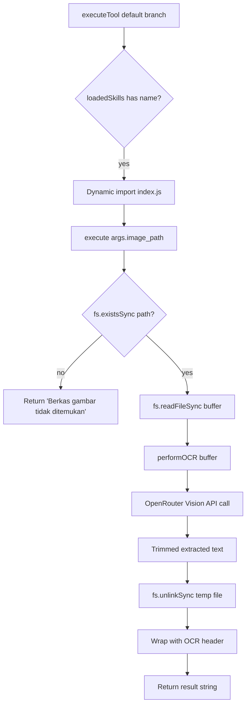

The OCR Extractor Skill enables the Speaki WhatsApp bot to transcribe textual content from locally stored image files using a multimodal vision model. It is one of the four pluggable skills in the `skills/` directory and follows the same dynamic-loader contract that the skill system uses to register and invoke capabilities at runtime. This page documents the skill's schema definition, execution flow, API integration, and failure semantics — scoped strictly to the `ocr_extractor` module.

## Skill Registration and Schema Contract

The skill declares its callable interface through a JSON schema embedded inside `SKILL.md`. The skill loader in `tools.js` does not hard-code this skill; instead it scans the `skills/` directory at startup, reads each `SKILL.md`, and extracts the first ```json``` fenced block via a regular expression. The parsed `function.name` becomes the dispatch key, and the path to `index.js` is registered alongside it.

The declared schema exposes a single required parameter, `image_path`, which is the absolute or relative path of the image file already stored on the server's local filesystem.

| Field | Value | Notes |
|-------|-------|-------|
| `function.name` | `extract_text_from_image` | Dispatch key used by `executeTool` default branch |
| `function.description` | Extracts all textual content from a local image file via a multimodal AI vision model | Surfaced to the LLM for tool selection |
| `parameters.type` | `object` | Standard OpenAI-style tool schema |
| `parameters.properties.image_path` | `string` (required) | Local server-side file path, not a remote URL |

This registration pattern means the skill is fully decoupled from `tools.js`: adding or removing the `ocr_extractor` folder automatically changes the available toolset without code edits to the loader.

Sources: [SKILL.md](skills/ocr_extractor/SKILL.md#L1-L24) · [tools.js](tools.js#L38-L75)

## Execution Flow and Module Structure

The skill's `index.js` exports two functions that serve distinct roles. `execute(args, sock)` is the entry point mandated by the dynamic loader contract — `executeTool` dynamically imports the module and calls `skillModule.execute(args, sock)` only if that export exists. `performOCR(imageBuffer)` is the internal core that performs the actual vision-API call and is not part of the loader contract.

The end-to-end flow proceeds as follows: the loader dispatches with `args.image_path`; `execute` validates file existence with `fs.existsSync`, reads the raw bytes via `fs.readFileSync`, forwards the buffer to `performOCR`, deletes the temporary image with `fs.unlinkSync` to reclaim disk space, and finally wraps the returned text in a `=== HASIL EKSTRAKSI TEKS (OCR) ===` header before returning it to the caller.



Modules interact through a single directional dependency: `execute` depends on `performOCR` and the Node `fs` module, while `performOCR` depends only on `fetch` and the `OPENROUTER_API_KEY` environment variable. The `sock` parameter is accepted by `execute` to satisfy the loader signature but is unused within this skill.

Sources: [index.js](skills/ocr_extractor/index.js#L76-L99) · [tools.js](tools.js#L916-L930)

## Vision API Integration

The `performOCR` function performs the actual transcription by encoding the image buffer to base64 and posting it to the OpenRouter chat completions endpoint. The request uses the `google/gemini-2.5-flash` model, selected as a reliable vision model for OCR workloads. The image is transmitted inline as a `data:` URL with a hardcoded `image/jpeg` MIME-type fallback, meaning all input buffers are treated as JPEG regardless of their actual format.

The system prompt instructs the model to behave as a high-precision OCR engine: copy all visible text, numbers, symbols, and tables verbatim without modification, emit no preamble or commentary, and return the literal string `[Tidak ada teks yang terdeteksi di dalam gambar]` when the image contains no text. The response content is accessed via `data.choices?.[0]?.message?.content` and trimmed before being returned.

| Aspect | Implementation Detail |
|--------|----------------------|
| Endpoint | `https://openrouter.ai/api/v1/chat/completions` |
| Model | `google/gemini-2.5-flash` |
| Auth | `Bearer ${OPENROUTER_API_KEY}` header |
| Image transport | Inline base64 `data:image/jpeg;base64,...` |
| Request metadata | `HTTP-Referer` and `X-Title` identify the Speaki bot |
| Output discipline | Verbatim copy, no commentary, empty-image sentinel string |

Sources: [index.js](skills/ocr_extractor/index.js#L1-L71)

## Error Handling and Failure Semantics

The skill defines explicit, user-facing failure messages at three layers. At the API layer, `performOCR` returns a descriptive string if `OPENROUTER_API_KEY` is unset, if the API returns empty content, or if the `fetch` call throws. At the file layer, `execute` returns a "file not found" message when `fs.existsSync` fails and a generic execution-failure message if `readFileSync` throws. The temporary-file cleanup is best-effort: a failed `fs.unlinkSync` is caught and logged as a warning rather than propagated, so a deletion error never masks the OCR result.

| Failure Condition | Returned Message (Indonesian) | Origin |
|-------------------|-------------------------------|--------|
| Missing API key | `Gagal memproses OCR: API Key OpenRouter belum diatur di file .env.` | `performOCR` guard |
| Empty API response | `Gagal mengekstrak teks: Respons kosong dari server AI.` | `performOCR` null check |
| Network/API exception | `Gagal memproses OCR gambar via API: ${e.message}` | `performOCR` catch |
| Image file absent | `Berkas gambar tidak ditemukan di server: ${imgPath}` | `execute` guard |
| Read/process exception | `Gagal mengeksekusi OCR file: ${e.message}` | `execute` catch |
| Temp-file delete failure | Warning log only (non-fatal) | `execute` inner catch |

Because every failure path returns a string rather than throwing, the skill is safe to call from the dynamic loader's `await skillModule.execute(args, sock)` without risking an unhandled rejection that would break the broader tool dispatch.

Sources: [index.js](skills/ocr_extractor/index.js#L14-L99)

## Configuration and Operational Notes

The skill's only external dependency is the `OPENROUTER_API_KEY` environment variable, loaded via `dotenv.config()` at module import. No local configuration file, model override, or timeout tuning is exposed; the model name and MIME-type fallback are constants within `index.js`. Intermediate developers extending this skill should note two constraints: the hardcoded `image/jpeg` MIME type may mislabel non-JPEG inputs, and the model constant is a single hardcoded string with no fallback chain if the provider is unavailable.

Sources: [index.js](skills/ocr_extractor/index.js#L1-L9)

## Related Pages

For the broader system that loads and dispatches this skill, see [Skills Architecture and SKILL.md Convention](12-skills-architecture-and-skill-md-convention). To compare this skill against sibling capabilities, refer to [Bitcoin Market Analyzer Skill](13-bitcoin-market-analyzer-skill), [SerpApi Quota Manager Skill](15-serpapi-quota-manager-skill), and [Sticker Responder Skill](16-sticker-responder-skill). The underlying dynamic dispatch mechanism is detailed in [Tool Integration Framework (tools.js)](10-tool-integration-framework-tools-js).