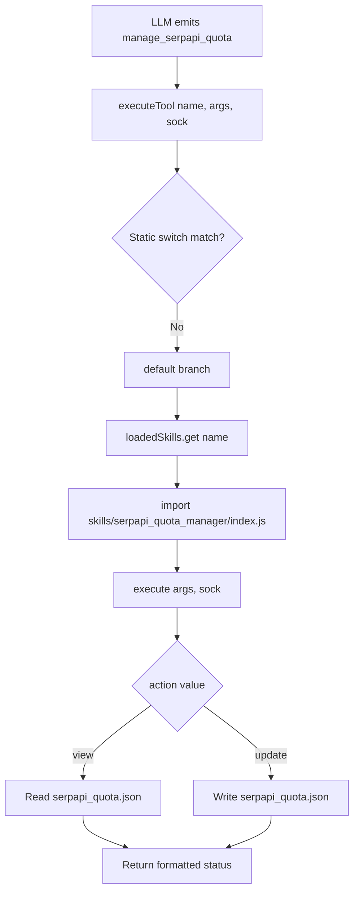

This page documents the **SerpApi Quota Manager** skill — a dynamically loaded function-calling skill that lets the agent inspect and manually correct the SerpAPI search quota state persisted in `serpapi_quota.json`. It is one of four skills under the `skills/` directory and is registered into the tool schema at startup. The skill does not perform searches itself; it is a **state observation and correction** layer that complements the automatic increment logic in `tools.js`. For the broader loading convention, see [Skills Architecture and SKILL.md Convention](12-skills-architecture-and-skill-md-convention).

Sources: [skills/serpapi_quota_manager/SKILL.md](skills/serpapi_quota_manager/SKILL.md#L1-L33) [tools.js](tools.js#L38-L75)

## Purpose and Architectural Role

The skill exposes a single function `manage_serpapi_quota` whose schema is embedded as a JSON code block inside `SKILL.md`. At startup, `loadDynamicSkills()` scans the `skills/` directory, extracts the JSON schema from each `SKILL.md`, and merges it into the global `toolsSchema` so the LLM can invoke it. The skill's `index.js` reads and writes the same `serpapi_quota.json` file that `tools.js` mutates automatically via `incrementSerpApiUsage()` after every successful SerpAPI-backed `web_search`. The skill therefore serves as the **manual reconciliation** path: when the agent suspects drift between real SerpAPI consumption and the local counter, it can read the current estimate (`view`) or overwrite the values (`update`).

Sources: [tools.js](tools.js#L38-L75) [tools.js](tools.js#L18-L30) [tools.js](tools.js#L376-L392)

## Skill Registration and Dispatch Flow

The skill follows the standard dynamic-skill contract: a `SKILL.md` (schema source) plus an `index.js` exporting an `execute(args, sock)` function. The loader maps `schema.function.name` → `index.js` path in a `loadedSkills` map. At runtime, `executeTool()` falls through its static `switch` to the `default` branch, dynamically `import()`s the skill module, and calls `execute()`. The diagram below shows the end-to-end flow specific to this skill.

Sources: [tools.js](tools.js#L916-L931) [tools.js](tools.js#L64-L65) [skills/serpapi_quota_manager/index.js](skills/serpapi_quota_manager/index.js#L22-L50)

## Function Schema

The schema defines one required parameter, `action`, with two allowed values. The `usage_count` and `total_limit` parameters are only meaningful when `action` is `update`. The table below summarizes each parameter's contract.

| Parameter | Type | Required | Applies To | Description |
|-----------|------|----------|------------|-------------|
| `action` | string (enum) | Yes | both | `view` to read current quota stats; `update` to overwrite quota values |
| `usage_count` | integer | No | `update` only | Number of SerpAPI searches already consumed |
| `total_limit` | integer | No | `update` only | Monthly total search limit |

Sources: [skills/serpapi_quota_manager/SKILL.md](skills/serpapi_quota_manager/SKILL.md#L5-L31)

## Implementation Behavior

The `index.js` module is self-contained and uses Node's `fs`/`path` modules. On every invocation it calls `getQuotaData()`, which reads `serpapi_quota.json` from the current working directory. If the file is missing or unparseable, it falls back to an in-memory default of `{ total_limit: 100, usage_count: 0, last_updated: <now> }`, logging a parse error to the console but never throwing. For `update`, it conditionally overwrites `usage_count` and `total_limit` only when those arguments are defined, stamps `last_updated`, persists via `saveQuotaData()`, and returns an Indonesian-language confirmation. For `view` (and any non-`update` action), it returns a status block. In both branches the remaining quota is computed as `Math.max(0, total_limit - usage_count)`, guaranteeing it never reports a negative remainder.

Sources: [skills/serpapi_quota_manager/index.js](skills/serpapi_quota_manager/index.js#L1-L50)

## State File and Data Contract

The persisted state lives in `serpapi_quota.json` at the project root. The current on-disk values show a 250-search monthly limit with 140 consumed. This file is the shared boundary between the skill and the automatic counter in `tools.js` — both read the same three keys (`total_limit`, `usage_count`, `last_updated`). The skill's `update` action is the only path that lets the agent *lower* or *reset* `usage_count`, which is necessary after a billing-cycle reset or when reconciling against SerpAPI's actual dashboard usage.

| Field | Type | Meaning | Written By |
|-------|------|---------|------------|
| `total_limit` | integer | Monthly SerpAPI search allowance | skill `update` |
| `usage_count` | integer | Searches consumed so far | `incrementSerpApiUsage()` + skill `update` |
| `last_updated` | ISO string | Timestamp of last mutation | both |

Sources: [serpapi_quota.json](serpapi_quota.json#L1-L5) [tools.js](tools.js#L18-L30) [skills/serpapi_quota_manager/index.js](skills/serpapi_quota_manager/index.js#L18-L20)

## Output Format

Both actions return a Markdown-formatted string with emoji-prefixed lines. The `view` response reports `Terpakai` (used), `Total Limit`, `Sisa Kuota` (remaining), and `Diperbarui pada` (last updated, localized to `id-ID`). The `update` response echoes the new `usage_count`/`total_limit`, the computed remaining estimate, and the update timestamp. These strings are returned directly to the LLM for relay to the WhatsApp chat, so the skill performs no socket I/O of its own — the `sock` parameter is accepted for interface compatibility but unused.

Sources: [skills/serpapi_quota_manager/index.js](skills/serpapi_quota_manager/index.js#L36-L49)

## Comparison With the Automatic Counter

The skill and the built-in `incrementSerpApiUsage()` function are complementary, not redundant. The automatic path is a blind `+1` increment triggered after each SerpAPI search; it cannot correct errors or reflect external resets. The skill provides the read/write reconciliation surface. The table contrasts their responsibilities.

| Aspect | `incrementSerpApiUsage()` (tools.js) | `manage_serpapi_quota` (skill) |
|--------|--------------------------------------|--------------------------------|
| Trigger | Automatic, post-search | Agent-initiated via function call |
| Operations | Increment only | Read + overwrite |
| Can reset counter | No | Yes (`update`) |
| Can change limit | No | Yes (`update`) |
| Failure handling | Swallows errors, logs | Swallows parse errors, uses default |

Sources: [tools.js](tools.js#L18-L30) [skills/serpapi_quota_manager/index.js](skills/serpapi_quota_manager/index.js#L6-L50)

## Related Pages

For the loading convention and the full skill registry, consult [Skills Architecture and SKILL.md Convention](12-skills-architecture-and-skill-md-convention). For how `web_search` consumes the quota and where `incrementSerpApiUsage()` is called, see [Tool Integration Framework (tools.js)](10-tool-integration-framework-tools-js). For the operational monitoring perspective and configuration of the quota file, refer to [SerpApi Quota Monitoring and Configuration](18-serpapi-quota-monitoring-and-configuration).