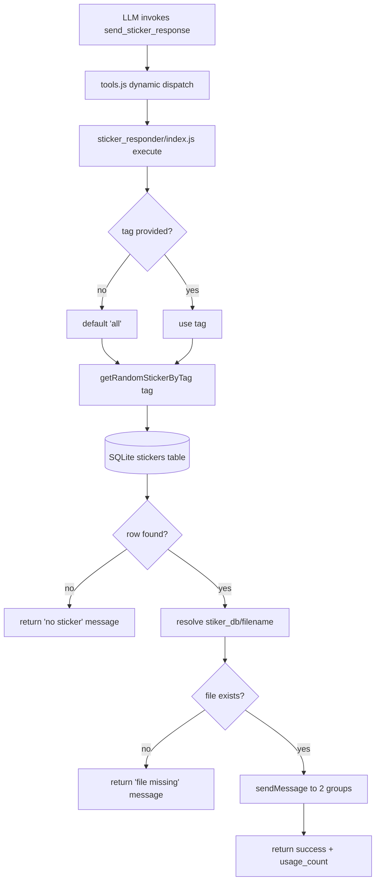

The Sticker Responder Skill enables the Speaki bot to reply to conversations by dispatching a randomly selected expression/meme sticker from a local SQLite-backed library to predefined WhatsApp groups. This page documents the skill's function schema, execution flow, database coupling, and failure semantics. It is scoped strictly to the `skills/sticker_responder/` module and its direct dependencies; for the broader plugin mechanism, see [Skills Architecture and SKILL.md Convention](12-skills-architecture-and-skill-md-convention) and [Tool Integration Framework (tools.js)](10-tool-integration-framework-tools-js).

## Function Schema and Invocation Contract

The skill exposes a single OpenAI-style function tool named `send_sticker_response`, declared as a JSON schema block inside `SKILL.md`. The schema defines one optional parameter, `tag`, constrained to the enum `["all", "ketus", "lucu", "datar", "kaget"]`. When `tag` is omitted, the skill defaults to `'all'`, which permits selection across every category. The description instructs the model to send a random local sticker to the current WhatsApp chat as an expressive response.

The dynamic loader in `tools.js` extracts this JSON block from `SKILL.md` via a regex match on the first ```json ... ``` fence, parses it, and registers the schema into the model's available tool list while mapping the function name to the skill's `index.js` path. This means the schema in `SKILL.md` is the single source of truth for how the LLM perceives and invokes the skill.

Sources: [SKILL.md](skills/sticker_responder/SKILL.md#L5-L24) [tools.js](tools.js#L52-L65)

## Execution Flow and Target Resolution

The skill's `execute(args, sock)` entry point is invoked by the dynamic dispatch branch in `tools.js` when no static tool matches the requested function name. Execution proceeds through a deterministic sequence: the requested tag is normalized (defaulting to `'all'`), a random sticker row is fetched from the database, the physical `.webp` file is resolved against the working directory, and the binary is transmitted to a fixed set of target group JIDs.

The target groups are hardcoded inside `index.js` as two WhatsApp group identifiers: `120363407159758205@g.us` (Grup Manhwa) and `120363322107836319@g.us` (Grup Punini). The sticker is sent to both groups in a sequential loop, with per-target error isolation so that a failure delivering to one group does not abort delivery to the other. The `sock` object is the Baileys socket instance passed through from the runtime, used to call `sock.sendMessage` with a `sticker` payload containing the raw file buffer.

Sources: [index.js](skills/sticker_responder/index.js#L8-L16) [index.js](skills/sticker_responder/index.js#L32-L40) [tools.js](tools.js#L917-L930)

## Database Coupling and Selection Logic

Sticker selection is delegated to `getRandomStickerByTag(tag)` in `database_db.js`, which queries the `stickers` table. When the tag is `'all'`, `'random'`, or falsy, the query selects across all rows; otherwise it filters `WHERE tag = ?`. The result is ordered by `ORDER BY RANDOM() LIMIT 1`, yielding a single uniformly random row for the requested category. Crucially, the same call increments that row's `usage_count` via an `UPDATE` statement, so selection and usage-statistics tracking are atomic within one database session.

The `stickers` table schema (`id`, `filename`, `tag`, `added_by`, `usage_count`, `created_at`) is defined in `database_db.js`. The `filename` column holds the relative path component used by the skill to locate the physical asset. The skill resolves the absolute path as `path.join(process.cwd(), 'stiker_db', stickerRow.filename)`, meaning stickers must reside under a `stiker_db/` directory at the bot's working root. The database itself lives at `speaki.db` in the working directory.

Sources: [database_db.js](database_db.js#L17-L24) [database_db.js](database_db.js#L58-L95) [index.js](skills/sticker_responder/index.js#L25)

## Failure Modes and Return Semantics

The skill is defensive at every boundary and returns human-readable Indonesian status strings rather than throwing. Four distinct failure states are handled: (1) no sticker row returned for the tag — instructs the user to send a sticker to the bot first; (2) the physical `.webp` file is missing on disk despite a database record; (3) a per-target send error, logged but non-fatal to other targets; and (4) an unexpected exception in the try block, surfaced via `e.message`. On success, it returns a confirmation string including the filename, tag, and the post-increment usage count (`stickerRow.usage_count + 1`).

Sources: [index.js](skills/sticker_responder/index.js#L18-L45)

## Architectural Summary

The diagram below traces the end-to-end path from model invocation to sticker delivery, highlighting the three collaborating modules and the two failure-check boundaries.



The following table summarizes the skill's key configuration and behavioral parameters:

| Aspect | Value / Behavior |
| --- | --- |
| Function name | `send_sticker_response` |
| Optional parameter | `tag` ∈ `all, ketus, lucu, datar, kaget` |
| Default tag | `all` (random across categories) |
| Target groups | `120363407159758205@g.us`, `120363322107836319@g.us` |
| Sticker storage | `stiker_db/<filename>` under `process.cwd()` |
| Database | `speaki.db` → `stickers` table |
| Selection | `ORDER BY RANDOM() LIMIT 1` |
| Side effect | Increments `usage_count` on selected row |
| Error strategy | Returns status string; per-target isolation |

## Relationship to the Skills System

This skill is a canonical example of the dynamic skill pattern: a `SKILL.md` schema plus an `index.js` exporting `execute(args, sock)`. It depends on the shared `database_db.js` helper rather than managing its own persistence, and it receives the Baileys `sock` through the standard dispatch contract. To understand how the loader discovers and registers this module, refer to [Skills Architecture and SKILL.md Convention](12-skills-architecture-and-skill-md-convention); for the dispatch and static-tool context, see [Tool Integration Framework (tools.js)](10-tool-integration-framework-tools-js); and for the underlying Baileys messaging primitives, see [Baileys WhatsApp Integration](11-baileys-whatsapp-integration).