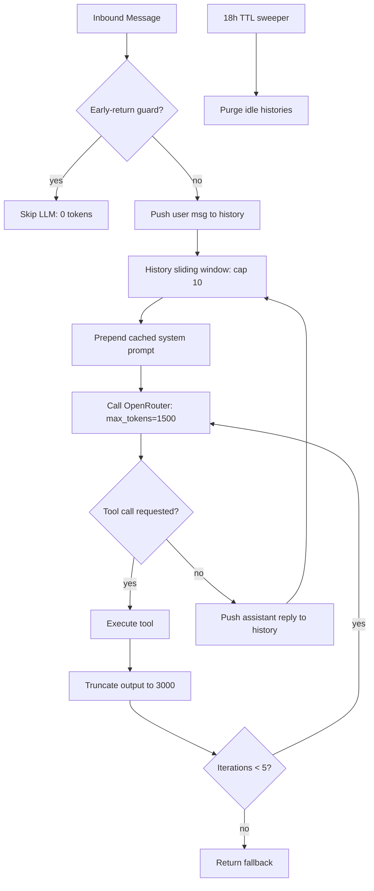

This page documents the deliberate engineering decisions in **Supikip (Speaki)** that minimize token consumption across the OpenRouter LLM lifecycle — from system-prompt construction and per-turn history management to tool-output truncation and background-process suppression. These mechanisms are concentrated in `bot-speaki.js` and reinforced by disciplined file-keeping conventions. The objective is to reduce both input and output token volume without degrading conversational coherence, directly lowering API cost and latency.

## System Prompt Construction and Caching

The system instruction is assembled once per process cycle from a fixed, minimal set of markdown files rather than embedding persona instructions inline in code. The `getSystemInstruction()` function reads only `CORE_IDENTITY.md` and `TOOLS.md`, concatenating them under a single structural wrapper so the LLM receives one consolidated identity block instead of redundant, scattered directives.

To avoid re-reading and re-serializing those files on every chat turn, the function implements an in-memory cache guarded by a time-to-live window. A cached instruction is reused if it was produced within the last five minutes (`CACHE_TTL_MS = 5 * 60 * 1000`). This collapses repeated disk I/O and prompt re-assembly into a single operation per five-minute window, keeping the system-prompt token cost amortized across potentially hundreds of requests.

Sources: [bot-speaki.js](bot-speaki.js#L377-L420)

## Per-Turn History Management (Sliding Window)

Conversation state is stored per chat room in a `Map` keyed by JID (`chatHistories`), each entry holding a `messages` array and a `lastAccessed` timestamp. The bot does not retain unbounded dialogue context. After every user message and every assistant reply, the history is capped at **10 messages** via a `while (history.length > 10) history.shift()` eviction at both the user-ingest path and the assistant-reply path.

This sliding window guarantees a deterministic upper bound on input-token growth from conversational memory. The system instruction is prepended fresh on each request (`currentMessages = [system, ...history]`), so only the most recent 10 exchanges ever enter the model context, preventing context-window saturation from long-running threads.

Sources: [bot-speaki.js](bot-speaki.js#L371-L372) · [bot-speaki.js](bot-speaki.js#L461-L464) · [bot-speaki.js](bot-speaki.js#L533-L535) · [bot-speaki.js](bot-speaki.js#L828-L843)

## Output Token Caps and Generation Loop Boundaries

Two distinct ceilings constrain output volume. The `max_tokens` parameter sent to OpenRouter is fixed at **1500** per request. This hard limit prevents runaway or looping generation that would otherwise inflate completion cost unpredictably, and it forces the model to be concise — aligned with the bot's configured "blunt, concise" persona.

Separately, the tool-calling loop is bounded by `maxIterations = 5`. Because tool outputs are re-injected into `currentMessages` and fed back to the model for each subsequent iteration, an unbounded loop would compound both input and output tokens each round. Capping iterations at five prevents chained-tool escalation from exhausting the budget, returning a fallback message if the limit is exceeded.

Sources: [bot-speaki.js](bot-speaki.js#L467-L484) · [bot-speaki.js](bot-speaki.js#L544)

## Tool Output Truncation

Tool results frequently return large payloads (web scrape text, OCR extractions, API responses). The `truncateOutput(text, maxLength = 3000)` helper caps any tool result at 3000 characters, appending a `[Output dipotong karena terlalu panjang untuk efisiensi token]` marker. Because tool outputs are inserted back into `currentMessages` and consumed by subsequent model iterations, truncation protects the input-token budget of every follow-up request in a tool chain — not just the current one.

Sources: [bot-speaki.js](bot-speaki.js#L428-L437) · [bot-speaki.js](bot#L515-L516)

## Background Process Suppression (Heartbeat and Early Returns)

Token efficiency extends to *when* the LLM is invoked. The `HEARTBEAT.md` convention keeps the file empty (comments-only) so that `checkHeartbeat()` finds no real content and skips the scheduled API call entirely — the HTML-comment stripper (`replace(/<!--[\s\S]*?-->/g, '')`) ensures comments never count as actionable tasks. This design lets operators disable periodic LLM evaluation through a pure file-state signal rather than code changes.

Additionally, the inbound message handler includes an early-return guard that halts the LLM completion flow for non-actionable inputs, explicitly documented in-code as "menghemat token & meminimalkan noise" (saving tokens and minimizing noise). Suppressing unnecessary model calls at the entry point is the cheapest possible optimization — zero tokens spent.

Sources: [HEARTBEAT.md](HEARTBEAT.md#L1-L6) · [bot-speaki.js](bot-speaki.js#L238-L245) · [bot-speaki.js](bot-speaki.js#L822-L824)

## Chat History TTL Eviction

Beyond the per-thread 10-message cap, an idle-conversation sweeper runs every 18 hours and deletes any chat-history entry whose `lastAccessed` timestamp is older than 18 hours (`TTL_DURATION = 18 * 60 * 60 * 1000`). This bounds total memory and ensures that stale, unused contexts are fully purged rather than lingering in the `Map`. Combined with the sliding window, this yields a two-tier containment: short-term (message count) and long-term (idle age).

Sources: [bot-speaki.js](bot-speaki.js#L639-L652)

## External Fetch Latency Guard

While not an LLM-token mechanism, the Shinigami scraper applies an 800ms `AbortSignal.timeout` to every outbound HTTP fetch. By failing fast on slow upstreams, the bot avoids blocking the event loop and prevents wasted cycles that would delay or multiply API-driven operations. The 800ms constant is defined once and reused across all scraper fetch calls for consistent, bounded external I/O.

Sources: [bot-speaki.js](bot-speaki.js#L18) · [bot-speaki.js](bot-speaki.js#L40-L135)

## Strategy Summary

The table below consolidates every token-efficiency control with its enforcement layer and primary effect.

| Mechanism | Location | Bound / Value | Layer | Primary Effect |
|---|---|---|---|---|
| System-prompt cache | `getSystemInstruction()` | 5-min TTL | Input | Amortizes prompt assembly I/O |
| Per-thread history cap | ingest + reply paths | 10 messages | Input | Bounds contextual memory growth |
| `max_tokens` cap | OpenRouter request | 1500 | Output | Prevents runaway generation |
| Tool-call loop cap | `getOpenRouterResponse()` | 5 iterations | Input+Output | Contains chained-tool escalation |
| Tool output truncation | `truncateOutput()` | 3000 chars | Input | Protects follow-up request budgets |
| Heartbeat suppression | `HEARTBEAT.md` empty | N/A (skips call) | Invocation | Zero tokens when no task |
| Early-return guard | message handler | N/A (skips call) | Invocation | Avoids unnecessary LLM calls |
| History TTL eviction | 18h sweeper | 18 hours idle | Memory | Purges stale contexts |

Sources: [bot-speaki.js](bot-speaki.js#L377-L652)

## Architectural Relationship

The following diagram maps how each optimization acts on the LLM request lifecycle, showing where tokens are constrained before, during, and after a call.

Sources: [bot-speaki.js](bot-speaki.js#L443-L549) · [bot-speaki.js](bot-speaki.js#L639-L652)

## Maintenance Conventions

Token discipline is reinforced by human-facing file conventions. `MEMORY.md` carries an explicit self-mandate to remain "pruned, structured, and strictly under 30 lines," because that file's content influences the broader system context the operator maintains. `TOOLS.md` is intentionally terse (contact list only), and `CORE_IDENTITY.md` is loaded wholesale by design — the efficiency gain comes from caching and bounded history, not from shrinking these files. The strategy is therefore a combination of automated runtime caps and operator-level brevity discipline.

Sources: [MEMORY.md](MEMORY.md#L43) · [TOOLS.md](TOOLS.md#L1-L10)

## Related Pages

For the runtime mechanics that exercise these caps, see [Architecture and Entry Point (bot-speaki.js)](8-architecture-and-entry-point-bot-speaki-js). The tool-call path and `toolsSchema` are detailed in [Tool Integration Framework (tools.js)](10-tool-integration-framework-tools-js). Scheduled invocation patterns that trigger (or skip) LLM calls are covered in [Heartbeat and Scheduling Mechanism](7-heartbeat-and-scheduling-mechanism), and quota-aware API usage is tracked in [SerpApi Quota Monitoring and Configuration](18-serpapi-quota-monitoring-and-configuration).