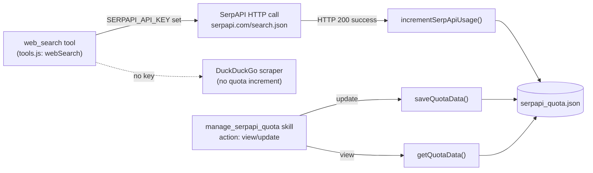
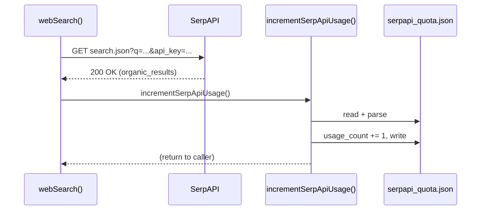
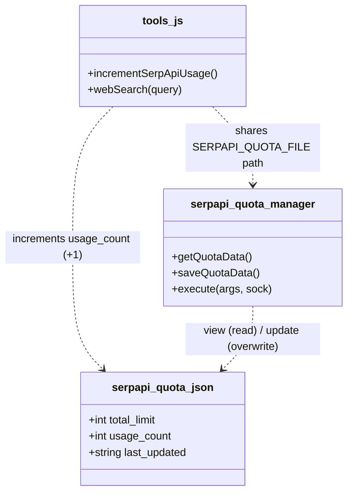

This page documents the SerpApi web-search quota subsystem in Supikip: how usage is tracked, where the state lives, how it is manually inspected and reconfigured, and the configuration surface (`SERPAPI_API_KEY`, monthly limit) that governs it. The subsystem is deliberately lightweight — it is an **estimation and observability layer**, not a request-blocking gate. Its purpose is to give the operator a running view of how many SerpAPI searches have been consumed against a configured monthly cap. For the surrounding tool framework that hosts `web_search`, see [Tool Integration Framework (tools.js)](10-tool-integration-framework-tools-js); for the skill loading convention, see [Skills Architecture and SKILL.md Convention](12-skills-architecture-and-skill-md-convention).

## Architectural Overview

The quota system is built around a single source of truth — the `serpapi_quota.json` file at the project root (`process.cwd()`) — and two independent writers that mutate it. The first writer, `incrementSerpApiUsage()` in `tools.js`, fires automatically after every successful SerpAPI-backed web search. The second writer is the `manage_serpapi_quota` skill, which lets the LLM/operator read the current state (`view`) or overwrite the counters (`update`). The diagram below maps the data flow; note that the fallback DuckDuckGo path bypasses SerpAPI entirely and therefore never touches the quota file.

The file path is declared identically in both modules: `tools.js` binds `SERPAPI_QUOTA_FILE` and the skill binds the same constant, guaranteeing both writers target the exact same artifact. Because both use synchronous `fs` calls, each read-modify-write completes atomically within a single event-loop tick, but the two writers can still clobber each other's values across ticks (see Limitations).

Sources: [tools.js](tools.js#L16) [tools.js](tools.js#L18-L30) [tools.js](tools.js#L381-L392) [skills/serpapi_quota_manager/index.js](skills/serpapi_quota_manager/index.js#L4) [skills/serpapi_quota_manager/index.js](skills/serpapi_quota_manager/index.js#L6-L20)

## The State File: serpapi_quota.json

The state file is a flat JSON object with three keys. On disk it currently holds a configured monthly limit of `250` and a consumed count of `140`, last written on `2026-07-16`. The `remaining` value shown to users is never stored — it is always derived at read time as `Math.max(0, total_limit - usage_count)`, so it can never report a negative balance.

| Field | Type | Meaning | Default if file absent |
|-------|------|---------|------------------------|
| `total_limit` | integer | Configured monthly SerpAPI search cap | `100` |
| `usage_count` | integer | Number of SerpAPI searches consumed | `0` |
| `last_updated` | string (ISO-8601) | Timestamp of last mutation | `new Date().toISOString()` |

Both `getQuotaData()` (skill) and `incrementSerpApiUsage()` (tools) share the **same default object** `{ total_limit: 100, usage_count: 0, last_updated: <now> }`. This is why a freshly cloned repository that has never searched the web will report a `100` cap until the operator raises it via the skill or the file is edited directly. The `last_updated` field is refreshed on every successful write, giving the operator a weak staleness signal.

Sources: [serpapi_quota.json](serpapi_quota.json#L1-L5) [skills/serpapi_quota_manager/index.js](skills/serpapi_quota_manager/index.js#L7) [skills/serpapi_quota_manager/index.js#L36) [skills/serpapi_quota_manager/index.js#L44) [tools.js](tools.js#L20)

## Automatic Tracking: incrementSerpApiUsage()

The automatic writer is `incrementSerpApiUsage()` in `tools.js`. It is invoked only on the success branch of `webSearch()` — specifically immediately after a `200 OK` response from `https://serpapi.com/search.json`. Its logic is a defensive read-modify-write: it reads the existing file (falling back to the default object if absent), increments `usage_count` by exactly one, stamps `last_updated`, and writes the file back with two-space indentation. Any filesystem or parse failure is swallowed and logged to stderr via `[SerpAPI Quota] Gagal memperbarui quota:` — the search result is still returned to the user even if the quota bookkeeping fails.

Crucially, the increment is **post-hoc**: `webSearch()` does not consult the quota before issuing the request, and there is no short-circuit when `usage_count >= total_limit`. This confirms the subsystem's nature as monitoring-only. The DuckDuckGo fallback path (taken when `SERPAPI_API_KEY` is unset) returns early and never calls `incrementSerpApiUsage()`, so fallback searches are invisible to the quota counter.

Sources: [tools.js](tools.js#L18-L30) [tools.js](tools.js#L381-L392)

## Manual Monitoring & Configuration: manage_serpapi_quota

The `manage_serpapi_quota` skill (`skills/serpapi_quota_manager`) exposes the quota to the LLM/operator through a single OpenAI-style function schema with one required parameter, `action`, and two optional parameters used only on `update`. The skill's `execute(args, sock)` dispatches on `action`; the default branch (any non-`update` value, including `view`) simply reads and reports.

| Parameter | Type | Required | Used by | Description |
|-----------|------|----------|---------|-------------|
| `action` | string enum `view` \| `update` | yes | both | `view` renders current state; `update` overwrites counters |
| `usage_count` | integer | no | `update` only | Absolute new value for consumed searches (overwrites, not increments) |
| `total_limit` | integer | no | `update` only | Absolute new monthly cap |

On `update`, the skill reads the current object, applies whichever of `usage_count`/`total_limit` were supplied (leaving the other untouched), refreshes `last_updated`, and persists via `saveQuotaData()`. It then returns a confirmation card showing the new usage, limit, and `remaining`. The `view` (default) branch returns a status card with the same four fields. Both cards are formatted in Indonesian with emoji and use `id-ID` locale for the timestamp, consistent with the rest of the bot's user-facing output.

Sources: [skills/serpapi_quota_manager/SKILL.md](skills/serpapi_quota_manager/SKILL.md#L1-L32) [skills/serpapi_quota_manager/index.js](skills/serpapi_quota_manager/index.js#L22-L50) [PANDUAN_BOT.md](PANDUAN_BOT.md#L85-L87)

## Configuration Surface: Key and Limit

Two configuration inputs govern the subsystem. The `SERPAPI_API_KEY` environment variable (loaded via `dotenv` in `tools.js`) is the master switch for SerpAPI usage: when present, `webSearch()` calls SerpAPI and increments the quota; when absent, it silently falls back to DuckDuckGo and the quota is never touched. The monthly cap, `total_limit`, is not an environment variable — it lives only inside `serpapi_quota.json` and defaults to `100` if the file is missing. To raise the cap, the operator either edits the file directly or invokes `manage_serpapi_quota` with `action: update` and the desired `total_limit`. There is no environment hook to set the limit at boot.

| Input | Source | Effect when unset | How to change |
|-------|--------|-------------------|---------------|
| `SERPAPI_API_KEY` | `.env` | DuckDuckGo fallback; quota idle | Set in `.env` |
| `total_limit` | `serpapi_quota.json` | Defaults to `100` | Edit file or `update` action |
| `usage_count` | `serpapi_quota.json` | Defaults to `0` | Auto-incremented or `update` action |

Sources: [tools.js](tools.js#L383-L387) [.zread/wiki/drafts/2-quick-start.md](.zread/wiki/drafts/2-quick-start.md#L23) [skills/serpapi_quota_manager/index.js](skills/serpapi_quota_manager/index.js#L30-L32)

## Behavioral Characteristics and Limitations

Understanding the following properties is essential for operating the subsystem correctly. The table contrasts the two writers and highlights edge cases that an operator should account for.

| Aspect | `incrementSerpApiUsage()` (tools.js) | `manage_serpapi_quota` `update` (skill) |
|--------|--------------------------------------|------------------------------------------|
| Trigger | Automatic, post-success of SerpAPI call | Manual, LLM/operator-initiated |
| Mutation | Adds `+1` to `usage_count` | **Overwrites** `usage_count`/`total_limit` with supplied value |
| Write mode | `fs.writeFileSync` (sync) | `fs.writeFileSync` (sync, via `saveQuotaData`) |
| Failure handling | Logs and continues (search still returns) | Logs parse error, returns default object in memory |
| Scope | Only when `SERPAPI_API_KEY` set | Always available |

Three limitations follow directly from the implementation. **First, no enforcement**: because `webSearch()` never gates on `usage_count >= total_limit`, the operator is responsible for watching the remaining balance and rotating keys or pausing searches manually. **Second, overwrite semantics on `update`**: supplying `usage_count` during an `update` replaces the counter rather than incrementing it, so a concurrent automatic increment that happened in another tick can be silently discarded. **Third, parse-error fallback**: if `serpapi_quota.json` is malformed, `getQuotaData()` logs the error and returns a fresh in-memory default `{ total_limit: 100, usage_count: 0 }` without repairing the file, so the next `incrementSerpApiUsage()` write could overwrite a corrupted-but-recoverable file with defaults. The `remaining` floor of `0` (via `Math.max`) means overage is reported as "0 remaining" rather than a negative number, masking the true extent of any over-consumption.

Sources: [tools.js](tools.js#L18-L30) [skills/serpapi_quota_manager/index.js](skills/serpapi_quota_manager/index.js#L6-L16) [skills/serpapi_quota_manager/index.js#L26-L41) [skills/serpapi_quota_manager/index.js#L44)

## Module Interaction Summary

The class/module interaction diagram below consolidates the two writers and the shared state, making explicit which function owns which mutation path. This is the canonical mental model for debugging quota discrepancies.

## Next Steps

You now understand the quota tracking and configuration surface end-to-end. To see where `web_search` and its quota increment actually sit within the broader tool catalogue, read [Tool Integration Framework (tools.js)](10-tool-integration-framework-tools-js). To understand how the `manage_serpapi_quota` schema is discovered and merged into the LLM tool set at boot, consult [Skills Architecture and SKILL.md Convention](12-skills-architecture-and-skill-md-convention); the skill's dedicated behavior page is [SerpApi Quota Manager Skill](15-serpapi-quota-manager-skill). For the token-budget rationale behind truncating and gating external calls, see [Token Efficiency Optimization Strategy](17-token-efficiency-optimization-strategy).