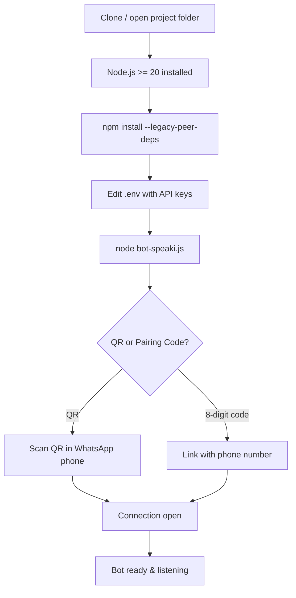
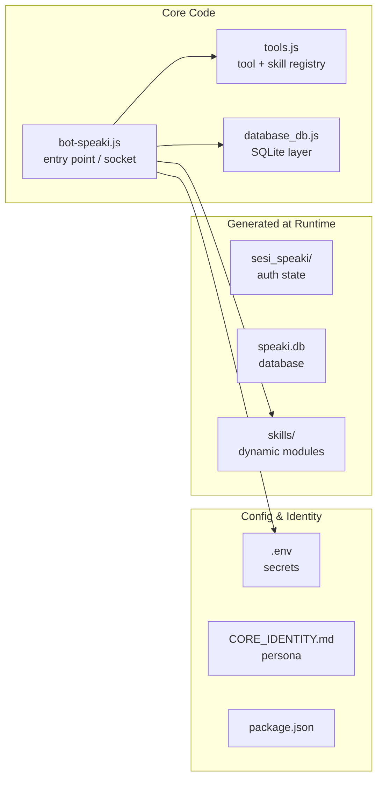

This page gets a developer from zero to a running **Speaki** WhatsApp bot in the shortest reliable path. Speaki is a standalone Node.js application that connects to WhatsApp through the Baileys library, uses an LLM (OpenRouter) for conversational intelligence, and extends its capabilities through a dynamic skills system. By the end of this guide you will have installed dependencies, configured your environment, started the bot, and linked it to a WhatsApp account. For the conceptual background on what Speaki is and why it is built this way, see [Overview](1-overview).

Sources: [package.json](package.json#L1-L15) [PANDUAN_BOT.md](PANDUAN_BOT.md#L1-L3)

## What You Need Before Starting

Speaki has a small but non-negotiable set of prerequisites. The most important is the Node.js runtime version: Baileys v7 requires **Node.js 20.0.0 or higher**. NPM ships with Node.js, so no separate package manager installation is needed. You will also need an OpenRouter API key, because the bot's conversational brain is an LLM accessed through OpenRouter. Finally, you need a WhatsApp account on a phone to scan the pairing QR code during first launch.

Sources: [PANDUAN_BOT.md](PANDUAN_BOT.md#L7-L9) [bot-speaki.js](bot-speaki.js#L15-L16)

The table below summarizes every environment variable the bot reads and what happens if you omit it. These values live in the `.env` file at the project root.

| Variable | Purpose | Default if unset |
|---|---|---|
| `OPENROUTER_API_KEY` | Authenticates LLM requests to OpenRouter | None (required for chat) |
| `MODEL_NAME` | LLM model identifier | `google/gemini-2.5-flash-lite` |
| `HERMES_API_KEY` | Local Hermes API gateway secret | None |
| `HERMES_ENDPOINT` | Local Hermes chat completions URL | None |
| `MANHWA_GROUP_JID` | Target group for manhwa update pushes | `120363407159758205@g.us` |
| `MANHWA_CHECK_INTERVAL` | Scraper poll interval (ms) | `900000` (15 min) |
| `BOT_NUMBER` | Phone number used for pairing code | `6283891270115` |
| `OWNER_NUMBER` | Admin/owner phone for privileged ops | None |
| `SERPAPI_API_KEY` | Key for web search via SerpApi | None |

Sources: [.env](.env#L1-L25) [bot-speaki.js](bot-speaki.js#L15-L25) [bot-speaki.js](bot-speaki.js#L578) [tools.js](tools.js#L383)

## Step-by-Step: From Clone to Connected

The startup sequence follows a strict order because the authentication session must be created interactively before the bot can run unattended. The flowchart below maps the exact path; each step is explained in the prose that follows.

Sources: [PANDUAN_BOT.md](PANDUAN_BOT.md#L32-L51) [bot-speaki.js](bot-speaki.js#L554-L620)

**Step 1 — Install dependencies.** From the project root, run `npm install --legacy-peer-deps`. The `--legacy-peer-deps` flag is required because the pinned Baileys build (`@itsliaaa/baileys`, loaded locally from `./baileys`) has peer-dependency constraints that the default resolver rejects. The full dependency set is declared in `package.json` and includes `node-cron`, `pdf-parse`, `qrcode-terminal`, and `sqlite3`.

Sources: [PANDUAN_BOT.md](PANDUAN_BOT.md#L34-L39) [package.json](package.json#L6-L13)

**Step 2 — Configure the environment.** Open `.env` in a text editor and supply at minimum your `OPENROUTER_API_KEY`. The model defaults to `google/gemini-2.5-flash-lite` but can be overridden via `MODEL_NAME`. Without a valid OpenRouter key the bot will connect to WhatsApp but cannot generate intelligent replies.

Sources: [PANDUAN_BOT.md](PANDUAN_BOT.md#L41-L42) [.env](.env#L1-L5) [bot-speaki.js](bot-speaki.js#L15-L16)

**Step 3 — Start the bot interactively.** Run `node bot-speaki.js`. The entry point calls `startBot()`, which establishes a multi-file auth state stored in the `sesi_speaki/` folder and prints connection events to the terminal.

Sources: [PANDUAN_BOT.md](PANDUAN_BOT.md#L44-L48) [bot-speaki.js](bot-speaki.js#L554-L565)

**Step 4 — Link to WhatsApp.** On first launch the bot offers two linking methods. If a QR code appears, open WhatsApp on your phone → Linked Devices → Link a Device and scan it. If instead an 8-digit pairing code is printed, open WhatsApp → Linked Devices → Link with Phone Number and enter the code. The phone number used for pairing is taken from `BOT_NUMBER` (falling back to `OWNER_NUMBER`). Once `connection === 'open'`, the bot is fully operational.

Sources: [PANDUAN_BOT.md](PANDUAN_BOT.md#L50-L51) [bot-speaki.js](bot-speaki.js#L576-L620)

## Project Layout You Should Recognize

Understanding the on-disk layout helps you navigate later. The diagram below shows the files that matter for a first run; runtime state folders (`sesi_speaki/`, `speaki.db`, `stiker_db/`) are generated automatically and intentionally excluded from version control.

Sources: [PANDUAN_BOT.md](PANDUAN_BOT.md#L13-L28) [.gitignore](.gitignore#L1-L22)

## From First Run to Production

The instructions above run the bot in the foreground, which is ideal for verification but not for long-term operation. Once you have confirmed a successful QR/pairing login (so that `sesi_speaki/` exists), you can promote the bot to a background systemd daemon that survives reboots and crashes. That process is detailed in [Bot Runtime Setup and Daemon Deployment](4-bot-runtime-setup-and-daemon-deployment). Critically, do **not** skip the interactive scan step — a daemon prints its QR to background logs where you cannot scan it, so the session must exist first.

Sources: [DAEMON_SETUP.md](DAEMON_SETUP.md#L7-L12) [bot-speaki.js](bot-speaki.js#L558)

## Where to Go Next

You now have a connected, conversational bot. The recommended reading progression builds from identity to mechanics to internals:

- Understand the bot's personality and design intent in [Project Identity and Core Philosophy](3-project-identity-and-core-philosophy).
- Learn how to talk to the bot and what commands exist in [User Interaction and Command Guide](5-user-interaction-and-command-guide).
- Study the entry-point architecture in [Architecture and Entry Point (bot-speaki.js)](8-architecture-and-entry-point-bot-speaki-js).
- Explore the extensible capability modules in [Skills Architecture and SKILL.md Convention](12-skills-architecture-and-skill-md-convention).