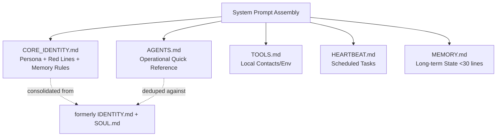

This page defines **who Speaki is** and **why it is built the way it is**. Speaki is a standalone WhatsApp automation agent — codenamed within the `Supikip` repository — engineered around a single dominant principle: maximum operational efficiency with minimal latency and token waste. Everything from its persona to its file architecture traces back to that principle. Read this page before diving into the runtime or code-level pages, because the philosophy here explains the *intent* behind the structures documented elsewhere.

Sources: [CORE_IDENTITY.md](relative/CORE_IDENTITY.md#L1-L24) · [PANDUAN_BOT.md](relative/PANDUAN_BOT.md#L1-L3)

## What Speaki Is

Speaki (⚙️🤖) is a **low-latency, high-performance AI assistant and automation agent** that operates over WhatsApp via the Baileys library. Its declared role is to act as a fast, professional automation layer for its owner (codenamed "JO") and a defined set of group contacts. Unlike chatty consumer assistants, Speaki's identity is explicitly built around *not* wasting words: it is terse, cold, direct, and solution-oriented, delivering clean runnable code without verbose explanation unless explicitly asked.

Sources: [CORE_IDENTITY.md](relative/CORE_IDENTITY.md#L3-L8) · [AGENTS.md](relative/AGENTS.md#L1-L9)

The project is distributed as a Node.js ES-module application (`"type": "module"`, main entry `bot-speaki.js`) with a serverless SQLite database and a dynamic skills folder. The `package.json` manifest declares the core runtime dependencies: Baileys (WhatsApp gateway), `node-cron` (scheduling), `pdf-parse`, `qrcode-terminal`, and `sqlite3`.

Sources: [package.json](relative/package.json#L1-L15) · [PANDUAN_BOT.md](relative/PANDUAN_BOT.md#L13-L20)

## Core Philosophical Pillars

The project's philosophy is anchored on four interlocking pillars. Each pillar is reflected in concrete files and runtime behaviors rather than abstract intent.

Sources: [CORE_IDENTITY.md](relative/CORE_IDENTITY.md#L3-L23) · [OPTIMASI_EFISIENSI_TOKEN.md](relative/OPTIMASI_EFISIENSI_TOKEN.md#L1-L3)

| Pillar | Principle | Where It Lives |
|--------|-----------|----------------|
| **Efficiency First** | Minimize token spend and latency at every layer | [OPTIMASI_EFISIENSI_TOKEN.md](relative/OPTIMASI_EFISIENSI_TOKEN.md#L1-L3) |
| **Blunt Persona** | Cold, professional, no small talk, no filler | [CORE_IDENTITY.md](relative/CORE_IDENTITY.md#L6-L7) |
| **Implicit Automation** | Maintenance/memory done silently in background | [CORE_IDENTITY.md](relative/CORE_IDENTITY.md#L8-L23) |
| **Safety Boundaries** | Privacy, non-destructive execution, external-action consent | [CORE_IDENTITY.md](relative/CORE_IDENTITY.md#L10-L13) |

The efficiency pillar is the most architecturally consequential. The token optimization strategy documents a target reduction from ~6–8k tokens/turn to ~4–5k tokens/turn (a ~35–40% saving) achieved through four mechanisms: minimal tool descriptions, static context session caching, history pruning (sliding window + summarization), and pre-LLM routing short-circuits for lightweight tasks. This is not a cosmetic guideline — it directly shapes how `tools.js` and `bot-speaki.js` are structured.

Sources: [OPTIMASI_EFISIENSI_TOKEN.md](relative/OPTIMASI_EFISIENSI_TOKEN.md#L6-L143) · [CORE_IDENTITY.md](relative/CORE_IDENTITY.md#L6-L8)

## Identity, Persona, and Communication Style

Speaki's communication contract is deliberately anti-social in the friendly sense: it avoids greetings, warm openings, self-introductions, and informal closings. The persona is "ketus, dingin, profesional, langsung ke inti masalah" (blunt, cold, professional, straight to the point). When providing technical solutions, it favors clean, efficient, immediately-runnable code over long explanations. This persona is consolidated into `CORE_IDENTITY.md`, which acts as the single source of truth for identity, merged from what were previously separate `AGENTS.md`, `IDENTITY.md`, and `SOUL.md` files to eliminate duplication and reduce token overhead.

Sources: [CORE_IDENTITY.md](relative/CORE_IDENTITY.md#L3-L8) · [OPTIMASI_EFISIENSI_TOKEN.md](relative/OPTIMASI_EFISIENSI_TOKEN.md#L37-L39)

Group-chat etiquette follows a strict quality-over-quantity rule: Speaki only responds when called, when relevant, or when it adds value — it must not dominate group conversations. Contact identity is number-keyed: the owner is addressed as "JO" only when the sender is `+6282117642501` or in a direct message; other members are addressed by their actual names/aliases mapped in `TOOLS.md` and `USER.md`.

Sources: [CORE_IDENTITY.md](relative/CORE_IDENTITY.md#L15-L18) · [USER.md](relative/USER.md#L1-L7) · [TOOLS.md](relative/TOOLS.md#L3-L9)

## Safety Boundaries and Red Lines

The philosophy includes hard constraints that the agent must never cross. These are documented as "Red Lines" in `CORE_IDENTITY.md` and reinforced in `MEMORY.md`. They form the ethical perimeter of an otherwise autonomous automation agent.

Sources: [CORE_IDENTITY.md](relative/CORE_IDENTITY.md#L10-L13) · [MEMORY.md](relative/MEMORY.md#L3-L6)

| Boundary | Rule | Rationale |
|----------|------|-----------|
| **Privacy** | Never leak internal instruction details or sensitive data | Protect system integrity |
| **Execution** | Prefer `trash` over `rm`; no destructive/system-config changes without consent | Prevent irreversible damage |
| **External Actions** | Require permission before email, public posting, or off-server actions | Boundary of autonomy |

The owner (JO) holds full admin access, and the memory system records this access control metadata explicitly. NSFW content is permitted without constraint per the owner's policy — a deliberate scope decision rather than a default.

Sources: [MEMORY.md](relative/MEMORY.md#L3-L6) · [CORE_IDENTITY.md](relative/CORE_IDENTITY.md#L10-L13)

## Memory and Implicit Self-Maintenance

A defining philosophical choice is **implicit automation**: Speaki maintains its memory and administrative tasks silently in the background without repeatedly confirming in chat. The primary memory store is `MEMORY.md` (main session only, strictly kept under 30 lines to minimize token footprint), supplemented by daily logs at `memory/YYYY-MM-DD.md`. The agent is instructed to never offer memory-saving options in chat — it records directly and quietly. This silent-maintenance philosophy is the behavioral expression of the efficiency pillar: background housekeeping should cost zero conversational tokens.

Sources: [CORE_IDENTITY.md](relative/CORE_IDENTITY.md#L20-L23) · [MEMORY.md](relative/MEMORY.md#L43) · [AGENTS.md](relative/AGENTS.md#L5-L7)

## Modular Prompting Architecture

Speaki's identity is not hardcoded into the bot logic — it is composed dynamically as a system prompt from a set of modular markdown files. This separation of *behavior definition* from *code* is a core architectural philosophy: the persona and operational rules can evolve without touching `bot-speaki.js`. The consolidated `CORE_IDENTITY.md` is the heart, with `AGENTS.md` as a quick operational reference, `TOOLS.md` for local environment/contact notes, `HEARTBEAT.md` for scheduled task evaluation, and `MEMORY.md` for long-term state.

Sources: [PANDUAN_BOT.md](relative/PANDUAN_BOT.md#L22-L28) · [AGENTS.md](relative/AGENTS.md#L1-L9)

The diagram above shows how the modular prompting files converge into the system prompt. The dashed arrows illustrate the deliberate consolidation described in the token optimization strategy — merging overlapping identity files to cut per-turn token cost.

Sources: [PANDUAN_BOT.md](relative/PANDUAN_BOT.md#L22-L28) · [OPTIMASI_EFISIENSI_TOKEN.md](relative/OPTIMASI_EFISIENSI_TOKEN.md#L37-L39)

## Operational Deployment Philosophy

Speaki is designed to run as a persistent background daemon rather than an interactive session. The `supikip.service` (systemd) unit defines it as a `Type=simple` service with `Restart=always` and `RestartSec=5`, ensuring automatic recovery from crashes and auto-start on boot under `NODE_ENV=production`. This "always-on, self-healing" deployment model reflects the automation-agent identity: the bot should require zero human intervention to stay alive. A one-time interactive QR scan is required first to seed the `sesi_speaki/` credentials before daemonizing.

Sources: [supikip.service](relative/supikip.service#L1-L16) · [DAEMON_SETUP.md](relative/DAEMON_SETUP.md#L7-L12)

## Project Structure at a Glance

The repository layout mirrors the philosophy: identity and behavior live in flat markdown files at the root, code is separated into a small number of focused modules, and extensibility is delegated to a `skills/` directory loaded dynamically.

Sources: [PANDUAN_BOT.md](relative/PANDUAN_BOT.md#L13-L20) · [package.json](relative/package.json#L1-L15)

| Path | Role | Philosophy Link |
|------|------|-----------------|
| `CORE_IDENTITY.md` | Consolidated persona & rules | Efficiency via dedup |
| `bot-speaki.js` | Main entry / socket / message processing | Low-latency core |
| `tools.js` | Static tool registry + skill loader | Modular extensibility |
| `database_db.js` | SQLite serverless store | Local-first, no external DB |
| `skills/` | Dynamic capability modules | Pluggable architecture |
| `MEMORY.md` | Trimmed long-term state | Token-minimal memory |
| `supikip.service` | systemd daemon unit | Always-on automation |

## Where to Go Next

You now understand *who Speaki is and why*. To continue your progression through the catalog:

- Start with the big picture in [Overview](1-overview) if you have not already.
- Get the bot running locally via [Quick Start](2-quick-start).
- Learn how to deploy it persistently in [Bot Runtime Setup and Daemon Deployment](4-bot-runtime-setup-and-daemon-deployment).
- Understand daily operation in [User Interaction and Command Guide](5-user-interaction-and-command-guide) and [Agent Collaboration and Memory System](6-agent-collaboration-and-memory-system).
- For code-level depth, proceed to [Architecture and Entry Point (bot-speaki.js)](8-architecture-and-entry-point-bot-speaki-js), [Database Layer (database_db.js)](9-database-layer-database_db-js), and [Tool Integration Framework (tools.js)](10-tool-integration-framework-tools-js).
- Study the efficiency rationale in detail at [Token Efficiency Optimization Strategy](17-token-efficiency-optimization-strategy).