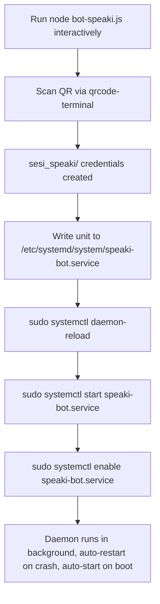

This page documents how the Speaki WhatsApp bot is launched as a long-lived background process and hardened against crashes and reboots using **systemd**. It covers the runtime entry point, the dependency contract, the systemd unit configuration, the mandatory one-time interactive QR pairing step, and the operational commands for managing the live daemon. The material here is scoped strictly to *runtime setup and daemon deployment*; behavioral internals are covered in [Architecture and Entry Point (bot-speaki.js)](8-architecture-and-entry-point-bot-speaki-js) and [Baileys WhatsApp Integration](11-baileys-whatsapp-integration).

## Runtime Entry Point and Module Contract

The bot's runtime begins at `bot-speaki.js`, which `package.json` declares as the package `main` and which is executed directly by the Node binary. The project is an ES module (`"type": "module"`), so the entry point uses `import` syntax rather than `require`. The script loads environment variables via `dotenv.config()` at the top, then imports the Baileys WhatsApp layer, the `pino` logger, `qrcode-terminal` for pairing, the local `tools.js` and `database_db.js` modules, and `node-cron` for scheduling.

The dependency set is small and explicit: `@itsliaaa/baileys` (a local file dependency), `dotenv`, `node-cron`, `pdf-parse`, `qrcode-terminal`, and `sqlite3`. There is no build step — the daemon runs the source directly through Node, which means any edit to `bot-speaki.js` (or `.env`) requires a service restart to take effect.

Sources: [package.json](package.json#L1-L15) · [bot-speaki.js](bot-speaki.js#L1-L25)

## Prerequisite: One-Time Interactive QR Pairing

Before the bot can run unattended as a daemon, the WhatsApp session credentials must exist on disk. The entry point calls `useMultiFileAuthState('sesi_speaki')` to persist the multi-file auth state, and during first connection it renders a QR code to the terminal via `qrcode-terminal` when no registered credentials are present. Because a daemon's stdout is routed to the journal rather than a visible terminal, **you must run the bot interactively once** (`node bot-speaki.js`) to scan the QR code and let the `sesi_speaki/` folder populate. Launching directly as a daemon without this step would print the QR into background logs where it cannot be scanned, leaving the bot unable to authenticate.

The `sesi_speaki` directory is confirmed present in the working directory, indicating the pairing prerequisite has already been satisfied in this deployment. If the session is ever invalidated, the code instructs operators to delete the `sesi_speaki` folder and re-run to re-scan.

Sources: [bot-speaki.js](bot-speaki.js#L557-L596) · [bot-speaki.js](bot-speaki.js#L616) · [DAEMON_SETUP.md](DAEMON_SETUP.md#L7-L12)

## systemd Unit Configuration

The daemon is defined by a systemd service unit. The repository ships a draft at `supikip.service`, while the live deployed unit is installed at `/etc/systemd/system/speaki-bot.service` (confirmed present on the host). Both share the same structural contract, summarized below.

| Directive | Value | Purpose |
|-----------|-------|---------|
| `[Unit] Description` | Speaki WhatsApp Bot Standalone Service | Human-readable service identity |
| `After` | `network.target` | Defer start until networking is up |
| `Type` | `simple` | Process started by `ExecStart` is the main process |
| `User` | `naaklaam` | Run under the non-root owner account |
| `WorkingDirectory` | `/home/naaklaam/Supikip` | Resolve relative paths (e.g. `sesi_speaki`, `.env`) |
| `ExecStart` | `/home/linuxbrew/.linuxbrew/bin/node bot-speaki.js` | Absolute Node path + entry script |
| `Restart` | `always` | Auto-respawn on crash or exit |
| `RestartSec` | `5` | 5-second backoff between restart attempts |
| `Environment` | `NODE_ENV=production` | Production runtime flag |
| `[Install] WantedBy` | `multi-user.target` | Hook into the multi-user boot target |

The `ExecStart` path is **absolute** and points to the Linuxbrew-managed Node (`/home/linuxbrew/.linuxbrew/bin/node`). systemd does not inherit the user's `PATH`, so the exact `which node` output must be used; the draft's placeholder `/usr/bin/node` differs from the deployed Linuxbrew path and must be corrected per host. The `WorkingDirectory` is critical — it is what lets the relative `sesi_speaki` auth folder and the `.env` file resolve correctly at runtime.

Sources: [supikip.service](supikip.service#L1-L16) · [DAEMON_SETUP.md](DAEMON_SETUP.md#L20-L38) · [DAEMON_SETUP.md](DAEMON_SETUP.md#L42-L49)

## Deployment Workflow

The deployment sequence moves the unit from draft to a live, boot-persistent daemon. The flow below reflects the steps documented in `DAEMON_SETUP.md` and the deployment state observed on the host (the `speaki-bot.service` symlink already exists under `multi-user.target.wants`).

The `daemon-reload` step registers the new unit with systemd; `start` launches it immediately under the `simple` type; `enable` creates the `WantedBy=multi-user.target` symlink so the service comes up after every reboot. Because `Restart=always`, a process crash triggers an automatic respawn after the 5-second `RestartSec` delay.

Sources: [DAEMON_SETUP.md](DAEMON_SETUP.md#L53-L80) · [supikip.service](supikip.service#L14-L15)

## Operational Management Commands

Once deployed, the daemon is managed entirely through `systemctl` and `journalctl`. The table below maps each operational need to its command.

| Operation | Command | Notes |
|-----------|---------|-------|
| Check status | `sudo systemctl status speaki-bot.service` | Reports active/error state |
| Live logs | `journalctl -u speaki-bot.service -f` | Follows stdout/stderr (QR would appear here) |
| Stop | `sudo systemctl stop speaki-bot.service` | Graceful termination |
| Restart | `sudo systemctl restart speaki-bot.service` | Required after editing `bot-speaki.js` or `.env` |

The live process is observable in the host's process table: a `node bot-speaki.js` process owned by `naaklaam` (PID 574) runs under the Linuxbrew Node path, started Jul 10 and consuming ~209 MB RSS — consistent with a `simple`-type systemd service whose main process is the Node runtime itself. Restarting the service is mandatory after any source or environment change because there is no hot-reload mechanism; the daemon simply re-executes the script on spawn.

Sources: [DAEMON_SETUP.md](DAEMON_SETUP.md#L84-L103) · [ps_aux_output.txt](ps_aux_output.txt#L157)

## Deployment Summary

The Speaki bot achieves unattended operation through a minimal, dependency-light systemd contract: an ES-module entry point run directly by an absolute Node binary, a pre-populated `sesi_speaki` credential store from a one-time interactive pairing, and a `simple`-type unit with `Restart=always` and `WantedBy=multi-user.target` for crash resilience and boot persistence. The absence of a build step keeps deployment transparent but means every code or `.env` change must be followed by an explicit `systemctl restart`.

Sources: [supikip.service](supikip.service#L1-L16) · [package.json](package.json#L1-L15) · [bot-speaki.js](bot-speaki.js#L557-L596)

## Where to Go Next

- To understand what the entry point actually does at runtime, read [Architecture and Entry Point (bot-speaki.js)](8-architecture-and-entry-point-bot-speaki-js).
- To see how the WhatsApp session and QR flow are implemented, see [Baileys WhatsApp Integration](11-baileys-whatsapp-integration).
- For the scheduling layer that runs inside this same daemon process, continue to [Heartbeat and Scheduling Mechanism](7-heartbeat-and-scheduling-mechanism).
- For end-user interaction once the bot is live, consult [User Interaction and Command Guide](5-user-interaction-and-command-guide).