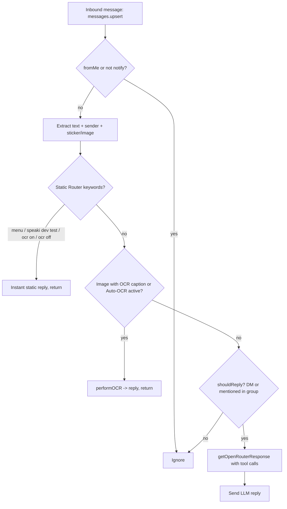
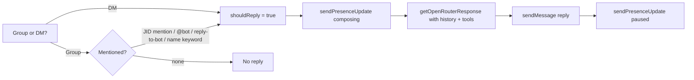

This page documents how users and the owner interact with the **Speaki** WhatsApp bot. It covers the message ingestion pipeline, the keyword-based static router (fast shortcuts that bypass the LLM), the natural-language conversational path, and the full catalog of LLM-callable tools. All behavior described here is verified against the source code in `bot-speaki.js` and `tools.js`. For deployment and connection setup, see [Bot Runtime Setup and Daemon Deployment](4-bot-runtime-setup-and-daemon-deployment).

## Message Ingestion Pipeline

Every inbound WhatsApp message is processed by a single `messages.upsert` event listener. The handler ignores messages sent by the bot itself (`!msg.key.fromMe`) and only acts on real notifications (`m.type === 'notify'`). It extracts text from multiple WhatsApp message shapes — plain conversation, extended text, and media captions (image/video) — and resolves the sender identity from `msg.key.participant` or `msg.key.remoteJid`, plus the display name from `msg.pushName`.

The handler then branches into three sequential decision stages: (1) a **static router** that matches exact keywords for instant responses, (2) an **OCR interceptor** for images, and (3) a **conversational router** that decides whether the LLM should reply. This staged design keeps common actions fast and token-efficient while reserving LLM calls for genuine conversation.

Sources: [bot-speaki.js](bot-speaki.js#L666-L690), [bot-speaki.js](bot-speaki.js#L716-L775)

## Static Router: Instant Keyword Commands

Before any LLM processing, the handler checks the lowercase text against a set of exact or substring keywords. These commands produce immediate responses and `return` early, saving tokens. The four static routes are summarized below.

| Keyword (case-insensitive) | Scope | Behavior | Source |
|---|---|---|---|
| `speaki`/`supikip` + `menu` | Anyone | Sends the Speaki Agent System Menu listing Manhwa check, web search, and server status | [bot-speaki.js](bot-speaki.js#L716-L733) |
| `speaki dev test` | Owner only | Runs `run_performance_test`; rejects non-owners with "Akses ditolak" | [bot-speaki.js](bot-speaki.js#L738-L757) |
| `ocr on` / `ocr_on` | Anyone | Enables Auto-OCR for the current chat JID (stored in `ocrActiveRooms` Map) | [bot-speaki.js](bot-speaki.js#L763-L771) |
| `ocr off` / `ocr_off` | Anyone | Disables Auto-OCR for the current chat JID | [bot-speaki.js](bot-speaki.js#L773-L778) |

The menu command is gated by `isCallingBot` (text contains `speaki` or `supikip`) **and** the substring `menu`. The dev test command is gated by owner identity, which is `(senderNumber === OWNER_NUMBER) || (senderName === 'JO')`. The OCR toggles persist per-chat in an in-memory `Map` keyed by JID and do not survive a bot restart.

Sources: [bot-speaki.js](bot-speaki.js#L716-L778)

## OCR Image Interception

After the static router, the handler inspects the message for an image — including `viewOnceMessage` and `viewOnceMessageV2` wrappers. OCR triggers when either the image caption is exactly `ocr` (or starts with `ocr `) or Auto-OCR is active for that chat. On trigger, the image is downloaded to a buffer, passed to `skills/ocr_extractor/index.js → performOCR`, and the extracted text is replied directly (quoted) to the image. This path also `return`s early to avoid LLM token consumption.

The Auto-OCR mode is especially useful for bulk image sends: once `ocr on` is typed, every subsequent image without a caption is OCR'd and replied individually. For the underlying skill implementation, see [OCR Extractor Skill](14-ocr-extractor-skill).

Sources: [bot-speaki.js](bot-speaki.js#L780-L826), [PANDUAN_BOT.md](PANDUAN_BOT.md#L137-L145)

## Conversational Router and Reply Logic

If no static route or OCR path matched, the handler decides whether to invoke the LLM. In a **direct message (DM)**, the bot always replies (`shouldReply = true`). In a **group**, the bot replies only when it is addressed, detected via several normalized signals: a JID mention in `mentionedJid`, a text mention `@<botNumber>` or `@133526976512185`, a reply whose quoted participant is the bot, or the name keywords `speaki`/`supikip` appearing in the text. All JID comparisons use `jidNormalizedUser` to strip device suffixes (`:1`, `:2`).

When `shouldReply` is true, the bot sets a "composing" presence indicator, calls `getOpenRouterResponse(jid, sock)` (which supports multi-turn tool calling), and sends the reply. Conversation history is kept per-JID in `chatHistories` and trimmed to the last 10 messages for context economy.

Sources: [bot-speaki.js](bot-speaki.js#L828-L906)

## LLM-Callable Tools Catalog

When the LLM responds, it may emit `tool_calls` that are resolved through `executeTool` in `tools.js`. The static tool schema is the authoritative list of capabilities the model can invoke. The table below maps each tool to its purpose and access restriction.

| Tool Name | Purpose | Access | Source |
|---|---|---|---|
| `web_search` | Search the web (SerpAPI with DuckDuckGo fallback) | Anyone | [tools.js](tools.js#L86-L98) |
| `check_shinigami_now` | Manual Shinigami manhwa update check | Anyone | [tools.js](tools.js#L103-L109) |
| `get_system_status` | RAM/CPU/uptime server metrics | Owner (JO) | [tools.js](tools.js#L114-L120) |
| `web_fetch` | Fetch and clean text from a URL | Anyone | [tools.js](tools.js#L125-L137) |
| `read_workspace_file` | Read a file in the workspace | Anyone | [tools.js](tools.js#L142-L154) |
| `write_workspace_file` | Write/edit a workspace file | Anyone | [tools.js](tools.js#L158-L174) |
| `run_terminal_command` | Execute a shell command | Owner (JO) | [tools.js](tools.js#L180-L192) |
| `add_cron_schedule` | Add a dynamic cron task | Anyone | [tools.js](tools.js#L197-L217) |
| `remove_cron_schedule` | Remove a cron task by description | Anyone | [tools.js](tools.js#L222-L234) |
| `set_one_shot_reminder` | One-shot countdown timer reminder | Anyone | [tools.js](tools.js#L239-L255) |
| `apply_patch` | Token-efficient search-and-replace file edit | Anyone | [tools.js](tools.js#L260-L280) |
| `parse_pdf_file` | Extract text from a local PDF | Anyone | [tools.js](tools.js#L285-L297) |
| `analyze_image` | Multimodal image analysis via Gemini | Anyone | [tools.js](tools.js#L302-L318) |
| `delegate_subagent` | Isolated sub-conversation with the LLM | Anyone | [tools.js](tools.js#L323-L339) |
| `run_performance_test` | Latency and I/O performance test | Owner (JO) | [tools.js](tools.js#L344-L350) |
| `send_workspace_file` | Send a workspace file to WhatsApp | Anyone | [tools.js](tools.js#L355-L371) |

In addition to these static tools, dynamically loaded skills from the `skills/` directory are merged into the schema at startup via `loadDynamicSkills()`. Those include `analyze_bitcoin_market`, `extract_text_from_image`, `manage_serpapi_quota`, and `send_sticker_response`. For the loading convention, see [Skills Architecture and SKILL.md Convention](12-skills-architecture-and-skill-md-convention).

Sources: [tools.js](tools.js#L80-L373), [tools.js](tools.js#L376)

## Owner-Only Capabilities

Three capabilities are restricted to the owner, identified by `OWNER_NUMBER` env var or the display name `JO`: `get_system_status`, `run_terminal_command`, and `run_performance_test` (the latter also reachable via the `speaki dev test` static command). The owner identity check is applied both in the static router and is embedded in the tool descriptions so the LLM self-gates. Note that the automatic sticker-to-database registration for owner-sent stickers is currently **disabled** in the source (commented out), so stickers are no longer auto-saved on receipt.

Sources: [bot-speaki.js](bot-speaki.js#L683-L704), [bot-speaki.js](bot-speaki.js#L738-L744), [tools.js](tools.js#L114-L120), [tools.js](tools.js#L180-L192)

## Practical Interaction Examples

The following table shows representative inputs and the resulting bot behavior, useful as a quick reference for new users and developers testing the bot.

| User Input | Context | Resulting Behavior |
|---|---|---|
| `speaki menu` | Any chat | Static menu listing features |
| `cek shinigami` / `update shinigami` | Any chat (LLM path) | LLM invokes `check_shinigami_now` |
| `status sistem` / `status pc` | Any chat (LLM path) | LLM invokes `get_system_status` (owner-gated) |
| `ocr` (as image caption) | Any chat | Single-image OCR reply |
| `ocr on` then send images | Group/DM | Auto-OCR every image until `ocr off` |
| `@speaki what is the weather?` | Group | LLM reply with possible `web_search` |
| `speaki dev test` | Owner only | Performance report |

Sources: [bot-speaki.js](bot-speaki.js#L718-L733), [bot-speaki.js](bot-speaki.js#L763-L778), [PANDUAN_BOT.md](PANDUAN_BOT.md#L59-L71)

## Next Steps

You now understand how messages flow from WhatsApp into the bot and which commands and tools are available. To learn how the bot's memory and multi-agent collaboration shape its responses, continue to [Agent Collaboration and Memory System](6-agent-collaboration-and-memory-system). For the underlying scheduling that powers periodic tasks and reminders, see [Heartbeat and Scheduling Mechanism](7-heartbeat-and-scheduling-mechanism). Developers extending capabilities should read [Tool Integration Framework (tools.js)](10-tool-integration-framework-tools-js) and [Skills Architecture and SKILL.md Convention](12-skills-architecture-and-skill-md-convention).