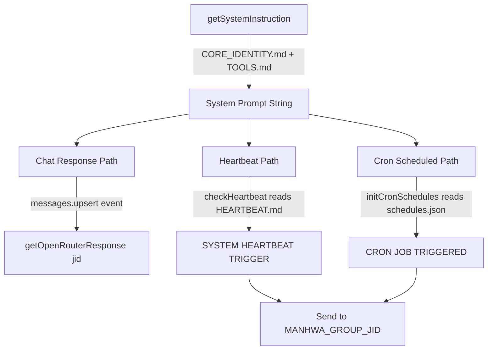

This page documents how the Speaki agent is composed from multiple instruction files, how it collaborates with itself across runtime contexts (chat, heartbeat, scheduled tasks), and how memory is persisted across both file-based and in-memory layers. The system is built on a **file-driven prompt architecture** where distinct Markdown files define identity, tools, and user context, assembled at runtime into a single system instruction. Memory operates on two tiers: a **persistent file-based memory** (`MEMORY.md`, daily logs) and an **ephemeral in-process conversation cache** (`chatHistories` Map).

## Agent Composition: The Instruction File Stack

The agent's behavior is not hardcoded in a single monolith. Instead, it is assembled from a stack of Markdown files that are read at runtime and concatenated into the system prompt. The `getSystemInstruction()` function reads `CORE_IDENTITY.md` and `TOOLS.md`, wraps each in a delimited section header, and joins them into a single structured instruction string fed to the LLM as the `system` role message.

The assembly is cached in memory with a 5-minute TTL (`CACHE_TTL_MS = 5 * 60 * 1000`) to avoid repeated disk reads on every request. If neither file is found, a hardcoded fallback persona is used. The two files serve distinct purposes: `CORE_IDENTITY.md` defines persona, red lines, and chat-group etiquette; `TOOLS.md` provides environment-specific contact mappings.

Sources: [bot-speaki.js](bot-speaki.js#L382-L422), [CORE_IDENTITY.md](CORE_IDENTITY.md#L1-L24), [TOOLS.md](TOOLS.md#L1-L10)

## The Role of Each Agent File

Beyond the two files loaded directly into the system prompt, several companion files define collaboration context and operational metadata. `AGENTS.md` acts as a quick-reference index pointing to `CORE_IDENTITY.md` and declaring the memory file convention. `USER.md` defines the owner identity and the rule for addressing JO versus other group members. `MEMORY.md` is the live working memory that the agent reads and updates. `HEARTBEAT.md` is a task-trigger file that, when populated, drives periodic self-evaluation.

| File | Loaded into LLM prompt? | Primary Role | Mutability |
|------|------------------------|--------------|------------|
| `CORE_IDENTITY.md` | Yes (via `getSystemInstruction`) | Persona, red lines, chat etiquette | Static (human-edited) |
| `TOOLS.md` | Yes (via `getSystemInstruction`) | Environment contacts, local notes | Static (human-edited) |
| `AGENTS.md` | No (reference index) | Quick operational reference | Static |
| `USER.md` | No (referenced by identity) | Owner identity & addressing rules | Static |
| `MEMORY.md` | No (agent self-manages) | Live working memory, < 30 lines | Dynamic (agent-written) |
| `HEARTBEAT.md` | Indirectly (as trigger prompt) | Periodic task definitions | Dynamic (human/agent) |

Sources: [AGENTS.md](AGENTS.md#L1-L9), [USER.md](USER.md#L1-L7), [MEMORY.md](MEMORY.md#L1-L44), [CORE_IDENTITY.md](CORE_IDENTITY.md#L20-L23)

## Runtime Collaboration Contexts

The agent does not only respond to user chat. It collaborates with itself across three distinct invocation contexts, each constructing its own message array but all sharing the same `getSystemInstruction()` base. The diagram below shows how a single system instruction fans out into three execution paths.

The chat path is the primary interactive loop: each incoming message from a non-self sender triggers `getOpenRouterResponse(jid, sock)`, which builds `currentMessages` from the system instruction plus the per-JID history. The heartbeat path reads `HEARTBEAT.md`, strips HTML comments, and if real content exists, sends a `[SYSTEM HEARTBEAT TRIGGER]` prompt to the LLM. The cron path loads `schedules.json`, validates each cron expression, and fires `[CRON JOB TRIGGERED]` prompts at the scheduled times. All three paths post results to the configured group JID.

Sources: [bot-speaki.js](bot-speaki.js#L232-L285), [bot-speaki.js](bot-speaki.js#L293-L368), [bot-speaki.js](bot-speaki.js#L443-L464), [schedules.json](schedules.json#L1-L12)

## Memory Tier 1: Persistent File-Based Memory

The persistent memory layer is governed by conventions declared in `CORE_IDENTITY.md` and `AGENTS.md`. `MEMORY.md` is the main session memory, constrained to **under 30 lines** to minimize token footprint. It stores system metadata, access control (owner JO, NSFW policy), core preferences, saved references, active WIP, and group contact mappings. Daily logs are stored separately at `memory/YYYY-MM-DD.md` for event/decision records.

The agent is instructed to maintain this memory **implicitly and silently** — it must never offer the user a "save to memory?" option in chat; it records directly in the background. This design keeps the memory file pruned and structured. The `AGENTS.md` quick reference reinforces that `MEMORY.md` applies to the main session only and that daily logs follow the dated-file convention.

Sources: [CORE_IDENTITY.md](CORE_IDENTITY.md#L20-L23), [AGENTS.md](AGENTS.md#L5-L8), [MEMORY.md](MEMORY.md#L1-L44)

## Memory Tier 2: Ephemeral In-Process Conversation Cache

The second memory tier is an in-process `Map` called `chatHistories`, keyed by WhatsApp JID. Each entry holds `{ messages: [], lastAccessed: timestamp }`. This cache provides short-term conversational context: the system prompt plus up to 10 recent messages (user/assistant pairs) are sent to the LLM each turn. When history exceeds 10 messages, the oldest are shifted off (`history.shift()`).

A TTL-based garbage collector runs every hour and deletes any JID entry not accessed within `18 * 60 * 60 * 1000` ms (18 hours). This means conversation context is **not** persisted across bot restarts or long idle gaps — it is purely runtime state. The tool-call loop (max 5 iterations per turn) also appends assistant `tool_calls` and `tool` results to the ephemeral `currentMessages` for that single request cycle, but only the final clean assistant reply is committed to the permanent `history`.

Sources: [bot-speaki.js](bot-speaki.js#L370-L372), [bot-speaki.js](bot-speaki.js#L449-L455), [bot-speaki.js](bot-speaki.js#L532-L535), [bot-speaki.js](bot-speaki.js#L639-L653)

## Memory Tier 3: Database-Backed Persistence

A third persistence layer exists in the SQLite database (`database_db.js`), initialized on connection open via `initDatabase()`. Its primary memory-bearing table is `stickers`, which records `(filename, tag, added_by)` for sticker responses. This is the only structured, queryable long-term store in the system — distinct from the file-based `MEMORY.md` (free-text agent notes) and the in-memory `chatHistories` (conversational context). `registerSticker(filename, tag, addedBy)` inserts rows with `INSERT OR IGNORE`, making sticker knowledge durable across restarts.

Sources: [database_db.js](database_db.js#L8-L17), [database_db.js](database_db.js#L40-L44), [bot-speaki.js](bot-speaki.js#L624-L628)

## Memory Architecture Comparison

The three tiers serve different durability and purpose profiles. Understanding their boundaries is essential for predicting what the agent "remembers" after a restart or idle period.

| Tier | Mechanism | Durability | Scope | Managed By |
|------|-----------|------------|-------|------------|
| File-based (`MEMORY.md`) | Markdown file on disk | Persistent across restarts | Main session facts, preferences | Agent (implicit) |
| In-process (`chatHistories`) | `Map` in Node process | Lost on restart / 18h TTL | Recent 10-message context per JID | Runtime GC |
| Database (`stickers` table) | SQLite via `database_db.js` | Persistent across restarts | Sticker tag→file mappings | `registerSticker` |

Sources: [bot-speaki.js](bot-speaki.js#L370-L372), [MEMORY.md](MEMORY.md#L43), [database_db.js](database_db.js#L17-L44)

## Daemon Deployment and Agent Continuity

The agent's collaboration capability depends on continuous background operation, achieved via a systemd service (`speaki-bot.service`). The daemon runs `node bot-speaki.js` with `Restart=always` and `RestartSec=5`, ensuring the in-process `chatHistories` cache and all cron/heartbeat intervals survive crashes. The `DAEMON_SETUP.md` guide mandates an initial interactive QR/pairing-code scan to build the `sesi_speaki/` credential folder before daemonizing, since background logs cannot display a QR code.

Because the file-based memory (`MEMORY.md`) and database persist on disk, agent identity and sticker knowledge survive restarts. Only the ephemeral conversation cache is reset. The connection lifecycle handler also clears the scraper interval on disconnect to prevent memory leaks, then re-initializes database, heartbeat, cron schedules, and the TTL cleaner on reconnect.

Sources: [DAEMON_SETUP.md](DAEMON_SETUP.md#L15-L38), [DAEMON_SETUP.md](DAEMON_SETUP.md#L53-L103), [bot-speaki.js](bot-speaki.js#L599-L662)

## Next Steps

To deepen your understanding of the surrounding systems, proceed to [Heartbeat and Scheduling Mechanism](7-heartbeat-and-scheduling-mechanism) for the detailed trigger logic behind `HEARTBEAT.md` and `schedules.json`. For the agent's structural foundation, see [Architecture and Entry Point (bot-speaki.js)](8-architecture-and-entry-point-bot-speaki-js). The persistent data store is covered in [Database Layer (database_db.js)](9-database-layer-database_db-js), and the daemon lifecycle is detailed in [Bot Runtime Setup and Daemon Deployment](4-bot-runtime-setup-and-daemon-deployment).