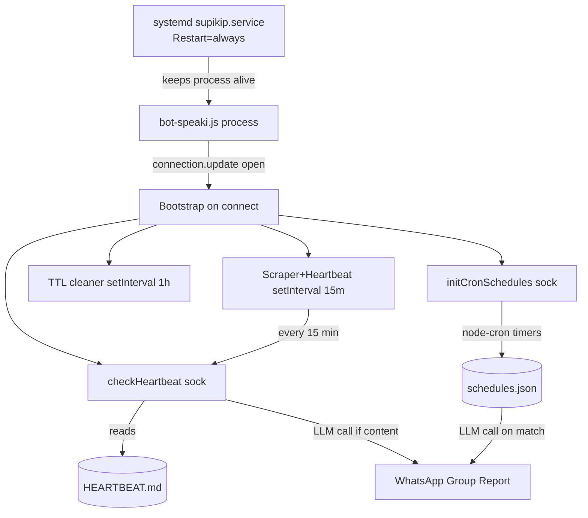

This page documents how the Speaki WhatsApp bot performs **time-driven work** without blocking its real-time message loop. The system separates periodic self-evaluation (the *heartbeat*) from fixed-time task execution (the *cron scheduler*), and delegates process-level survival to the operating system's service manager. Understanding this layer is essential before reading [Architecture and Entry Point (bot-speaki.js)](8-architecture-and-entry-point-bot-speaki-js), since both mechanisms are bootstrapped inside the Baileys connection event.

## Two Complementary Timing Models

The bot does not rely on a single clock. It combines two distinct paradigms: a **polling-based heartbeat** that inspects a markdown file on a fixed interval, and a **calendar-based cron scheduler** that fires at absolute times defined in JSON. The heartbeat is intentionally lightweight and opt-in, while the cron layer is declarative and validated at load time.

The conceptual relationship between these layers and the external supervision boundary is shown below.

The diagram illustrates that the heartbeat and cron paths converge only at the LLM-call stage; their trigger sources and timing semantics are independent. Sources: [bot-speaki.js](bot-speaki.js#L232-L285), [bot-speaki.js](bot-speaki.js#L293-L368), [bot-speaki.js](bot-speaki.js#L630-L661), [supikip.service](supikip.service#L1-L16)

## The Heartbeat Mechanism

The heartbeat is a **file-gated self-evaluation loop**. Rather than hardcoding recurring tasks in code, the bot reads `HEARTBEAT.md` on every polling cycle. The file ships with HTML comments and a sentinel line instructing operators to keep it empty; when the file contains only comments or the sentinel, no LLM call is made, so the heartbeat is effectively dormant at zero cost.

The `checkHeartbeat` function strips HTML comments and blank lines, then checks whether real content remains. If content exists and does not start with the `# Keep this file empty` sentinel, it builds a `[SYSTEM HEARTBEAT TRIGGER]` prompt and sends it to the OpenRouter LLM with the full tool schema. The model's reply, if any, is forwarded to the configured group as a `💓 Speaki Heartbeat Report`. This design lets an operator add periodic introspection tasks by simply editing a markdown file — no code change or restart required.

The trigger cadence is not owned by `checkHeartbeat` itself. It is invoked in two places: once immediately after connection, and repeatedly inside the scraper interval. The relevant guard logic is the content check at line 245, which prevents API calls when the file is empty. Sources: [HEARTBEAT.md](HEARTBEAT.md#L1-L6), [bot-speaki.js](bot-speaki.js#L232-L285), [bot-speaki.js](bot-speaki.js#L633-L634)

## The Cron Scheduler

Fixed-time tasks live in `schedules.json` as an array of objects, each carrying a `schedule` (cron expression), a `description`, and a `prompt`. The `initCronSchedules` function first stops any previously registered jobs to avoid duplication, then parses the file, validates each cron expression with `cron.validate`, and registers a `node-cron` timer. On each fire, the job wraps the entry's prompt in a `[CRON JOB TRIGGERED]` message, calls the LLM, and posts the result to the group as a `⏰ Scheduled Task Report`.

The shipped configuration defines two jobs: a daily system status report at `0 9 * * *` (09:00 every day) and an annual WhatsApp Premium billing reminder at `0 9 1 1 *` (09:00 on January 1). Entries missing `schedule` or `prompt`, or carrying an invalid cron string, are skipped with a warning rather than crashing the loader. Because `initCronSchedules` is called on every connection event, the scheduler is resilient to transient disconnects — it re-registers cleanly each time the socket reopens.

The table below summarizes the active scheduled entries as defined in the repository.

| Cron Expression | Description | Fires | Report Prefix |
|---|---|---|---|
| `0 9 * * *` | Daily system status report | 09:00 daily | ⏰ Scheduled Task Report |
| `0 9 1 1 *` | WhatsApp Premium billing reminder | 09:00, Jan 1 | ⏰ Scheduled Task Report |

Sources: [schedules.json](schedules.json#L1-L12), [bot-speaki.js](bot-speaki.js#L287-L368), [bot-speaki.js](bot-speaki.js#L636-L637)

## Bootstrap Timing and Polling Intervals

All periodic machinery is armed inside the Baileys `connection.update` handler once the socket reports `open`. Three independent timers are established there, plus the immediate one-shot calls. The heartbeat is polled at the same cadence as the Shinigami content scraper, controlled by `MANHWA_CHECK_INTERVAL` (default 900000 ms = 15 minutes, overridable via environment variable). A separate 1-hour `setInterval` runs the chat-history TTL cleaner, which evicts conversation entries older than 18 hours.

The table below contrasts the three timers established at connection time.

| Timer | Trigger Source | Default Interval | Purpose |
|---|---|---|---|
| Scraper + Heartbeat | `MANHWA_CHECK_INTERVAL` | 15 min | Poll `HEARTBEAT.md` + check Shinigami updates |
| TTL Cleaner | fixed `60*60*1000` | 1 hour | Evict chat histories older than 18h |
| Cron jobs | `schedules.json` expressions | per-entry | Fire absolute-time LLM tasks |

Note that the heartbeat interval is coupled to the scraper interval by design — there is no separate heartbeat timer, so the effective heartbeat resolution equals the scraper resolution. Sources: [bot-speaki.js](bot-speaki.js#L24-L25), [bot-speaki.js](bot-speaki.js#L630-L661)

## Process-Level Supervision

Above the in-process timers sits the operating-system supervisor. `supikip.service` is a systemd unit of `Type=simple` that launches `node bot-speaki.js` and declares `Restart=always` with a 5-second `RestartSec`. This means if the Node process exits for any reason — an uncaught exception, an OOM kill, or a host reboot — systemd restarts it automatically. The scheduling state is therefore reconstructed on every restart: `initCronSchedules` re-reads `schedules.json` and `checkHeartbeat` re-reads `HEARTBEAT.md`, so no schedule is lost across restarts. This external watchdog is what makes the in-process intervals durable without persistence logic of their own.

The deployment and management workflow for this supervisor is covered in [Bot Runtime Setup and Daemon Deployment](4-bot-runtime-setup-and-daemon-deployment). Sources: [supikip.service](supikip.service#L1-L16), [DAEMON_SETUP.md](DAEMON_SETUP.md#L1-L104), [bot-speaki.js](bot-speaki.js#L293-L296)

## Operational Notes for Developers

To add a periodic self-check, edit `HEARTBEAT.md` and place task text below the sentinel line; the next 15-minute poll will pick it up and route the result to the group. To add a fixed-time task, append an object to `schedules.json` with a valid cron expression and prompt, then restart the service so `initCronSchedules` re-registers it (or wait for the next reconnect). Both paths require a valid `OPENROUTER_API_KEY` and will silently no-op without it. The heartbeat is the lower-friction option for ad-hoc introspection; the cron layer is the correct choice for deterministic calendar events.

For the surrounding runtime context — how the connection event, message handling, and tool schema fit together — proceed to [Architecture and Entry Point (bot-speaki.js)](8-architecture-and-entry-point-bot-speaki-js). Sources: [HEARTBEAT.md](HEARTBEAT.md#L1-L6), [bot-speaki.js](bot-speaki.js#L257), [bot-speaki.js](bot-speaki.js#L333)