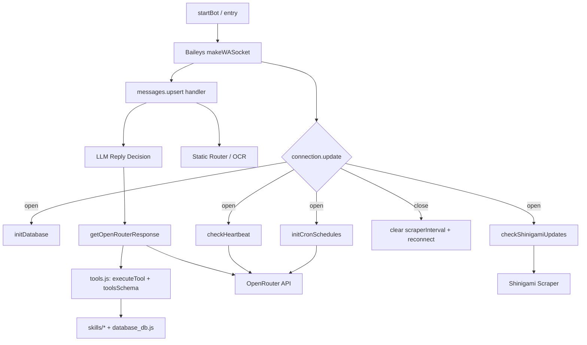

This page documents `bot-speaki.js` — the single, monolithic entry point and orchestration core of the Supikip/Speaki WhatsApp agent. It is the file executed by the daemon (see [Bot Runtime Setup and Daemon Deployment](4-bot-runtime-setup-and-daemon-deployment)) and is responsible for bootstrapping the Baileys WhatsApp connection, wiring the database and tool layers, running periodic schedulers, and routing inbound messages to the LLM. This page focuses exclusively on the internals of `bot-speaki.js`; companion concerns are covered in [Database Layer (database_db.js)](9-database-layer-database_db-js), [Tool Integration Framework (tools.js)](10-tool-integration-framework-tools-js), and [Baileys WhatsApp Integration](11-baileys-whatsapp-integration).

## Bootstrapping and Module Wiring

The file opens by importing its dependency graph and loading environment configuration. Baileys (`@itsliaaa/baileys`) provides the socket factory, multi-file auth state, disconnect reasons, JID normalization, and media download utilities; `pino` silences noisy native logs; `dotenv` loads `.env`; `qrcode-terminal` renders the login QR; and `node-cron` drives scheduled jobs. Locally, the bot pulls in `toolsSchema`/`executeTool` from `tools.js` and `initDatabase`/`registerSticker` from `database_db.js`. Configuration is read from `process.env`: the OpenRouter key, an optional model name (defaulting to `google/gemini-2.5-flash-lite`), and a fixed 800ms fetch timeout used by the scraper.

Sources: [bot-speaki.js](bot-speaki.js#L1-L18)

The entry point is the bottom-of-file call to `startBot()` (line 905), guarded by a global `uncaughtException` handler (lines 900–903) that logs without terminating the process. `startBot()` is also the reconnect target, so understanding its composition is the key to understanding the whole runtime.

Sources: [bot-speaki.js](bot-speaki.js#L900-L906)

## Connection Lifecycle and Reconnection

`startBot()` establishes a persistent WhatsApp session using `useMultiFileAuthState('sesi_speaki')` for credential persistence and `makeWASocket` configured with a silent `pino` logger and an Ubuntu Chrome browser profile to avoid link rejection. The WebSocket lifecycle is governed by the `connection.update` event handler, which handles three concerns: pairing-code/QR login, graceful reconnection, and post-connect initialization.

On first connection, if a QR is present and the device is unregistered, it requests an 8-digit pairing code for the configured `BOT_NUMBER`/`OWNER_NUMBER` (fallback `6283891270115`) and also renders the QR to the terminal. On `connection === 'close'`, it inspects `lastDisconnect.error` via `Boom` and reconnects unless the reason is `loggedOut`; cruelly, it clears the `scraperInterval` on close to avoid leaked timers, then recursively calls `startBot()`. On `connection === 'open'`, it initializes the SQLite database, runs an immediate Shinigami/manhwa check, runs the heartbeat check, loads cron schedules, installs an 18-hour chat-history TTL cleaner (running hourly), and starts the periodic scraper/heartbeat interval.

Sources: [bot-speaki.js](bot-speaki.js#L554-L663)

## The Shinigami Manhwa Scraper Subsystem

A significant portion of the entry file is a self-contained manhwa update tracker (`resolveDomains`, `fetchLatestManhwa`, `checkShinigamiUpdates`). Rather than hardcoding endpoints, `resolveDomains` dynamically resolves the active Shinigami domain from a landing-page `links.json` and then statically scans the SvelteKit site's JS bundles to discover the live `/v1/manga/list` API URL, falling back to known defaults on failure. `checkShinigamiUpdates` diffs the fetched list against a JSON state file (`last_manhwa.json`), sends new-chapter notifications to the target group (`MANHWA_GROUP_JID`), and persists new state. This function is exposed to the tool layer via the `executeTool` callback parameter (see [Tool Integration Framework (tools.js)](10-tool-integration-framework-tools-js)).

Sources: [bot-speaki.js](bot-speaki.js#L23-L226)

## Periodic Schedulers: Heartbeat and Cron

The file implements two distinct scheduled-evaluation paths. `checkHeartbeat` reads `HEARTBEAT.md`, strips HTML comments and blank lines, and — if non-empty and not the "Keep this file empty" sentinel — sends its contents as a `[SYSTEM HEARTBEAT TRIGGER]` prompt to OpenRouter, posting the result back to the group. `initCronSchedules` dynamically loads `schedules.json` (an array of `{schedule, prompt, description}`), validates each cron expression, and registers `node-cron` jobs; it first stops a tracked `activeCronJobs` list to prevent duplicates on reload. Both paths call OpenRouter with `tools: toolsSchema`, mirroring the live chat path.

Sources: [bot-speaki.js](bot-speaki.js#L232-L368)

## System Instruction Assembly and Response Engine

`getSystemInstruction()` composes the LLM system prompt by concatenating `CORE_IDENTITY.md` and `TOOLS.md` from disk, cached for 5 minutes (`CACHE_TTL_MS`) to avoid repeated I/O — a deliberate token-efficiency measure documented further in [Token Efficiency Optimization Strategy](17-token-efficiency-optimization-strategy). `getOpenRouterResponse(jid, sock)` is the core inference loop: it prepends the cached system instruction to the per-JID chat history (capped at 10 messages), then runs a bounded `while` loop (max 5 iterations) that issues a chat-completion request with `max_tokens: 1500`, and if the model returns `tool_calls`, executes each via `executeTool(name, args, sock, checkShinigamiUpdates)`, truncates tool output to 3000 chars (`truncateOutput`), appends `role: 'tool'` messages, and continues until a final text reply is produced. The final reply is persisted to history.

Sources: [bot-speaki.js](bot-speaki.js#L377-L549)

## Inbound Message Routing and the Static Router

The `messages.upsert` handler is the bot's request dispatcher. It filters to non-self messages of type `notify`, extracts text from conversation/extended-text/image-caption/video-caption fields, resolves the sender, group status, and owner identity, and computes the bot's own `botJid`. Before reaching the LLM path, a **static router** intercepts specific keyword commands with immediate, hardcoded responses — bypassing the model for efficiency:

| Command / Condition | Behavior | Line Reference |
|---|---|---|
| `speaki`/`supikip` + `menu` | Sends a feature menu | L717–L736 |
| `speaki dev test` (owner only) | Runs `run_performance_test` tool | L739–L761 |
| `ocr on` / `ocr_off` | Toggles per-JID auto-OCR map | L764–L779 |
| Image + `ocr` caption or auto-OCR active | Extracts text via `skills/ocr_extractor` | L782–L826 |

This static-first design reduces token spend on predictable interactions; the full tool/function-calling capability is handled separately in [Tool Integration Framework (tools.js)](10-tool-integration-framework-tools-js). The OCR path dynamically imports `skills/ocr_extractor/index.js#performOCR`, illustrating the entry point's direct but lazy linkage into the [Skills Architecture and SKILL.md Convention](12-skills-architecture-and-skill-md-convention).

Sources: [bot-speaki.js](bot-speaki.js#L666-L826)

## LLM Reply Decision Logic (Group vs DM)

After the static router, text messages are formatted as `[senderName]: text` and pushed into the per-JID `chatHistories` map (also capped at 10 entries). The bot then decides whether to reply: in a direct message it always replies; in a group it replies only when `isMentioned` is true. Mention detection is robust — it normalizes JIDs via `jidNormalizedUser` to strip device suffixes and checks reply-participant equality, `mentionedJid` arrays, literal `@<botNumber>`/`@<botJid>` text, a hardcoded `133526976512185` prefix, and the name keywords `speaki`/`supikip`. When `shouldReply` is set, it sends a `composing` presence indicator, calls `getOpenRouterResponse`, sends the reply, and pauses presence.

Sources: [bot-speaki.js](bot-speaki.js#L828-L897)

## Global State and Architectural Summary

The entry point maintains several module-level mutable structures that constitute the bot's runtime state: `chatHistories` (per-JID conversation memory), `ocrActiveRooms` (per-JID auto-OCR toggles), `activeCronJobs` (live cron handles), `scraperInterval` (periodic timer), and the `systemInstructionCache` pair. The diagram below maps the major subsystems and their wiring inside `bot-speaki.js`.

The architecture is a **single-file orchestrator** pattern: `bot-speaki.js` owns connection lifecycle, scheduling, routing, and the inference loop, while delegating capability execution to `tools.js` and persistence to `database_db.js`. This keeps the control flow centralized but concentrates significant logic (scraper, heartbeat, cron, routing, inference) in one 905-line module.

Sources: [bot-speaki.js](bot-speaki.js#L288-L289) · [bot-speaki.js](bot-speaki.js#L372-L380) · [bot-speaki.js](bot-speaki.js#L554-L663)

## Next Steps

To go deeper into the subsystems introduced here, follow this progression:

- [Database Layer (database_db.js)](9-database-layer-database_db-js) — how `initDatabase` and `registerSticker` persist sticker and state data.
- [Tool Integration Framework (tools.js)](10-tool-integration-framework-tools-js) — the `toolsSchema` contract and `executeTool` dispatch used by the inference loop.
- [Baileys WhatsApp Integration](11-baileys-whatsapp-integration) — socket, auth state, and event semantics referenced throughout this page.
- [Skills Architecture and SKILL.md Convention](12-skills-architecture-and-skill-md-convention) — the `skills/ocr_extractor` and sibling skills dynamically imported by the entry point.
- [Heartbeat and Scheduling Mechanism](7-heartbeat-and-scheduling-mechanism) — operational detail on `HEARTBEAT.md` and `schedules.json` consumed by `checkHeartbeat` and `initCronSchedules`.