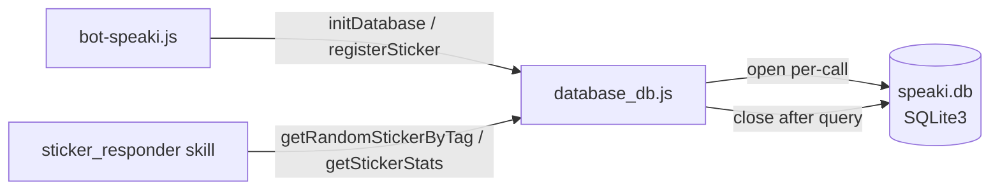

This page documents `database_db.js` — the local persistence module of the Supikip/Speaki WhatsApp agent. It is a thin, serverless **SQLite3** wrapper that owns the only structured, queryable long-term store in the system: a single `stickers` table inside `speaki.db`. The module exposes four exported functions (`initDatabase`, `registerSticker`, `getRandomStickerByTag`, `getStickerStats`) and is consumed by the orchestrator `bot-speaki.js` for initialization and sticker registration, and by the `sticker_responder` skill for randomized retrieval and usage statistics. This page focuses exclusively on the internals of `database_db.js`; the surrounding orchestration is covered in [Architecture and Entry Point (bot-speaki.js)](8-architecture-and-entry-point-bot-speaki-js) and the consuming skill in [Sticker Responder Skill](16-sticker-responder-skill).

Sources: [database_db.js](database_db.js#L1-L114), [bot-speaki.js](bot-speaki.js#L10), [skills/sticker_responder/index.js](skills/sticker_responder/index.js#L3)

## Architectural Pattern

The module follows a **stateless, per-call connection** pattern rather than a shared long-lived connection pool. Each exported function opens a fresh `sqlite3.Database` handle against `DB_PATH`, executes its query inside a serialized or direct callback, then immediately closes the handle. The database file path is computed once at module load as `path.join(process.cwd(), 'speaki.db')`, binding persistence to the current working directory of the running process. This design favors simplicity and crash-safety (no dangling connections) at the cost of per-request connection overhead — an acceptable tradeoff for a low-write-frequency, single-process bot.

Sources: [database_db.js](database_db.js#L5-L5), [database_db.js](database_db.js#L42), [database_db.js](database_db.js#L60)

The diagram above shows both consumers reaching `database_db.js`, which opens and closes a connection on every call rather than maintaining a shared pool.

## Schema Definition

`initDatabase()` creates the `stickers` table if it does not already exist. The schema is intentionally minimal — a vertical store of sticker assets keyed by an auto-incrementing `id`. The `filename` column is declared `UNIQUE`, which is what makes the `INSERT OR IGNORE` strategy in `registerSticker` idempotent. The `tag` column defaults to `'general'` and serves as the lookup dimension for randomized retrieval; `usage_count` tracks how often each sticker has been served, and `created_at` captures insertion time.

Sources: [database_db.js](database_db.js#L8-L35)

| Column | Type | Constraint / Default | Purpose |
|--------|------|----------------------|---------|
| `id` | INTEGER | `PRIMARY KEY AUTOINCREMENT` | Surrogate key for each sticker row |
| `filename` | TEXT | `UNIQUE NOT NULL` | Physical `.webp` filename in `stiker_db/` |
| `tag` | TEXT | `DEFAULT 'general'` | Categorization dimension for random fetch |
| `added_by` | TEXT | `NOT NULL` | Sender name of the sticker contributor |
| `usage_count` | INTEGER | `DEFAULT 0` | Monotonic counter incremented on each serve |
| `created_at` | TIMESTAMP | `DEFAULT CURRENT_TIMESTAMP` | Insertion timestamp |

## Function Reference

**`initDatabase()`** returns a Promise that resolves `true` once the `stickers` table is confirmed present. It opens the database, runs a `CREATE TABLE IF NOT EXISTS` inside `db.serialize()`, then closes the handle and resolves. It is invoked from `bot-speaki.js` immediately after the WhatsApp connection reports `open`, ensuring the store exists before any message routing occurs. On error at the open or create stage, it closes and rejects, which the caller logs without aborting the bot process.

Sources: [database_db.js](database_db.js#L8-L35), [bot-speaki.js](bot-speaki.js#L624-L628)

**`registerSticker(filename, tag, addedBy)`** inserts a new sticker row using `INSERT OR IGNORE`. Because `filename` is `UNIQUE`, re-registering an existing file is a silent no-op and the Promise resolves with `this.changes` (0 for ignored, 1 for inserted). This makes sticker registration idempotent and safe to call repeatedly. In `bot-speaki.js` it is wired into an owner-triggered sticker handler (currently disabled in source), demonstrating the intended write path.

Sources: [database_db.js](database_db.js#L40-L53), [bot-speaki.js](bot-speaki.js#L697-L698)

**`getRandomStickerByTag(tag)`** selects a single random row, optionally filtered by tag. When `tag` is falsy or equals `'all'` / `'random'`, the `WHERE` clause is omitted and any sticker may be returned; otherwise it filters `WHERE tag = ?`. The query appends `ORDER BY RANDOM() LIMIT 1`. After retrieving the row, it issues a second `UPDATE` that increments `usage_count` for that `id`. The update error is logged but non-fatal — the function still resolves with the original row. This is the read path used by `skills/sticker_responder`.

Sources: [database_db.js](database_db.js#L58-L95), [skills/sticker_responder/index.js](skills/sticker_responder/index.js#L19)

**`getStickerStats()`** returns the top 10 most-used stickers via `db.all(... ORDER BY usage_count DESC LIMIT 10)`, projecting `id, filename, tag, usage_count, added_by`. It is the reporting accessor for usage analytics. The function closes the handle in all branches and rejects on query error.

Sources: [database_db.js](database_db.js#L100-L113)

| Function | Returns | Side Effect | Consumer |
|----------|---------|-------------|----------|
| `initDatabase()` | `Promise<true>` | Creates `stickers` table | `bot-speaki.js` |
| `registerSticker(filename, tag, addedBy)` | `Promise<number>` (`changes`) | Inserts row (idempotent) | `bot-speaki.js` |
| `getRandomStickerByTag(tag)` | `Promise<row \| null>` | Increments `usage_count` | `sticker_responder` skill |
| `getStickerStats()` | `Promise<row[]>` | None | Reporting |

## Connection Lifecycle and Error Handling

Every function constructs its own `new sqlite3.Database(DB_PATH)` and closes it before resolving or rejecting. This per-call lifecycle means there is no module-level shared state and no connection leak risk across the event loop. Error handling is consistent: open errors reject the Promise; query errors close the handle and reject (except the `usage_count` update in `getRandomStickerByTag`, which logs and still resolves). The `INSERT OR IGNORE` guard plus `UNIQUE` constraint is the only data-integrity mechanism — there are no foreign keys, transactions spanning multiple functions, or migrations beyond the initial `CREATE TABLE IF NOT EXISTS`.

Sources: [database_db.js](database_db.js#L40-L53), [database_db.js](database_db.js#L58-L95), [database_db.js](database_db.js#L100-L113)

## Integration Boundaries

The module is deliberately narrow in scope: it persists and queries **only** sticker metadata. It does not store chat history (held in-memory in `bot-speaki.js`), agent notes (file-based `MEMORY.md`), or scheduling state (`schedules.json`). The physical `.webp` files live separately in `stiker_db/` and are resolved by consumers via `path.join(process.cwd(), 'stiker_db', filename)` — `database_db.js` stores only the filename reference, never the binary. This separation of metadata (SQLite) from assets (filesystem) is the core persistence contract of the system.

Sources: [skills/sticker_responder/index.js](skills/sticker_responder/index.js#L25-L29), [database_db.js](database_db.js#L17-L24)

## Next Steps

To understand how this module is bootstrapped and wired into the message pipeline, read [Architecture and Entry Point (bot-speaki.js)](8-architecture-and-entry-point-bot-speaki-js). For the skill that consumes `getRandomStickerByTag`, see [Sticker Responder Skill](16-sticker-responder-skill). The broader persistence comparison across SQLite, `MEMORY.md`, and in-memory history is detailed in [Agent Collaboration and Memory System](6-agent-collaboration-and-memory-system).