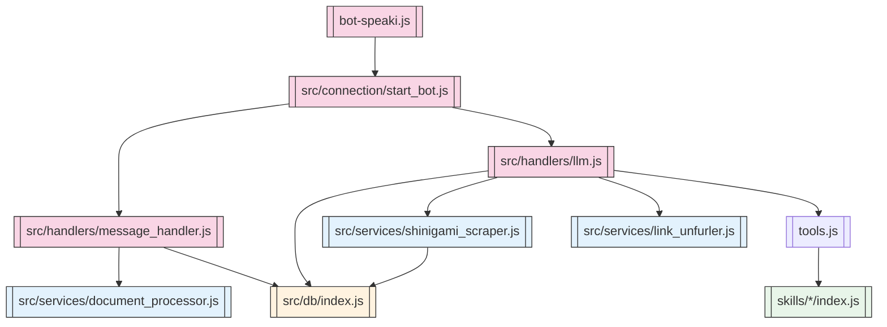

# Audit Arsitektur Repo Speaki

> [!summary] Ringkasan cepat
> Repository ini sudah **lebih terstruktur** dibanding audit sebelumnya: `bot-speaki.js` sekarang menjadi entrypoint ringkas, logika utama dipindahkan ke `src/`, dan beberapa risiko awal sudah diperbaiki seperti database init yang di-await, scraper state yang lebih atomik, serta validasi schema skill dinamis.
>
> Namun, risiko kritis masih ada pada **tool execution boundary**, **path traversal workspace**, **dynamic skills loader**, **cron live reload**, **konsumsi cookies/sensitif file**, dan **concurrency/background jobs**.

## Quick Links

- `[[bot-speaki.js]]`
- `[[src/connection/start_bot.js]]`
- `[[src/handlers/message_handler.js]]`
- `[[src/handlers/llm.js]]`
- `[[tools.js]]`
- `[[src/db/index.js]]`
- `[[src/services/shinigami_scraper.js]]`
- `[[src/services/cron_scheduler.js]]`
- `[[src/services/document_processor.js]]`
- `[[src/services/link_unfurler.js]]`
- `[[skills/multi_agent_delegator/index.js]]`
- `[[skills/social_media_downloader/index.js]]`
- `[[Celah Bot.md]]`

## Audit Scope

| Area | Status |
|---|---|
| Struktur modul | Diaudit |
| Tool execution | Diaudit |
| Scheduler/cron | Diaudit |
| Database/memory | Diaudit |
| Scraper/Shinigami | Diaudit |
| Document/cookie handling | Diaudit |
| Dynamic skills loader | Diaudit |
| Syntax JS | Dicek dengan `node --check` |

> [!note] Validasi syntax
> Perintah yang dijalankan:
>
> ```bash
> for f in bot-speaki.js tools.js src/**/*.js; do node --check "$f" || exit 1; done
> ```
>
> Hasil: syntax JS utama valid.

## Current Architecture Map



## Current Improvements Compared to Previous Audit

> [!success] Perbaikan yang sudah terlihat
>
> - `bot-speaki.js` sekarang hanya wrapper entrypoint: `[[bot-speaki.js]]:1-3`.
> - `src/connection/start_bot.js` sudah memakai message queue untuk mengurangi race condition pesan masuk: `[[src/connection/start_bot.js]]:14-35`.
> - Reconnect memakai exponential backoff, bukan recursive langsung tanpa batas: `[[src/connection/start_bot.js]]:102-108`.
> - Database init sudah di-await saat bot open: `[[src/connection/start_bot.js]]:118-128`.
> - SQLite init sudah memakai WAL, busy timeout, foreign keys: `[[src/db/index.js]]:14-17`.
> - Scraper state memakai `atomicWriteJsonSync`, bukan `fs.writeFileSync` langsung: `[[src/services/shinigami_scraper.js]]:320-323`.
> - Dynamic skills schema sekarang divalidasi sebelum dimuat: `[[tools.js]]:91-183`.
> - Owner-only tool middleware sudah ada: `[[tools.js]]:38-89`.

## Risk Register

| ID | Risiko | Severity | Confidence | Priority | Status |
|---|---|---:|---:|---:|---|
| F1 | Tool authorization boundary masih parsial | Critical | High | P0 | Open |
| F2 | Path traversal workspace masih mungkin | Critical | High | P0 | Open |
| F3 | `setOneShotReminder` memakai `extraContext` tidak terdefinisi | High | High | P1 | Open |
| F4 | Dynamic skills loader tetap bisa memuat kode arbitrer | High | High | P0 | Open |
| F5 | Cron live reload dan schedule writes tidak cukup guarded | High | High | P1 | Open |
| F6 | Scraper masih bisa overlap pada interval pendek | Medium | Medium | P2 | Open |
| F7 | Database layer belum punya migration/pooling/transaksi | Medium | High | P2 | Open |
| F8 | Memory/context injection masih berisiko context bloat dan leak | Medium | High | P2 | Open |
| F9 | External fetch/tool web fetch berpotensi SSRF ringan | Medium | High | P1 | Open |
| F10 | Cookies dan file sensitive tersinkronisasi/tersedia untuk downloader | High | High | P0 | Open |
| F11 | Lifecycle/concurrency background jobs belum sepenuhnya terkendali | Medium | Medium | P2 | Open |
| F12 | Multi-agent masih wrapper LLM call, bukan arsitektur subagent nyata | Medium | High | P3 | Open |
| F13 | Schema typo dan path stale pada performance test | Low | High | P3 | Open |

## Findings Detail

### F1. Tool authorization boundary masih parsial

> [!risk] Critical
>
> Sistem sudah punya owner-only middleware untuk beberapa tool, tetapi tidak semua tool yang powerful sudah masuk daftar owner-only.
>
> **Bukti kode:**
>
> - Daftar owner-only terbatas: `[[tools.js]]:38-45`
> - Middleware owner-only: `[[tools.js]]:83-89`
> - Router tool: `[[tools.js]]:1094-1149`
> - Tool yang tidak owner-only tetapi sensitif: `[[tools.js]]:1102-1133`
>
> **Dampak:**
>
> - `web_fetch`, `parse_pdf_file`, `analyze_image`, `delegate_subagent`, dan `send_workspace_file` bisa dieksekusi oleh non-owner.
> - LLM bisa mengirim file workspace ke chat atau grup jika tool ini tersedia.
> - Autorisasi berbasis deskripsi tool tidak cukup kuat.
>
> **Rekomendasi:**
>
> 1. Tambahkan semua tool yang membaca, menulis, mengirim, mengeksekusi, atau memanggil LLM ke policy layer.
> 2. Bedakan permission: `read_workspace`, `write_workspace`, `send_message`, `network_fetch`, `execute_command`, `manage_cron`.
> 3. Validasi izin di router sebelum switch-case tool.
> 4. Jangan hanya mengandalkan `OWNER_NUMBER` dan `senderName === 'JO'`.

### F2. Path traversal workspace masih mungkin

> [!risk] Critical
>
> Tool file read/write/patch/send masih memakai sanitasi ringan: `filename.replace(/\.\.\//g, '')`. Ini tidak cukup untuk mencegah traversal, absolute path, backslash traversal, symlink traversal, atau path normalization issue.
>
> **Bukti kode:**
>
> - `readWorkspaceFile`: `[[tools.js]]:720-726`
> - `writeWorkspaceFile`: `[[tools.js]]:735-740`
> - `applyPatch`: `[[tools.js]]:828-840`
> - `sendWorkspaceFile`: `[[tools.js]]:1043-1062`
>
> **Dampak:**
>
> - LLM atau user bisa membaca file di luar workspace.
> - LLM atau user bisa menulis file di luar workspace.
> - Symlink bisa mengarahkan akses ke file di luar allowlist.
>
> **Rekomendasi:**
>
> 1. Gunakan root allowlist absolut.
> 2. Gunakan `fs.realpathSync` dan pastikan path final berada di bawah workspace root.
> 3. Blokir path absolute.
> 4. Tambahkan extension allowlist per tool.
> 5. Gunakan atomic write untuk write tool.

### F3. `setOneShotReminder` memakai `extraContext` tidak terdefinisi

> [!risk] High
>
> Fungsi `setOneShotReminder` memakai variable `extraContext` tanpa parameter. Karena file ini ESM module, referensi bebas ke `extraContext` berpotensi menjadi `ReferenceError` saat timer dieksekusi.
>
> **Bukti kode:**
>
> - Fungsi: `[[tools.js]]:807-822`
>
> **Dampak:**
>
> - Reminder bisa gagal saat deadline tiba.
> - Error async tidak tertangkap di dalam callback timer.
> - Log bisa membingungkan karena error muncul setelah fungsi utama selesai.
>
> **Rekomendasi:**
>
> 1. Tambahkan parameter `extraContext = {}` ke signature.
> 2. Tangani callback timer dengan `try/catch`.
> 3. Jangan mengirim reminder jika `sock` tidak tersedia.

### F4. Dynamic skills loader tetap bisa memuat kode arbitrer

> [!risk] High
>
> Schema skill divalidasi, tetapi eksekutor skill tetap dimuat langsung dari `skills/*/index.js` dan dieksekusi tanpa capability policy, owner-only enforcement, sandbox, dependency allowlist, atau cost cap.
>
> **Bukti kode:**
>
> - Loader dynamic skills: `[[tools.js]]:188-238`
> - Eksekusi skill dynamic: `[[tools.js]]:1134-1141`
>
> **Dampak:**
>
> - Skill baru bisa mengubah perilaku runtime secara langsung.
> - Skill bisa membaca file, memanggil network, atau mengirim pesan.
> - Tidak ada audit capability per skill.
>
> **Rekomendasi:**
>
> 1. Buat registry skill dengan capability eksplisit.
> 2. Tambahkan owner-only policy untuk skill sensitif.
> 3. Tambahkan timeout, cost cap, dan output validation.
> 4. Jangan auto-load skill dari folder sembarangan tanpa konfigurasi enable.

### F5. Cron live reload dan schedule writes belum cukup guarded

> [!risk] High
>
> Cron reload live memakai file watcher dan tool write schedule. Perubahan file bisa memicu reload sebelum write selesai. Tidak ada cooldown, overlap guard, atau permission per schedule.
>
> **Bukti kode:**
>
> - File watcher: `[[src/services/cron_scheduler.js]]:31-55`
> - `initCronSchedules`: `[[src/services/cron_scheduler.js]]:61-141`
> - Add/remove cron tool: `[[tools.js]]:765-798`
>
> **Dampak:**
>
> - Schedule corrupt bisa memicu reload error.
> - LLM bisa membuat cron job yang tidak diinginkan.
> - Cron job bisa menjalankan LLM tanpa batas biaya.
>
> **Rekomendasi:**
>
> 1. Tambahkan schedule schema validation.
> 2. Tambahkan targetJid allowlist.
> 3. Tambahkan cooldown dan overlap guard.
> 4. Tambahkan permission untuk create/delete schedule.
> 5. Tambahkan cost budget per cron job.

### F6. Scraper masih bisa overlap

> [!risk] Medium
>
> Scraper state sudah ditulis secara atomik, tetapi interval checker tidak punya single-flight lock. Jika interval lebih pendek dari runtime scraper, job bisa tumpang-tindih.
>
> **Bukti kode:**
>
> - State default: `[[src/services/shinigami_scraper.js]]:15-19`
> - Interval: `[[src/connection/start_bot.js]]:155-160`
> - Atomic state write: `[[src/services/shinigami_scraper.js]]:320-323`
>
> **Dampak:**
>
> - Network request ganda.
> - Race condition state.
> - Potensi pesan update ganda.
>
> **Rekomendasi:**
>
> 1. Tambahkan `scraperInProgress` lock.
> 2. Tambahkan TTL lock.
> 3. Tambahkan queue untuk manual trigger.
> 4. Tambahkan log start/end duration.

### F7. Database layer belum punya migration/pooling/transaksi

> [!risk] Medium
>
> SQLite memakai connection per operation. Init database sudah lebih baik, tetapi tidak ada migration versioning, pool, transaction policy, backup, atau error propagation untuk semua write.
>
> **Bukti kode:**
>
> - DB path: `[[src/db/index.js]]:5`
> - Init PRAGMA: `[[src/db/index.js]]:14-17`
> - Per-operation connections: `[[src/db/index.js]]:96-311`
> - Chat message save swallows error: `[[src/db/index.js]]:173-186`
>
> **Dampak:**
>
> - Sulit migrasi aman.
> - Error save bisa tersembunyi.
> - Concurrency writes sulit dikontrol.
>
> **Rekomendasi:**
>
> 1. Tambahkan migration table/version.
> 2. Tambahkan connection pool atau manager.
> 3. Gunakan transactions untuk FTS update.
> 4. Propagate error untuk critical writes.
> 5. Tambahkan backup policy.

### F8. Memory/context injection masih berisiko

> [!risk] Medium
>
> Memory context disisipkan ke system message. Riwayat chat hanya 10 pesan di memory, sedangkan database menyimpan semua pesan. Ini bisa menyebabkan context bloat dan data leak.
>
> **Bukti kode:**
>
> - Retrieval memory: `[[src/handlers/llm.js]]:94-100`
> - Memory appended to system: `[[src/handlers/llm.js]]:98-101`
> - History cap 10: `[[src/handlers/llm.js]]:175-178`
> - Memory block: `[[src/db/index.js]]:289-306`
>
> **Dampak:**
>
> - Sistem prompt tidak stabil.
> - Data lama bisa masuk ke konteks LLM.
> - Tidak ada TTL, redaction, atau token budget.
>
> **Rekomendasi:**
>
> 1. Pindahkan memory context ke user/system data section terpisah.
> 2. Tambahkan token budget.
> 3. Tambahkan redaction policy.
> 4. Tambahkan TTL dan decay.
> 5. Tambahkan audit log untuk memory retrieval.

### F9. External fetch/tool web fetch berpotensi SSRF ringan

> [!risk] Medium
>
> `web_fetch` dan link unfurler bisa fetch URL dari user tanpa allowlist. Ini bukan akses filesystem langsung, tetapi tetap membuka risiko SSRF ke internal network jika URL yang diberikan dikendalikan user.
>
> **Bukti kode:**
>
> - Web search fallback: `[[tools.js]]:542-604`
> - Web fetch: `[[tools.js]]:667-714`
> - Link unfurler: `[[src/services/link_unfurler.js]]:46-119`
>
> **Dampak:**
>
> - Bot bisa diminta fetch URL internal.
> - LLM bisa menghasilkan permintaan network berulang.
>
> **Rekomendasi:**
>
> 1. Tambahkan URL allowlist.
> 2. Blokir private IP, localhost, metadata IP.
> 3. Tambahkan timeout dan rate limit.
> 4. Tambahkan cost cap per request.
> 5. Tambahkan cache response.

### F10. Cookies dan file sensitive tersinkronisasi/tersedia untuk downloader

> [!risk] High
>
> Upload `cookies.txt` otomatis disalin ke home Downloads dan workspace. Social media downloader kemudian mencari dan menyuntikkan cookies tersebut. Ini meningkatkan risiko kebocoran atau misuse.
>
> **Bukti kode:**
>
> - Cookie auto-sync: `[[src/services/document_processor.js]]:28-38`
> - Cookie lookup: `[[skills/social_media_downloader/index.js]]:33-37`
> - Cookie injection: `[[skills/social_media_downloader/index.js]]:119-135`
>
> **Dampak:**
>
> - Risiko eksfiltrasi cookies.
> - Risiko autentikasi pihak ketiga terganggu.
> - File sensitive masuk workspace.
>
> **Rekomendasi:**
>
> 1. Hapus auto-sync ke home Downloads.
> 2. Jangan simpan cookies di workspace.
> 3. Tambahkan explicit opt-in.
> 4. Tambahkan permission dan audit.
> 5. Gunakan encrypted secret store jika diperlukan.

### F11. Lifecycle/concurrency background jobs belum sepenuhnya terkendali

> [!risk] Medium
>
> Message handler sudah diberi queue, tetapi scraper, cron, reminder, dan background LLM calls masih bisa berjalan paralel. `uncaughtException` hanya logging.
>
> **Bukti kode:**
>
> - Message queue: `[[src/connection/start_bot.js]]:14-35`
> - Scraper interval: `[[src/connection/start_bot.js]]:155-160`
> - Reconnect delay: `[[src/connection/start_bot.js]]:102-108`
> - Uncaught exception: `[[src/connection/start_bot.js]]:171-174`
>
> **Dampak:**
>
> - Background job bisa menumpuk.
> - Reconnect bisa menghasilkan proses ganda.
>
> **Rekomendasi:**
>
> 1. Tambahkan job scheduler global.
> 2. Tambahkan single-flight per job type.
> 3. Tambahkan graceful shutdown.
> 4. Tambahkan process exit policy.
> 5. Tambahkan health metrics.

### F12. Multi-agent masih wrapper LLM call

> [!risk] Medium
>
> `delegate_subagent` dan `delegate_parallel_subagents` hanya memanggil OpenRouter dengan prompt baru. Tidak ada tool access, role supervision, structured output, cost cap, atau provenance.
>
> **Bukti kode:**
>
> - Static tool: `[[tools.js]]:481-500`
> - Multi-agent executor: `[[skills/multi_agent_delegator/index.js]]:53-69`
>
> **Dampak:**
>
> - Multi-agent tidak benar-benar terisolasi.
>
> **Rekomendasi:**
>
> 1. Buat supervisor/executor contract.
> 2. Tambahkan structured output validation.
> 3. Tambahkan tool scope per subagent.
> 4. Tambahkan cost cap dan provenance.

### F13. Schema typo dan path stale

> [!risk] Low
>
> Static schema pertama memiliki duplicate `type`, dan performance test masih merujuk ke `bot-speaki.js` sebagai file uji utama, padahal entrypoint sekarang sudah dipindahkan ke `src/`.
>
> **Bukti kode:**
>
> - Duplicate type: `[[tools.js]]:241-245`
> - Stale path: `[[tools.js]]:996-1005`
>
> **Dampak:**
>
> - Bisa membingungkan lint/schema consumer.
>
> **Rekomendasi:**
>
> 1. Hapus `type: "string"` yang duplikat.
> 2. Ubah performance test ke `src/connection/start_bot.js` atau buat test file.

## Implementation Order

> [!todo] Prioritas eksekusi
>
> - [ ] F1: Harden tool authorization boundary
> - [ ] F2: Tambahkan workspace path allowlist dan realpath validation
> - [ ] F4: Tambahkan capability registry untuk dynamic skills
> - [ ] F10: Hapus auto-sync cookies ke home/workspace
> - [ ] F5: Tambahkan cron schema validation dan overlap guard
> - [ ] F3: Perbaiki `setOneShotReminder` signature dan async handling
> - [ ] F6: Tambahkan scraper single-flight lock
> - [ ] F7: Tambahkan migration dan connection manager
> - [ ] F8: Pindahkan memory context dari system message
> - [ ] F9: Tambahkan URL allowlist dan private IP block
> - [ ] F11: Tambahkan global job scheduler dan graceful shutdown
> - [ ] F12: Definisikan contract multi-agent
> - [ ] F13: Perbaiki typo dan stale path

## Test Plan

### Static Checks

```bash
node --check bot-speaki.js
node --check tools.js
find src -name '*.js' -print0 | xargs -0 -n1 node --check
```

### Security Checks

- [ ] Tool read/write/patch/send harus menolak path traversal.
- [ ] Non-owner tidak bisa memanggil tool sensitif.
- [ ] `web_fetch` tidak boleh fetch localhost/private/metadata IP.
- [ ] `cookies.txt` upload tidak otomatis masuk home/workspace.
- [ ] Dynamic skill loader tidak auto-load skill tanpa capability registry.

### Concurrency Checks

- [ ] Scraper tidak boleh overlap.
- [ ] Cron tidak boleh overlap.
- [ ] Reminder tidak boleh mengirim tanpa sock aktif.
- [ ] Message queue tidak boleh drop handler tanpa log.

### Database Checks

- [ ] Init DB siap sebelum save message.
- [ ] FTS triggers update/delete konsisten.
- [ ] Error save critical write tidak tersembunyi.
- [ ] Migration version aman.

## Decision Log

### 2026-07-22

- Repository sudah berevolusi dari monolith besar ke struktur `src/`.
- Audit ini mencatat risiko yang tersisa setelah perubahan tersebut.
- Fokus perbaikan berikutnya sebaiknya security boundary dulu, bukan module split besar.

## Dataview Mini Queries

> [!info] Opsional untuk Obsidian Dataview

```dataview
TABLE severity, confidence, priority, status
FROM "Celah Bot.md"
WHERE contains(tags, "risk")
```

```dataview
TABLE status
FROM "Celah Bot.md"
WHERE contains(tags, "todo")
```

## Notes

> [!warning] Catatan eksekusi
>
> Jangan eksekusi semua perbaikan sekaligus. Prioritaskan security boundary dan path traversal sebelum refactor besar.
>
> Setelah fix, lakukan commit kecil per area:
>
> 1. Tool security
> 2. Cookie handling
> 3. Scheduler/concurrency
> 4. DB/memory
> 5. Scraper
> 6. Multi-agent contract
